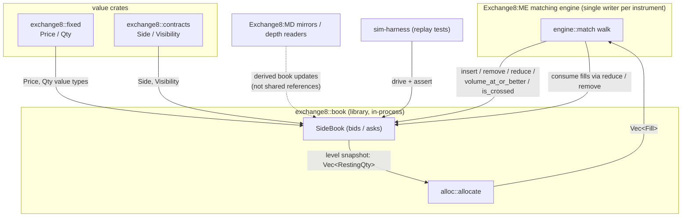
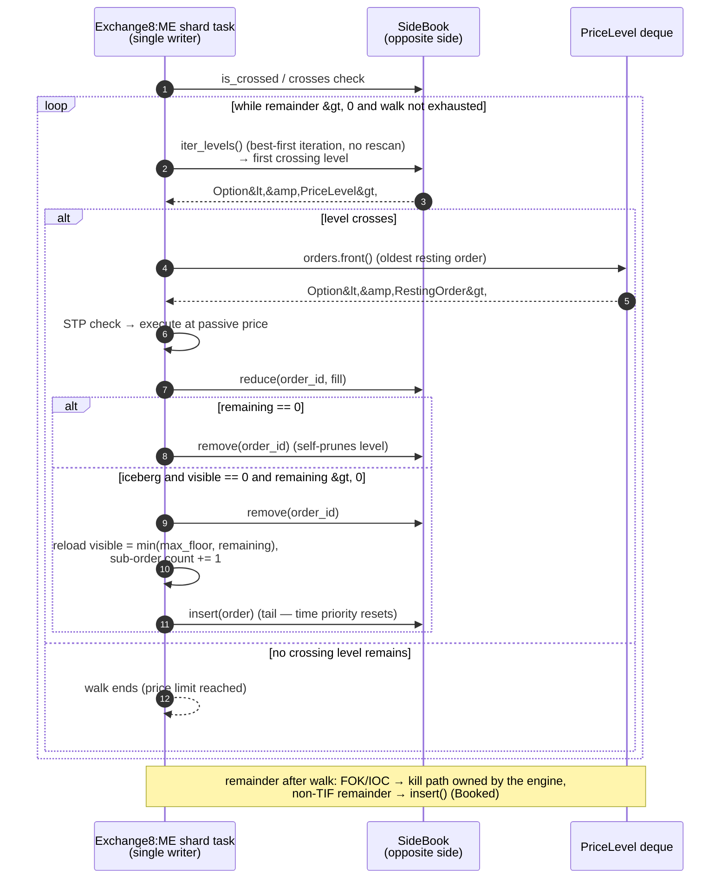
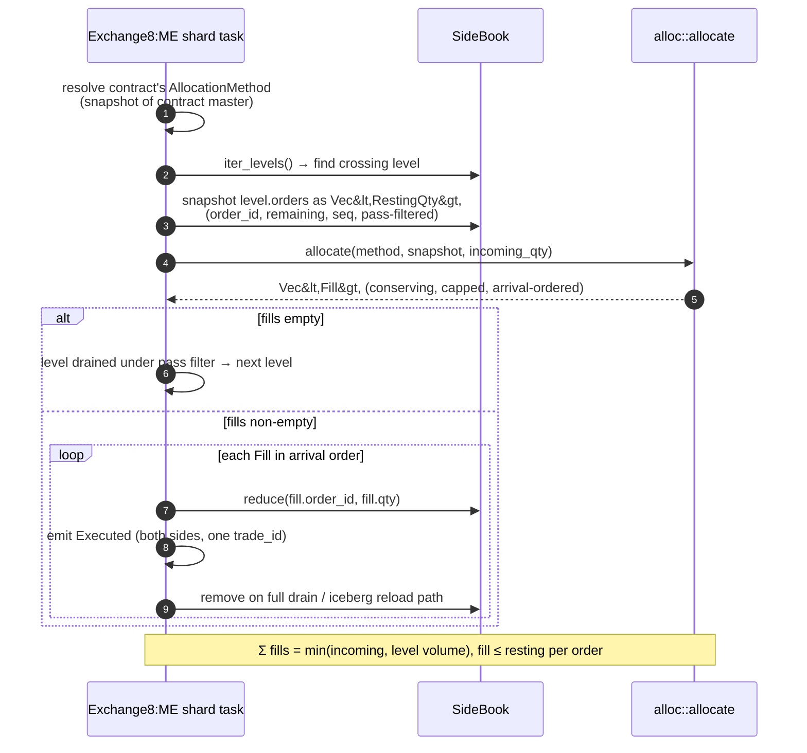
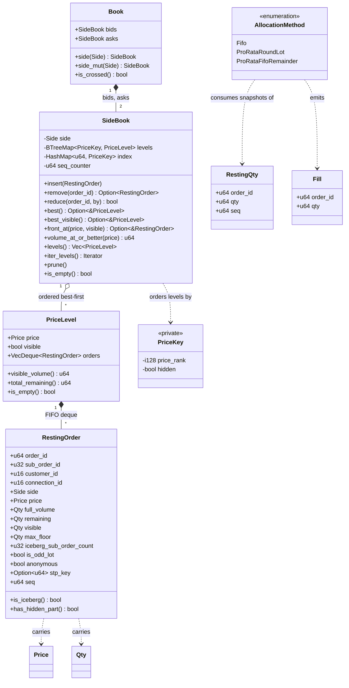
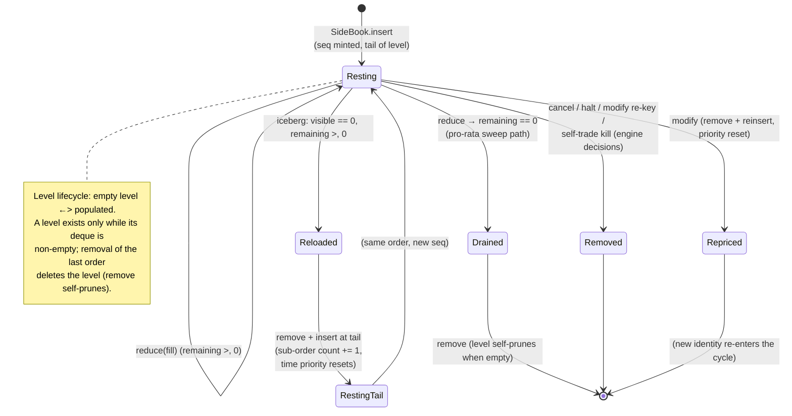
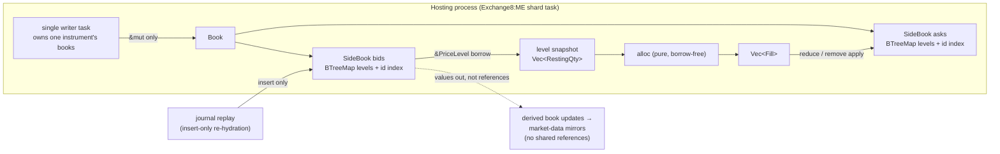
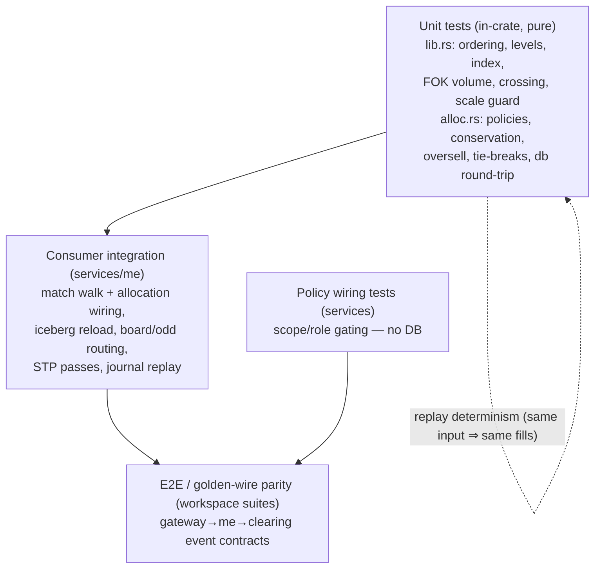

# exchange8::book — Detailed Design Document

## 1. Scope & Context

**Owns:**

- The in-memory book containers for one instrument's two-sided book:
  `RestingOrder`, `PriceLevel`, `SideBook`, `Book`, and the private
  `PriceKey` ordering that makes map iteration best-first on both sides.
- The per-contract within-level allocation policies
  (`alloc::AllocationMethod`, `alloc::allocate` with `fifo`,
  `pro_rata_round_lot`, `pro_rata_fifo_remainder`) as pure
  snapshot-in/fills-out functions.
- The arrival-sequence discipline (monotone `seq` minted per side book) and
  the visible/hidden level-partition semantics.

**Does NOT own (delegated):**

| Concern | Owning unit |
|---|---|
| Matching policy (when to match, STP actions, price protection, post-only, TIF kills, board/odd routing) | Exchange8:ME matching engine |
| Order state persistence, journaling, and recovery replay | Exchange8:ME (journal + shard state) |
| Trade-id sequencing, execution envelopes, event fan-out | Exchange8:ME + platform sequence plane |
| Market-data publication and depth snapshots derived from the book | Exchange8:MD / book-update consumers |
| Price/quantity value types and precision helpers | `exchange8::fixed` |
| Order/contract domain enums (`Side`, `Visibility`) | `exchange8::contracts` |
| Contract master (allocation method per instrument) | Exchange8:RefData schema |
| Thread ownership of a book (single-writer scheduling) | the hosting service |

**System context:**

There is no trust boundary inside an in-process library: the diagram marks
direction of data flow, not network hops. Every arrow above is an ordinary
Rust function call or value return inside one process, under the single-writer
ownership of the hosting shard.

## 2. Runtime Architecture

A library has no processes, routers, or workers. Its "runtime" is the set of
types consumers instantiate and the call order they use. The composition:

- **Container layer** (`lib.rs`): `Book` → `SideBook` → `PriceLevel` →
  `RestingOrder`; the `PriceKey` ordering and the id→key index live inside
  `SideBook`.
- **Policy layer** (`alloc.rs`): `AllocationMethod` selects among the pure
  allocators; the allocator consumes `Vec<RestingQty>` snapshots and emits
  `Vec<Fill>`.

The engine is the sole mutator. Per instrument its shard task performs:
insert on rest, front/level walk on match, `reduce` on fill, `remove` on
full consumption or cancel, and remove+reinsert for iceberg reloads and
priority-losing replaces.

Two consumer-side driving patterns matter for interpreting the diagrams:
the FIFO walk locates the crossing level by an `iter_levels` sweep (best-first
order, skipped per bypass visibility) and then consumes its deque front; the
pro-rata pass snapshots the level once per pass. Both apply fills through the
same primitives below — the library never distinguishes the disciplines.

**FIFO match walk (default discipline) — the primary call sequence:**

**Pro-rata allocation pass (contract-declared alternative, same walk):**

**Iceberg-tail reload path** (within either discipline above): a resting
iceberg is reduced in place; when its displayed quantity reaches zero but a
reserve remains, the engine removes the order and re-inserts it — the
re-insertion assigns a fresh, higher `seq`, placing the reloaded slice at
the tail of its level. That re-entry is the documented time-priority reset;
the bumped `iceberg_sub_order_count` is the feed identity of the new slice.

## 3. Data Model

Pure in-memory structures, all serde-serializable so a mirror or recovery
path can reconstruct a book from a serialized frame. Quantities are
`exchange8::fixed::Qty` (`u64` raw units, integer board lots by default,
fractional decimal scaling for crypto per-instrument); prices are
`exchange8::fixed::Price` (`i128` scaled integer ticks plus a per-value
scale) — the book never rescales values, it compares and stores raw units.

**Structural relationships:** a `SideBook` owns its levels; a level owns its
orders by value; the id index is a redundancy that must agree with the map
at all times (an invariant, not a second source of truth). The allocator's
`RestingQty`/`Fill` are deliberate value copies, not references — the
snapshot/apply split is the boundary that keeps allocation pure.

**Order and level lifecycle (as driven by the engine):**

Visibility is a structural property, not a mutable state: orders are placed
into the visible or hidden level by their `visible` quantity at
insert time, and a hidden order never migrates to a visible level without
full re-entry.

## 4. API Surface

A library's "API surface" is its public Rust items; there are no HTTP
endpoints, network protocols, or authorization gates. Consumers are
in-process exchange8 services, and the platform's authorization pipeline
applies at the owning service boundary, never here.

Grouped by consumer role:

**Market-data and parity views (read-only):**
- `Book::is_crossed` — crossed-market detection used by parity checks and
  halt/quotation logic.
- `SideBook::best` / `SideBook::best_visible` — the best level overall, and
  the best displayable (visible) level, which is what displayed depth means.
- `SideBook::levels` / `SideBook::iter_levels` — best-first depth access,
  by-value snapshot or borrowing walk.
- `SideBook::volume_at_or_better` — cumulative resting volume (visible +
  hidden) at prices at-or-better than the given limit; the FOK availability
  primitive.
- `SideBook::front_at` — direct access to a level's oldest order (the
  pickup point for the matching walk).
- `PriceLevel::visible_volume` / `PriceLevel::total_remaining` — aggregated
  level depth.
- `RestingOrder::is_iceberg` / `RestingOrder::has_hidden_part` — display
  predicates mirrored into derived market data.
- `SideBook::side` / `Book::side` — side identification for generic code
  paths.

**Matching operations (mutating, engine-only by convention):**
- `SideBook::insert` — place a resting order; mint the arrival sequence;
  tail of its (price, visibility) level.
- `SideBook::reduce` — in-place fill decrement of one order (saturating at
  zero); returns whether the id was known.
- `SideBook::remove` — take a resting order out (cancel, full consumption,
  iceberg re-entry, modify re-key); self-prunes an emptied level.
- `SideBook::prune` — explicit empty-level sweep (defensive parity with
  self-pruning removal).
- `Book::new`, `Book::side`, `Book::side_mut`, `SideBook::new` —
  construction and side-scoped mutation access.

**Allocation policy (pure functions):**
- `alloc::allocate` — allocate an incoming quantity across a level snapshot
  under the contract's method; deterministic, conserving, capped.
- `alloc::AllocationMethod` + `from_db` / `as_str` — the per-contract
  policy selector and its contract-master column round-trip.
- `alloc::RestingQty`, `alloc::Fill` — the snapshot and fill transfer types.

**Memory/snapshot operations:**
- Every container derives `Serialize`/`Deserialize` (`Book`, `SideBook`,
  `PriceLevel`, `RestingOrder` included) — the reconstruction contract for
  mirror/replay consumers. `Book`, `SideBook`, and `PriceLevel` also derive
  `Clone` for cheap engine-side snapshots.
- Complexity contract (hot path): insert O(log L); best O(1) map-front
  lookup after ordered insert; cancel/reduce locate O(1) via the id index;
  front consumption O(1); `volume_at_or_better` O(L) — L = distinct
  (price × visibility) levels on the side.

**Rustdoc coverage companion:** each of the public items above carries a `///`
doc comment in source (short summary, explanation, examples for non-trivial
functions, and errors/panics notes where they apply) — the API contract
lives with the code; this document intentionally describes rather than
duplicates signatures.

## 5. Cross-Cutting Concerns

A library has no HTTP, RLS, rate limiting, or audit surface — the platform
cross-cutting concerns apply to the consuming services. What applies *to the
library itself*:

- **Allocation posture.** All structures are owned Rust; there is no
  custom allocator, no slab pool, and no `unsafe` in the crate. Hot-path
  cost is ordinary heap allocation of deque blocks and map nodes; steady-state
  reuse and pooled allocation for the engine's event envelopes are engine-side
  concerns layered above this crate.
- **Round-lot exact-share allocation.** Pro-rata shares are computed as
  integer floors of `qty × incoming / total` in `i128` arithmetic (products
  of two `u64` values cannot overflow `i128`), and the indivisible remainder
  is distributed one unit per round over a deterministic ranking
  (largest fractional remainder with arrival tie-break, or plain FIFO for the
  hybrid policy). Quantities are never divided into non-representable
  fractions; every fill is an exact integer share and the sum is exactly
  conserved.
- **Numeric precision.** The crate stores raw scaled integers only
  (`Price::raw: i128`, `Qty::raw: u64`) and delegates scale semantics to
  `exchange8::fixed` (equity prices ×10⁴, FX ×10⁵, crypto ×10⁸; quantities
  integer lots by default, fractional ×10⁸ where the contract says so).
  No operation in the crate multiplies, divides, or rescales prices; the
  only arithmetic is side-relative ordering, saturating quantity
  decrements, and the allocator's integer share math, all of which are
  exact.
- **Zero-copy semantics.** Reads are borrows (`iter_levels`, `front_at`,
  `best`); the only accidental-copy paths are the snapshot helpers
  (`levels()` cloning levels, the allocator's `RestingQty` snapshot) which
  exist precisely to decouple mutation from decision-making. Engine hot
  paths use the borrowing walk and indexed in-place reduce; snapshotting is
  reserved for the one pro-rata pass per touched level.
- **Determinism.** Identical input sequences produce identical allocation
  decisions bit-for-bit on any host: no floats, no HashMap iteration order
  influencing results (pro-rata remainder ordering is by explicit sort key),
  no wall-clock inputs. This is the property the engine's replay guarantees
  rests on.

## 6. Failure Modes & Recovery

A library's failure modes are the precondition violations and resource
exhaustion its consumers must survive, plus the contract it offers for
reconstruction:

- **Out-of-memory / allocator exhaustion.** Levels grow with resting
  liquidity; the crate performs no admission control and cannot shed load.
  Exhaustion surfaces as an allocation abort in the hosting process — the
  exchange's policy is fail-stop for the engine process (book state must
  never be silently approximated), and bounded queues upstream keep resting
  depth bounded. The recovery contract: after a restart the engine
  re-hydrates books from its own journal replay; the library plays only an
  insert-only role there, so recovery correctness is the engine's journal
  contract, not this crate's.
- **Corrupt book reconstruction contract.** Any `Book` serialized by
  `Serialize` deserializes into a structurally valid book that upholds the
  invariants (best-first iteration, FIFO-per-level, index agreement) *only
  if the producer serialized an invariant-holding book*; the serde layer
  cannot enforce cross-field invariants, so the engine's recovery path
  re-verifies crossing and depth aggregates after replay rather than
  trusting a frame. A recovered book with a torn id index (only possible
  from a foreign writer) is treated as unreplayable — the engine rebuilds
  from the journal instead of patching the index.
- **Unknown-order operations.** `reduce`/`remove` return `false`/`None` for
  unknown ids rather than panicking; the engine surfaces these as
  `NotFound`-class rejections. Double-consume races are impossible by
  construction (single writer), and mid-apply counterparty removal under
  pro-rata is handled by the engine skipping the vanished fill.
- **Saturating floors.** All quantity arithmetic on fills saturates rather
  than wrapping; reduce never drives `remaining`/`visible` negative, so no
  fill sequence can corrupt depth.
- **No panic paths on the hot path.** Public operations do not panic for
  any caller input: there is no index arithmetic that can go out of range,
  no unwrap on caller-provided state, and the allocator's remainder loop
  terminates on capacity exhaustion explicitly.

## 7. Concurrency & Performance Model

Ownership model: **single-writer consumption**. The engine's shard map
assigns every instrument to exactly one task; all mutation of that
instrument's `Book` happens on that task with no locks or atomics. `&mut
self` is the crate's entire synchronization contract — if a second writer
existed, it would be a consumer-architecture violation, not a library
shortfall. Read-only sharing (depth mirrors) reaches consumers through
derived updates, never through concurrent references into a live book.

**Cache behavior.** Level deques are contiguous blocks accessed front-first
and tail-inserted — the two hottest patterns for a FIFO level. The level
map walks in execution order with pointer-chasing only across level keys,
not per order. The pro-rata snapshot is the one per-match allocation, sized
to the level's resting count. Order lookup by id is a single hash probe.

- **Performance contract recap** (the numbers the engine's sizing assumes):
  insert O(log L); best/best_visible O(1) front-of-map; cancel/reduce locate
  O(1); front-fill locate O(1) via the deque front (the engine's fill loop
  re-locates the level on the best-first `iter_levels` basis); FOK
  availability O(L); pro-rata allocation O(n) per level (n = resting
  orders). A regression test holds a 10 000-level / 100 000-order book
  against a time guard to keep the sub-linear contract honest.

## 8. Invariants, Insecure-Defaults Rejected, Unsafe Rationale

**Invariants (always true after any accepted operation sequence):**

1. Level iteration of a `SideBook` is best-first per side: bids descending
   by price, asks ascending, visible levels before hidden at equal price.
2. Within a level, deque order is strictly arrival order (`seq`
   monotone per side book; callers cannot set `seq`).
3. The id index and the level deque agree for every resting order — no
   dangling or duplicated identity.
4. Visibility partition is derivable: `visible == 0` ⇔ hidden level
   membership; `remaining ≥ visible ≥ 0` always; `reduce` saturates at
   zero.
5. Allocation outputs conserve quantity exactly:
   Σ fills = min(incoming, Σ resting `qty`); every fill ≤ its order's
   resting qty; `fifo` allocations are strict FIFO prefixes.
6. Allocation is deterministic: same `(method, snapshot, incoming)` ⇒
   same `Vec<Fill>` on any host, any thread, any time.
7. Empty levels do not linger: `remove` prunes its level when drained;
   `best()` never returns a hollow level.
8. Crossing detection is side-relative and total: `Book::is_crossed` is
   false exactly when one side has no level or best bid < best ask.

**Insecure defaults rejected:** no hidden liquidity leaks into displayed
depth (visible/hidden partition is structural, not filtered); no floating
point anywhere in the hot path (integer shares only — a float-based pro-rata
would be non-reproducible across hosts); no caller-supplied time priority
(a book that trusted caller `seq` would let spoofed sequence numbers
reorder fills); no interior mutability — a shared-mutable book would let
readers observe torn levels; no implicit level merging where hidden orders
surface as display depth.

**Unsafe rationale:** the crate contains no `unsafe` blocks. Ordering is
achieved with type-derived key ordering (a totally ordered `PriceKey`
struct), memory reuse is left to the standard allocator, and all quantity
math is saturating/checked — safety comes from the types, not from unchecked
code.

## 9. Testing Strategy

- **What this crate's unit tests own (in `#[cfg(test)]` modules of
  `lib.rs` and `alloc.rs`):** side-relative best-first ordering (including
  hidden-before-worse-visible), FIFO within levels, visible/hidden level
  separation, crossing detection, FOK volume semantics on both sides,
  indexed remove/prune behavior, iceberg predicates, allocation method
  string round-trips, exact-share pro-rata, largest-remainder distribution
  with arrival tie-breaks, FIFO-remainder divergence from
  largest-remainder, and the conservation/no-oversell matrix across all
  policies × level shapes × incoming quantities; plus the 10k-level
  complexity guard. Doctests compile-and-run every public example:
  the crate documentation is executable.
- **What is deliberately NOT tested here:** cross-service behavior — the
  engine's matching walk, STP/price-protection/post-only decision logic,
  board/odd routing, journaling and replay, market-data projection, and
  wire/event parity are owned by the consuming services and workspace
  suites. The library tests the containers and policies; the services test
  the driving.

## 10. Open Questions

- **Pooled storage for hot-path orders.** Whether a future
  `book::pool` (or a pooled variant of the book) should replace owned deque
  storage to cut steady-state allocations on the engine's fill path — to be
  designed together with the engine's event-envelope pooling, one storage
  decision rather than two.
- **Result-carrying reduce.** Whether `reduce` should return the post-fill
  order state to remove the engine's level re-scan before iceberg reload
  decisions.
- **Aggregated depth view.** Whether to ship a native depth-aggregation
  helper (visible volume per price rung, book/odd partitioned) instead of
  every consumer folding `iter_levels` itself.
- **Allocator extensibility.** Whether additional per-contract methods
  (e.g. size-priority variants) become needed; today the closed enum mirrors
  the contract master exactly, and any extension must extend both ends of
  the `from_db`/`as_str` round-trip and the conservation matrix in the same
  change.
- **Cross-side atomic checks.** `Book::is_crossed` is the only two-sided
  primitive; post-only and crossing decisions re-derive side crossing in
  the engine today. A `Book`-level "best price/qty both sides" accessor
  would centralize that if engine-side duplication grows.

---

**Design attribution:** exchange8:book and its underlying concepts were designed by Hamid Jahanzad <Hamid@Jahanzad.com>.
