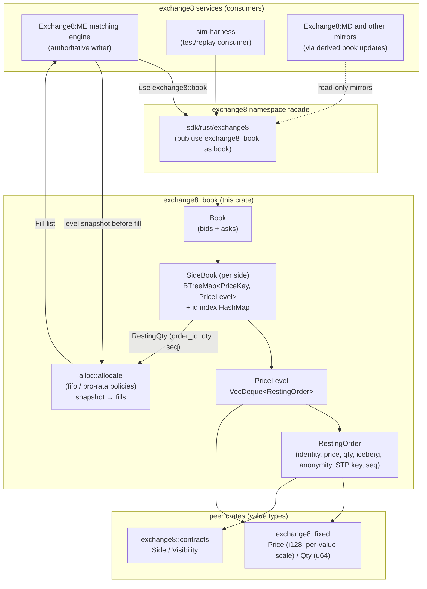

# exchange8::book

## 1. Summary

`exchange8::book` is the price-level order-book library of the exchange8
vertical: it owns the in-memory book data structures - one best-first
`SideBook` per market side, FIFO `VecDeque` queues per level, an O(1)
order-identity index, and the per-contract within-level allocation policies
(`fifo`, `pro_rata_round_lot`, `pro_rata_fifo_remainder`). It is a pure
domain library with no HTTP surface, no database presence, and no process of
its own; it is consumed by exchange8 services - principally the matching
engine (Exchange8:ME), which is the only authoritative writer - and by the
simulation harness.

## 2. Motivation

The matching engine must consume liquidity with sub-linear, deterministic
data-structure behavior at exchange scale. The book library exists to provide:

- **Best-first iteration without rescans.** The matching walk advances
  through levels in execution order; a level container whose iteration order
  equals priority order removes the need to repeatedly re-find the best
  level on every fill.
- **O(1) order identity.** Cancels and reduce operations locate any resting
  order by id directly, regardless of level count.
- **Deterministic, policy-driven allocation.** How an incoming order
  consumes one price level is a per-contract property, and the same policy
  always produces the same fill list for the same input on any host.
- **A single shared definition of depth.** Market-data mirrors, FOK
  availability checks, post-only and crossing checks, and the engine itself
  must all read the same visible/hidden level semantics.
- **Pure testability.** The allocator is a snapshot-in/fills-out function;
  the book is an insert/remove/reduce state machine. Neither does I/O,
  which makes both exhaustively unit-testable without service scaffolding.

## 3. Architecture & High-Level Design

The crate is layered in two parts. `lib.rs` owns the book containers -
`RestingOrder`, the private `PriceKey` ordering, `PriceLevel`, `SideBook`,
and the two-sided `Book`. `alloc.rs` owns the within-level consumption
policies as pure functions over an order-id/qty/seq snapshot. The exchange8
services construct books, feed them orders, and interpret the returned
allocations; the library never performs I/O, scheduling, or persistence.

- **`Book`** composes two independent `SideBook`s. Each side is fully
  independent; crossing and best-price arithmetic stay side-relative.
- **`SideBook`** keeps its levels in an ordered map whose keys bake in
  side-aware best-first ordering and the visible-before-hidden tiebreak.
- **`PriceLevel`** is a FIFO queue of resting orders; the front is the
  oldest order and the next to fill.
- **`alloc`** never touches book state: the engine snapshots the level as
  `(order_id, qty, seq)` triples, calls `alloc::allocate`, then applies the
  returned fills through the book's `reduce`/`remove` operations - exactly
  as it does for the FIFO path.

## 4. Key Traits and Data Structures

- **`RestingOrder`** - one resting order's full identity: exchange-level ids
  (`order_id`, `sub_order_id`), customer and connection identity, side,
  price, full/remaining/visible volumes, iceberg display state
  (`max_floor`, reload counter), odd-lot flag, anonymity flag, STP key, and
  arrival sequence. Helper predicates (`is_iceberg`, `has_hidden_part`)
  express display-state decisions read by the engine.
- **`PriceLevel`** - one (price, visibility) tuple with the FIFO deque of
  orders resting there. Aggregation helpers (`visible_volume`,
  `total_remaining`) answer depth questions without exposing the deque.
- **`SideBook`** - one side's ordered level map plus the order-id index. It
  answers best-first queries (`best`, `best_visible`), walks levels without
  cloning (`iter_levels`), and performs the three mutations the engine
  needs: `insert` (assigns arrival sequence, tail of its level), `remove`
  (indexed locate, self-prunes empty levels), `reduce` (in-place
  decrement).
- **`Book`** - the two-sided instrument book: `bids` and `asks` side books,
  side accessor, and the cross-detection used by market-data and parity
  tests.
- **`alloc::AllocationMethod`** - the per-contract consumption policy
  selector, parsed from and rendered to the contract-master column values.
- **`alloc::RestingQty`** - the allocator's view of one resting order
  (identity, fillable quantity, arrival sequence); the snapshot boundary.
- **`alloc::Fill`** - one allocation decision (order id + granted
  quantity); the allocator's output contract handed back to the engine.

The crate is data-oriented: no traits, no dyn dispatch, no callbacks.
Consumers drive it; nothing drives consumers.

## 5. Rationale, Trade-offs, and Alternatives

**Pattern choices.**
- *Ordered map of levels, not a hash map of levels + linear best search.* The
  match walk needs the next-best level after every partial consumption; a
  `BTreeMap` whose key order *is* the walk order makes the walk a plain
  iterator advance. Inverting the bid-side rank into the key means both
  sides share one walk implementation and one correctness story. A level
  hash map would re-scan to find the best level (O(L) per fill) or need a
  second ordered index - the same cost with two sources of truth.
- *Side-aware rank encoding instead of per-side comparators.* Encoding
  "best" as a signed integer rank (bids negated, asks absolute) plus the
  visibility tiebreak in the key makes *map iteration order == priority
  order* a structural invariant, verifiable by one unit test, rather than
  an emergent property of comparator wiring that can regress silently.
- *Snapshot-pure allocator.* The allocation policies are functions of a
  level snapshot and the incoming quantity - no book mutation, no
  references into the book. This keeps pro-rata exhaustively testable
  (conservation/oversell/consistency across shape matrices) and lets the
  engine apply pro-rata fills through the identical `reduce`/`remove`
  primitives the FIFO hot path already uses.
- *`VecDeque` for the level queue.* The only two access patterns on a
  level are tail-insert (new or iceberg-reloaded orders) and front /
  positional consume; deques provide both at O(1) with contiguous,
  cache-friendly blocks and no per-order node allocation. An intrusive
  doubly-linked list (the classic exchange design) was not chosen: this
  crate's levels own their orders by value, so there is no pool/allocation
  lifetime to share, and the deque keeps the whole structure serde-serializable
  for mirror/replay consumers.

**Dispatching.** Allocation is selected by an enum passed as a value -
static dispatch with a small `match`. The policy set is closed (three
methods, mirroring the contract-master CHECK), policies are stateless, and a
`match` makes a new method a compile-verified change at the single dispatch
point. A trait-object registry would add indirection and dyn-dispatch on
the hot path for no extension capability the contract master can express.

**Concurrency.** The crate is deliberately non-thread-safe: `&mut self` for
every mutation, no atomics, no internal locks. This is not a limitation but
the point - the matching engine's single-writer-per-instrument architecture
(one shard task owns one instrument's books) is exactly the model in which
unsynchronized data structures are fastest and safest. Shared readers
(market-data mirrors) are fed by derived updates, not shared references, so
the library needs no read path synchronization and its complexity contract
is unconditionally true.

**Rejected alternatives.**
- *Hash map keyed by price* - loses deterministic ordering; rescans or a
  companion ordered structure required.
- *Doubly-linked intrusive levels/orders* - O(1) mid-list removal is its one
  advantage, but the id-index locate plus deque `remove(index)` matches the
  hot path (front/back O(1)) with owned, serializable state; intrusive
  nodes would pin the design to a slab-pool allocator.
- *Global order book with visibility filters* - a hidden level at a better
  price must sort before a visible level at a worse price for matching
  (price dominates), yet bypass-style flows must skip hidden levels entirely.
  Separate (price, visibility) levels encode both behaviors directly;
  filtering a merged structure re-implements the tiebreak per consumer.
- *Storing allocated fills with fractional quantities* - rejected in favor
  of integer share distribution (floors + explicit remainder rounds), which
  is exactly reproducible bit-for-bit and mirrors round-lot market
  convention.

## 6. Internal Implementation & Invariants (Private Design)

- **`PriceKey`** is the ordering core: `price_rank` is the side-transformed
  price (`−price` for bids, price for asks), `hidden` breaks the equal-rank
  tie placing visible levels first. Insert and remove path construction is
  the only place the transform exists - a single point that keeps both
  sides' iteration best-first. It is private: consumers never construct or
  order keys themselves.
- **Sequence assignment** - `SideBook` mints the monotone `seq` on insert
  (`seq_counter += 1`); callers cannot spoof time priority. An iceberg
  order is reloaded by full removal and re-insertion at the tail, which is
  precisely the documented "time priority resets on reload" behavior; the
  reload counter travels with the order.
- **Reduce/visibility floor** - `reduce` decrements both `remaining` and
  `visible` with saturating floors; the engine decides iceberg reloads by
  consulting the order's post-fill state (`remaining > 0 && visible == 0 &&
  is_iceberg`). The book never reloads by itself: reload is ownership of
  the matching policy, not the container.
- **Index discipline** - the id index is updated only inside `insert` and
  `remove`; `reduce` never mutates it (identity and location are
  invariant under fills). `remove` prunes the level when its deque empties,
  so `best()` cannot surface a hollow level.
- **Fills never oversell** - every allocator enforces per-order caps
  (`fill ≤ resting`) and global conservation (Σ fills = min(incoming, total
  level volume)); the round-distribution loop grants at most one unit per
  order per pass and stops when capacity is exhausted.
- **Invariants held across all mutations:**
  1. Iteration over a `SideBook`'s levels is always best-first
     (price-dominant, visible-before-hidden at equal price, per side).
  2. Within a level, deque order is arrival order (`seq` strictly
     increasing).
  3. `index` and `levels` agree for every resting order - no order exists
     in the deque without an index entry and vice versa.
  4. `order.remaining ≥ visible ≥ 0`, and `visible == 0` exactly for
     hidden orders (the visibility partition is derived from `visible.raw`,
     never stored twice).
  5. A `fifo` allocation is a strict FIFO prefix - orders after the prefix
     boundary are untouched; this is CI-enforced by the strict-prefix and
     deep-level arrival-sequence tests.

## 7. Unresolved Questions / Future Designs

- **Slab-pool integration.** The matching-engine design reserves a
  hot-path allocation-reuse pool (`crates/book::pool`) for order records
  and level events; the present crate holds owned, heap-allocated orders
  and deques. Library-level pooling (or a pooled mirror structure) remains
  a future design for the engine's steady-state allocation posture.
- **Native market-depth views.** Consumers derive their own depth
  snapshots from `iter_levels`; a first-class aggregated-depth view
  (price-rung aggregation of visible volume across book/odd partitions)
  would relieve every mirror of the same fold.
- **Streaming `reduce` state.** `reduce` answers success/failure but not
  the order's post-fill state; the engine re-scans the level to decide
  removal versus iceberg reload. A result-carrying reduce would close that
  read.
- **FOK volume in better-than-linear time.** `volume_at_or_better` is O(L)
  by design; if FOK checks ever profile hotter, prefix-aggregate levels
  (running sum per entry) could make availability O(log L).
- **Mixed-lot twin linkage.** The engine splits board/odd quantities into
  twin orders held in separate `Book` instances; the twin link lives in
  engine state, not in `RestingOrder`. A library-side twin field would make
  the split visible to any future mirror consumer.

---

**Architecture & Design:** exchange8:book and its underlying concepts were designed by [Hamid Jahanzad](https://www.linkedin.com/in/hamidjahanzad/).
