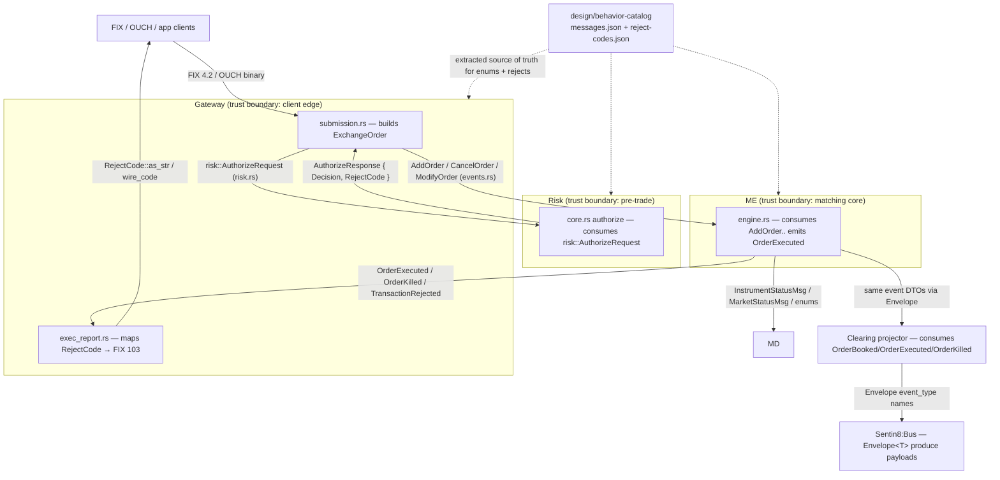
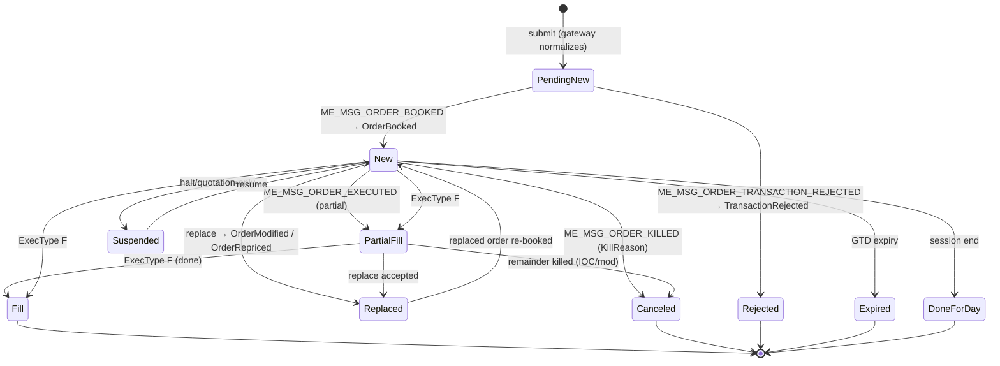
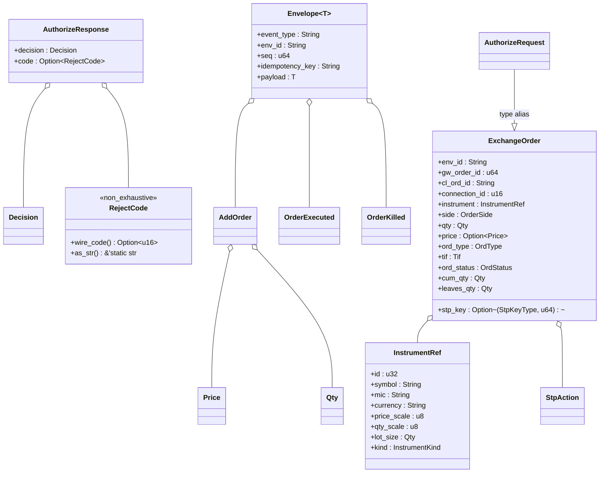
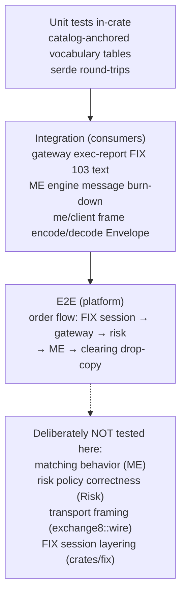

# DESIGN.md: exchange8::contracts — Detailed Design Document

> Audience: maintainers and reviewers modifying the crate. This is a
> **library**: it has no HTTP surface, no database, no deployment, and no
> runtime architecture of its own. Sections that describe service concepts
> (runtime architecture, API authorization, failure recovery of a process)
> state explicitly how the library concept applies instead.

## 1. Scope & Context

**Owns** (the vocabulary itself):

- Normalized order/instrument DTOs — `order.rs`.
- ME char-code enums — `enums.rs`.
- Reject-code catalog + FIX 103 text — `reject.rs`.
- Sentin8:Bus envelopes + ME/OMS event payloads + quote events — `events.rs`.
- Gateway → Risk authorize wire DTOs — `risk.rs`.

**Does NOT own** (delegated everywhere else in the vertical):

| Concern | Owner |
|---|---|
| Framing/codec for the framed streams | `exchange8::wire` |
| Typed ME-stream client (connect, encode/decode envelopes) | `exchange8::me::client` |
| FIX session decoding into `ExchangeOrder` | Gateway service |
| Pre-trade authorization logic | Risk service |
| Matching/burn-down logic | ME service |
| Persistence of orders/trades | Clearing / OMS services |
| Scaled decimal arithmetic primitives | `exchange8::fixed` |

System context — every trust boundary crossing a service consumes one module
of this crate:

## 2. Runtime Architecture

**Service concept:** not applicable — the crate is a passive type library with
no routers, handlers, workers, caches, or tasks. The "runtime map" is the
module map compiled into every consumer:

| Module | Contents | Used by |
|---|---|---|
| `enums.rs` | 12 char-code enums (order type, side, visibility, client/house, capacity, price protection, instrument status, market status, kill reason, ME reject reason, liquidity, lot type) + system event codes | ME engine/shard, gateway ouch/submission, md book/calendar, clearing projector |
| `events.rs` | `Envelope<T>`, inbound ME order-entry DTOs, outbound ME lifecycle DTOs, `RejectedOp`, `Quote`, `BboUpdated` | ME engine/shard/journal, gateway exec_report, me-client, clearing projector, oms |
| `order.rs` | `ExchangeOrder`, `InstrumentRef`, `InstrumentKind`, `OrderSide`, `Tif`, `OrdType`, `PegType`, `StpAction`, `StpKeyType`, `BookToken`, `CrossData`, `OrdStatus` | Gateway submission, Risk core, sim-harness, oms |
| `reject.rs` | `RejectCode` (59 variants, `#[non_exhaustive]`) + `wire_code()` + `as_str()` | Gateway exec_report, Risk, OMS |
| `risk.rs` | `AuthorizeRequest` (= `ExchangeOrder`), `AuthorizeResponse`, `Decision` | Gateway ↔ Risk wire contract |

The order lifecycle as encoded by this crate (`OrdStatus` values consumers
transition through; the crate stores the state, producers advance it):

`OrderStateMsg` ('V' request / 'U' response / 'X' erase) is the query/erase
vehicle for the states above; `TransactionRejected` carries `RejectedOp`
(Add/Cancel/Modify) plus `MeRejectReason` for the failed operation.

## 3. Data Model

**Service concept:** not applicable — no tables, no RLS. The data model is the
struct/enum inventory and its serialization form.

Inventory by module (variant/field counts from the sources):

- `enums.rs` — 12 enumerations, each with exact `char` wire codes:
  `OrderType` ('L','F','I','P','B'), `Side` ('B','A'),
  `Visibility` ('D','H'), `Capacity` ('A' agency / 'P' principal),
  `PriceProtection` ('K','P'), `InstrumentStatus` ('O','H','Q'),
  `MarketStatus` ('O','H','P','S','D'), `KillReason` (10 chars
  'H','C','A','I','F','S','R','P','M','E'), `MeRejectReason`
  ('H','F','W','U','E','V'), `Liquidity` ('A','R'), `LotType` ('1','2'),
  `SystemEventCode` ('O','C','Q','M','S','E','P').
- `events.rs` — `Envelope<T>` + 9 inbound DTOs (`AddOrder`, `CancelOrder`,
  `CancelAllForConnection`, `ModifyOrder`, `InstrumentStatusMsg`,
  `MarketStatusMsg`, `OrderStateMsg`) + 9 outbound DTOs (`OrderBooked`,
  `OrderKilled`, `OrderModified`, `OrderFilled`, `OrderAccepted`,
  `TransactionRejected`, `OrderExecuted`, `OrderRepriced`) + `RejectedOp` +
  `Quote`, `BboUpdated`.
- `order.rs` — `ExchangeOrder` (~40 fields in identity/instrument/attribute/
  state groups), `InstrumentRef`, `InstrumentKind` (7 kinds), `OrderSide`
  (6 FIX 54 codes), `Tif` (7 FIX 59 codes), `OrdType` (FIX 40 subset),
  `PegType` (4 FIX 18 peg chars), `StpAction` (4), `StpKeyType` (4),
  `BookToken('M'|'L'|'O'|'Q'|'D'…)` , `CrossData`, `OrdStatus` (12 FIX 39
  states).
- `reject.rs` — `RejectCode`: order_reject codes 1–8 / 100–124 / 130–144,
  base_reject 125–129 + 200, cancel_reject 0/2/3/105, plus platform rejects
  with no numeric code (`RiskUnavailable`, `RateLimited`, `GreeksLimit`,
  `MarginInsufficient`, `Malformed`, `Internal`).
- `risk.rs` — `AuthorizeResponse`, `Decision`.

**Serialization format.** Every type derives `Serialize`/`Deserialize`
(`serde`), interchange encoding JSON via `serde_json`:

- Struct field names are the JSON keys verbatim (`price_scale`,
  `idempotency_key`); the one keyword collision is renamed
  (`InstrumentRef::kind` → `"type"`).
- Enum variants serialize by name (`"Limit"`, `"Rejected"`); wire chars are
  accessed through `as_char`/`from_char` associated functions, never implied
  by the serde form.
- `Price`/`Qty` from `exchange8-fixed` serialize as `{ raw, scale }` scaled
  integers — precision-preserving across instruments with different digit
  scales.
- `Option<T>` fields encode as absent/`null`; `Vec` fields as arrays.
- The framed direct-stream codec (`exchange8::wire`) wraps whole `Envelope<T>`
  values, so the same JSON object appears inside frames and inside bus
  produce payloads.

## 4. API Surface

**Service concept:** not applicable — no endpoints, no authorization gates.
The public API is the Rust item inventory (all re-exported explicitly from the
crate root, and reachable through the vertical facade
`sdk/rust/exchange8::contracts`). Grouped for navigation:

- **Order types / instrument vocabulary** (`order`):
  `ExchangeOrder`, `InstrumentRef`, `InstrumentKind`, `OrderSide`
  (`as_char`/`from_fix`/`me_side`/`is_short`/`is_cross`), `Tif`
  (`as_char`/`from_fix`: empty = Day), `OrdType` (Limit | Pegged), `PegType`
  (midpoint/market/primary/darkpool), `StpAction`, `StpKeyType`, `BookToken`
  (`is_lit`), `CrossData`, `OrdStatus` (`as_char`/`is_terminal`).
- **ME wire enums** (`enums`): `OrderType`, `Side` (+`opposite`),
  `Visibility` (+`is_visible`), `Capacity`, `PriceProtection`,
  `InstrumentStatus`, `MarketStatus`, `KillReason`, `MeRejectReason`,
  `Liquidity`, `LotType`, `SystemEventCode` — each with exact
  `as_char`/`from_char` round-trips.
- **Rejects** (`reject`): `RejectCode` with `wire_code() -> Option<u16>` and
  `as_str() -> &'static str`; `#[non_exhaustive]` so new platform reasons can
  be added without breaking matches.
- **Events** (`events`): `Envelope<T>` + inbound order-entry DTOs
  (`AddOrder`, `CancelOrder`, `CancelAllForConnection`, `ModifyOrder`,
  `InstrumentStatusMsg`, `MarketStatusMsg`, `OrderStateMsg`) + outbound
  lifecycle DTOs (`OrderBooked`, `OrderKilled`, `OrderModified`,
  `OrderRepriced`, `OrderFilled`, `OrderAccepted`, `OrderExecuted`,
  `TransactionRejected`, `RejectedOp`) + quote events (`Quote`, `BboUpdated`).
- **Risk contract** (`risk`): `AuthorizeRequest`, `AuthorizeResponse`,
  `Decision`.

Event-type vocabulary the crate encodes (names consumers put into
`Envelope::event_type`, per master design §7, all
`exchange8:{service}:{resource}:{operation}`):

| Family | Names |
|---|---|
| Gateway | `exchange8:gateway:order:submitted` |
| ME order lifecycle | `exchange8:me:order:booked`, `exchange8:me:order:killed`, `exchange8:me:order:modified`, `exchange8:me:order:repriced`, `exchange8:me:order:rejected` |
| ME trades | `exchange8:me:trade:executed` |
| ME/MD state | `exchange8:me:instrument:halted` / `...:opened`, `exchange8:me:market:state` |
| Market data / feeds | `exchange8:md:bbo:updated`, `exchange8:md:depth:updated`, `exchange8:md:trade:printed`, `exchange8:md:trade:busted`, `exchange8:md:trade:amended`, `exchange8:vfeeds:venue:quote`, `exchange8:vfeeds:feed:status` |
| SOR / clearing | `exchange8:sor:leg:submitted|filled|cancelled|rejected`, `exchange8:clearing:order:recorded`, `exchange8:clearing:drop:sent` |

## 5. Cross-Cutting Concerns

- **Wire-format stability.** The crate is the serialization boundary: any
  field removal/rename can silently break bus consumers, framed-stream peers,
  and cleared-record readers. Rules: additive changes only; new enum variants
  must be either exhaustive-compiled (ME enums — compiler forces the catalog
  match) or `#[non_exhaustive]` (rejects); the unit tests that iterate every
  wire char and every reject code against the extracted catalog are the
  change-detector. No serde attributes may change existing names.
- **Numeric precision conventions.** Prices and quantities are
  `exchange8-fixed` scaled integers carrying their decimal `scale` per value —
  4 digits for the equity VER2 board, 8 digits for crypto; `InstrumentRef`
  repeats the scales (`price_scale`, `qty_scale`) so validation can compare
  the order's price scale against the instrument's. Time in force, peg
  differences, and quantities stay integral; no floating-point type appears
  anywhere in the crate. `peg_difference` is `i128`-scaled. Timestamps are
  microsecond `u64` (`ts_us`, `timestamp_us`).
- **Error-code vocabulary.** `RejectCode` is the single failure vocabulary
  across the vertical: Gateway maps it into FIX `OrdRejReason` (numeric code
  where `wire_code()` is `Some`; FIX 103 text via `as_str()`), Risk returns it
  in `AuthorizeResponse::code`, OMS/OMS-adjacent services log it. Unmapped
  (platform-only) rejects must never be presented to FIX clients as numeric
  codes.
- **Event-name discipline.** `Envelope::event_type` strings follow the colons
  -only convention; consumers (e.g. Clearing's drop-copy projector, the
  envelope test in `events.rs`) rely on exact names for grouping and
  idempotency projections.
- **Authorization pipeline position.** The crate contributes types to steps
  (token extraction → verification → tenant resolve → Shield decision → RLS
  context) of the platform pipeline but performs none of it — service crates
  do. Requests that cannot resolve tenant context are rejected by the services,
  never defaulted; the crate's `env_id` field is the routing key they set.

## 6. Failure Modes & Recovery

**Service concept:** not applicable — a library cannot crash or retry. What
the crate provides is the **failure vocabulary** the vertical's services use
to recover:

- **Reject taxonomy as the failure vocabulary.** Every observable failure of
  order handling is expressible as a `RejectCode`: session/parse failures map
  to `Malformed`, catalog-mapped semantic failures carry their numeric code
  (e.g. `WrongPrice` = 120, `MismatchPriceTicksize` = 132), risk-engine
  unavailability is explicit (`RiskUnavailable`, fail-closed), rate-guard
  pressure is `RateLimited`, margin shortfall `MarginInsufficient`, and
  unmatched internal faults collapse to `Internal` — each renders a stable
  FIX 103 text for the client-visible path.
- **Unknown-data handling.** Parsing functions return `Option` (`from_char`,
  `from_fix`), never panic on unknown codes; callers decide between reject
  (`Malformed` / specific code) and log-and-continue. `RejectCode::UnknownReason`
  (200) is the designated catch-all for legacy/foreign reasons that no variant
  captures.
- **Envelope recovery.** `seq` + `idempotency_key` let consumers detect gaps
  and dedup re-deliveries on both transports (bus inbox and framed streams);
  `ExchangeOrder::unresolved_instrument_code()` gives the gateway a
  deterministic reject (`InvalidSymbol` when the symbol is empty, otherwise
  `InvalidSecurityId`) when Risk's instrument snapshot disagrees with the
  session's view — the stale-cache failure mode.
- **Deserialization failures** bubble as serde errors to the transport layer
  (frame decode error, produce validation), which owns the retry/drop policy;
  the crate guarantees the failure is type-level (no partially-deserialized
  domain payload is ever observable).

## 7. Concurrency & Performance Model

**Service concept:** not applicable — the crate spawns no tasks and holds no
locks. What it contributes to the vertical's concurrency posture:

- **Clone/Copy semantics.** All ME message DTOs and every enum are `Copy` +
  `Clone` (single-digit-byte-size types: `u8`–`u128`, `char`s, small fixed
  arrays) — matching-engine side channels pass them by value. The composite
  carriers (`ExchangeOrder`, `InstrumentRef`, `AddOrder`, `Envelope<T>`) are
  `Clone`-only because they own `String`/`Vec` identity fields; cloning is
  expected at hand-off boundaries (order state vs. event emission), not in
  per-tick loops.
- **Sizes.** Enums occupy one byte-class discriminant plus payloads (e.g.
  `OrderExecuted` ≈ 100 bytes; `CancelOrder` 14 bytes; `Envelope<OrderKilled>`
  dominated by four `String`s + payload). No type exceeds a few hundred
  bytes without holding heap allocations.
- **Allocation posture.** Heap allocation is confined to identity strings
  (`event_type`, `env_id`, `idempotency_key`, `account`, `cl_ord_id`,
  `symbol`), the `strategy: Vec<u8>` token list, and option-wrapped strings.
  Hot-path numeric fields (`Price.raw: i128`, `Qty` scaled ints, `trade_id`,
  `order_id`) are inline integers. Consumers that need zero-allocation reads
  borrow these fields instead of cloning.
- **Send/Sync everywhere.** No interior mutability, no lifetime-bound borrows
  in public types — every DTO can cross tokio task boundaries and channels
  freely, which the ME shard dispatch and gateway fan-out rely on.
- **No atomics/locks by design.** Lifecycle state changes live in producer
  services; the crate's types are immutable snapshots, so there is nothing to
  lock.

## 8. Invariants, Insecure-Defaults Rejected, Unsafe Rationale

**Invariants** (checked by the crate's unit tests and exhaustive matching):

1. Every `enums.rs` variant round-trips exactly through its wire `char`
   (or FIX string) as extracted in `design/behavior-catalog/messages.json`
   `me_enums`; adding a variant without the matching code fails compilation of
   the exhaustive tests.
2. `RejectCode::wire_code` covers every catalog-mapped code exactly and
   returns `None` exactly for platform-added rejects.
3. `Envelope::event_type` always carries
   `exchange8:{service}:{resource}:{operation}` names — colon-separated, with
   `env_id`, `seq`, `idempotency_key` set by any producer.
4. `OrdStatus` terminal set is exactly {`Fill`, `Canceled`, `Rejected`,
   `Expired`} — `is_terminal` is the single source of that truth.
5. All public types are `Serialize + Deserialize + Debug + Clone`; no `unsafe`,
   no interior mutability.
6. FIX code conversions never accept strings/chars outside the documented
   sets (`from_fix("7") == None`, empty TIF = Day).

**Insecure defaults rejected:** no variant silently maps an unknown wire char
to a "default" order type/side; no reject code maps to a generic bucket
before `UnknownReason`; no `Price`/`Qty` mixing across different `scale`
values is possible because the scale rides inside the value.

**Unsafe rationale:** none — the crate contains no `unsafe` blocks; its
soundness needs no invariants beyond the standard library's guarantees.

## 9. Testing Strategy

The crate's tests are its compatibility contract. Unit tests (in-module
`#[cfg(test)]`) anchor every vocabulary surface to the extracted behavior
catalog:

- `enums.rs` — `wire_chars_match_catalog`, `kill_reasons_match_catalog`,
  `system_events_match_catalog` iterate every char/variant pair;
  `side_opposite` checks derivation.
- `reject.rs` — `wire_codes_match_catalog` samples the order/base/cancel
  families, asserts `None` for platform-added rejects; `fix103_text_present`
  walks a spread of codes and asserts non-empty `as_str()`.
- `order.rs` — FIX 54 side codes, FIX 59 TIF parsing (empty = Day),
  `OrdStatus::is_terminal`, peg char round-trips.
- `events.rs` — `Envelope` JSON round-trip with a real
  `exchange8:me:trade:executed` event name.

Run with the vertical build only (`make build-rust`, `cargo test
--workspace` via the Makefile `test` target); the crate has no standalone test
binary. E2E behavior coverage of the flows the crate's types describe (order
entry, execution reports, drop copy) is owned by the platform's E2E suite
(browsing the BFF-proxied UI only) and is out of this crate's scope.

## 10. Open Questions

- **Missing ME message DTOs.** The catalog inbound all-orders state request
  ('W') and outbound exec-post route message (`T`,
  `MERouteOrderPostedMsg`) have no struct in `events.rs`; deciding whether
  they belong in this crate (closing the inbound/outbound set) or stay
  out-of-crate awaits the ME-stream consumer inventory.
- **Event-payload completeness sweep.** The master design's event table
  specifies self-contained payload snapshots per event; several
  `Envelope` payloads in this crate are narrower than their catalog rows
  (e.g. `OrderBooked` vs. the `order_id, instrument_id, book_id, price,
  visible vol, side, conn/gw ids` row). A compatibility pass — widening
  payload structs or documenting the narrower contract — is owed.
- **Binary encoding of the envelope for the direct streams.** Today the
  framed codec serializes the same JSON as bus produce; if the framed path
  needs a denser encoding, the crate must add a wire-form enum without
  breaking the JSON form.
- **Reject-code localization.** FIX 103 texts are English-only today;
  whether client-facing reject text becomes a locale-aware lookup is a
  business decision outside the crate.
- **`Envelope` string economy.** Per-emission `String` allocations for
  `event_type`/`env_id`/`idempotency_key` are acceptable at current rates; a
  borrowed/interned variant is deferred until profiling shows frame-build cost
  on the ME hot path.

---

**Design attribution:** exchange8:contracts and its underlying concepts were designed by Hamid Jahanzad <Hamid@Jahanzad.com>.
