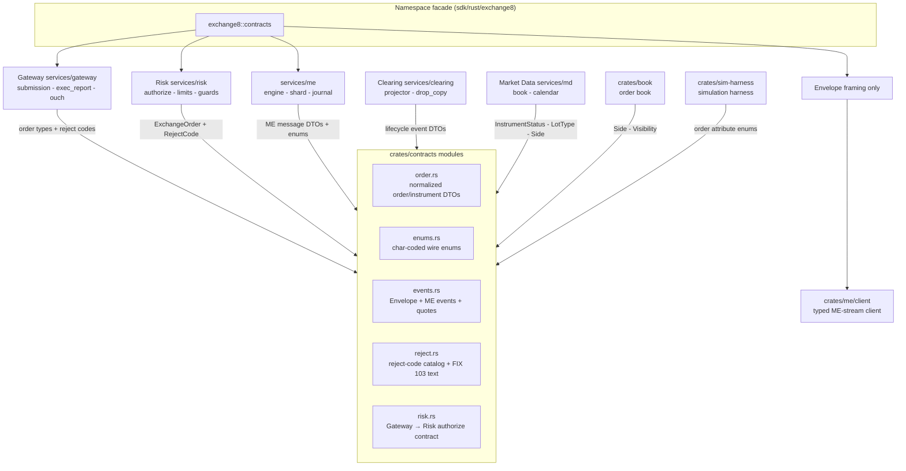

# README.md: exchange8::contracts - Shared Domain Vocabulary for the exchange8 Vertical

> Audience: anyone evaluating or onboarding to the capital-markets platform
> vocabulary. A library crate - no HTTP, no database, no deployment. For
> wire-level construction read `DESIGN.md`; for business-facing functionality
> read `BUSINESS.md`.

## 1. Summary

`exchange8::contracts` is the shared domain-vocabulary library for the
exchange8 vertical. It defines the normalized order and instrument types, the
reject-code taxonomy with FIX 103 compatibility text, the char-coded enums that
mirror the matching-engine wire constants, the event DTOs carried in
Sentin8:Bus envelopes (naming `exchange8:{service}:{resource}:{operation}`),
and the Gateway → Risk authorize contract. Every service in the
orders/rejects flow - gateway → risk → me → clearing - imports its types from
this single crate instead of declaring its own variants.

## 2. Motivation

The vertical's core data path (order submission, risk authorization, matching,
clearing projection) would otherwise force each service to re-declare order,
reject, and event types. A single shared vocabulary exists because:

- **Drift is expensive at the exchange.** A reject code that differs between
  Gateway and Clearing breaks client-facing FIX reports and drop-copy records;
  one crate means one possible drift, not several.
- **The wire constants are fixed by the matching-engine protocol spec.** The
  char codes (`'L'`, `'B'`, `'H'`, …), reject numbers (`1…144`, `0/2/3/105`),
  and FIX 103 texts are a contract, not an implementation choice - they are
  captured once, 1:1, in this crate and anchored to the extracted
  behavior catalog at `design/behavior-catalog/messages.json` and
  `design/behavior-catalog/reject-codes.json`.
- **Cross-service API surface belongs to shared code.** The Gateway → Risk
  authorize request/response shapes live here, not in a single-service client
  crate, so both sides (and tests of both sides) speak the same type.
- **Envelopes are transport-agnostic.** The same
  `Envelope<T>` shape encodes both Sentin8:Bus produce payloads and the
  point-to-point framed streams between the matching engine and its clients.

## 3. Architecture & High-Level Design

The crate is a passive type library: it owns no runtime, no I/O, and no state.
Every other unit derives its wire posture from the types defined here. The
domain flow it underpins is: a client order is normalized (`order.rs`), sent to
Risk for authorization through the `risk` module DTOs, accepted or rejected
using the `reject` module taxonomy, matched with `enums`/`events` messages on
the ME streams, and mirrored into Clearing/MD through bus events of the same
shape.

Dependency direction is one-way: services and support crates depend on the
facade `exchange8::contracts` (or the direct workspace dependency), never the
reverse. The transport primitives this crate's envelopes ride -
`exchange8::wire` framing and the ME client live in their own crates; they
frame `Envelope<T>` values but add no domain vocabulary here.

## 4. Key Traits and Data Structures

There are no traits: the crate's abstractions are plain data plus small
associated functions. The conceptual model:

- **The normalized order** (`ExchangeOrder`): the single collapsed order shape
  that Gateway produces after FIX/session decoding and Risk consumes. It packs
  order identity (`gw_order_id`, `cl_ord_id`, `connection_id`), the
  `InstrumentRef` (symbol, MIC, currency, per-instrument price/quantity scales,
  board lot), order attributes (side, time in force, peg, visibility, STP,
  capacity, book token), and lifecycle state (`OrdStatus`, cumulative and
  remaining quantity, average price).
- **Order lifecycle state** (`OrdStatus`): the FIX 39 execution-status set from
  `PendingNew` up to the terminal states (`Fill`, `Canceled`, `Rejected`,
  `Expired`), replacing the layered history of status transitions.
- **The reject taxonomy** (`RejectCode`): one `#[non_exhaustive]` enum spanning
  the order-reject, base-reject, and cancel-reject families of the behavior
  catalog, each with its numeric wire code where one exists
  (`wire_code() -> Option<u16>`) and its FIX 103 `OrdRejReason` text
  (`as_str()`). Platform-only rejections (risk-service unavailability, rate
  limiting, Greeks limits, margin, malformed, internal) extend the set and
  deliberately carry no numeric wire code.
- **The event envelope** (`Envelope<T>`): `event_type` (colons-only name),
  `env_id`, monotonic `seq`, `idempotency_key`, and the domain payload. It is
  the shared shape for both bus produce and framed direct streams.
- **ME wire messages as DTOs** (`events.rs`): inbound order-entry operations
  (`AddOrder`, `CancelOrder`, `ModifyOrder`, `CancelAllForConnection`,
  `InstrumentStatusMsg`, `MarketStatusMsg`, `OrderStateMsg`) and outbound
  lifecycle events (`OrderBooked`, `OrderKilled`, `OrderModified`,
  `OrderRepriced`, `OrderFilled`, `OrderAccepted`, `OrderExecuted`,
  `TransactionRejected`), one Rust struct per tagged message.
- **Char-coded wire enums** (`enums.rs`): a 1:1 mapping between Rust variants
  (or FIX codes) and the protocol's single-character constants - order type,
  side, visibility, capacity, price protection, instrument/market status, kill
  reason, ME reject reason, liquidity, lot type, system event codes.
- **The risk decision vocabulary** (`risk` module): `AuthorizeRequest` (the
  normalized order), `AuthorizeResponse { decision, code }`, and the two
  wire outcomes `Allow` / `Reject`.

## 5. Rationale, Trade-offs, and Alternatives

- **Plain data over methods.** The crate concentrates vocabulary, not
  behavior. Business rules (pre-trade checks, matching, projections) live in
  the services; the crate only guarantees that both sides of a conversation use
  the same types. This keeps serde round-trips trivially stable and keeps the
  crate dependency-light (serde + `exchange8-fixed` only). Rejected
  alternative: a behavior-rich `Order` value object - it would drag domain
  services into a library shared by nearly every other unit.
- **One shared `enums` module.** Every char-coded constant for the matching
  engine lives in a single module, mirroring the catalog's `me_enums` table.
  Per-domain enum modules would encourage near-duplicate variants (`Side` in
  the ME sense vs. FIX `OrderSide` are deliberately both defined and each
  converts once at the gateway boundary). The conversion points
  (`OrderSide::me_side`, `OrderSide::from_fix`) are explicit.
- **Explicit re-exports, no globs.** The crate root re-exports a curated,
  collision-free name set; module paths (`reject::RejectCode`,
  `risk::AuthorizeRequest`) stay canonical for cross-service clarity. Rejected
  alternative: glob re-exports - shorter imports, silent name collisions as the
  surface grows.
- **Serde posture.** All types are `Serialize`/`Deserialize` with
  JSON (`serde_json`) as the interchange encoding, stable field names, and
  explicit `#[serde(rename = "type")]` only where a keyword conflicts. Enum
  variants serialize as their names; wire chars are an associated-function
  concern, not the serde form. Rejected alternative: serializing enum wire
  chars directly - that would mix the transport encoding into payloads that are
  also stored/relayed as JSON.
- **Scaled numerics from `exchange8-fixed`.** `Price`/`Qty` are scaled
  integers that carry their decimal scale per value (equity 4 digits, crypto 8),
  so instruments with different tick conventions never mix silently. Rejected
  alternatives: floating point (tick-exactness breaks) or bare integers (scale
  drift is invisible).
- **`#[non_exhaustive]` only on `RejectCode`.** The reject vocabulary grows as
  risk and margin engines add reasons; downstream services must handle
  unmatched variants. The matching-engine enum set is closed by the protocol
  spec and stays exhaustive - the compiler enforces the catalog match.
- **Envelope over raw payloads.** Carrying `event_type`, `env_id`, `seq`, and
  `idempotency_key` beside the payload duplicates a little data per frame, but
  gives consumers exactly-once dedup and tenant routing regardless of transport
  (bus or framed stream). Rejected alternative: transport-owned metadata - one
  transport feature set becomes load-bearing for all consumers.

## 6. Internal Implementation & Invariants (Private Design)

- **Invariants** (always true):
  - Every `enums.rs` enum has an exact pair of `as_char`/`from_char` (or
    `as_fix`-style) accessors whose values match
    `design/behavior-catalog/messages.json` `me_enums`, proved by the unit
    tests that iterate the full table.
  - `RejectCode::wire_code` returns `Some` for every catalog-mapped reject and
    `None` exactly for the platform-added rejects - exhaustively matched, so a
    new variant fails compilation until its mapping decision is encoded.
  - `Envelope::event_type` uses only `exchange8:{service}:{resource}:{operation}`
    names with colons; no dotted names are ever stored.
  - Terminal `OrdStatus` states never appear alongside a positive
    `leaves_qty` claim produced by the same lifecycle update (state and
    quantities are advanced together by producers; the crate encodes the
    fields).
  - All types are sendable between tasks: no interior mutability, no
    `unsafe`, no `lib.rs` re-export collisions.
- **Struct layout convention**: DTOs derive `Debug`, `Clone` (plus `Copy`,
  `PartialEq`, `Eq` where field types allow), `Serialize`, `Deserialize`; ID
  fields use fixed-width integer types; free-form names (`account`,
  `cl_ord_id`, `symbol`) are owned `String` because they cross service
  boundaries asynchronously.
- Per-instrument precision: scales ride inside `Price`/`Qty`, not in global
  configuration, so a single process can hold crypto (8 digits) and equity
  (4 digits) instruments side by side.

## 7. Unresolved Questions / Future Designs

- **Not-yet-encapsulated wire messages.** The behavior catalog's inbound
  all-orders state request (`W`) and outbound exec-post route message (`T`,
  `MERouteOrderPostedMsg`) have no Rust DTO in `events.rs` yet; the ME-stream
  consumers currently handle them outside this crate. Whether the missing
  envelope types land here or the protocol surface shrinks must be decided once
  the direct-stream consumer set stabilizes.
- **Consumer completeness.** Order entry, risk, clearing, and market data
  consume this crate; other vertical services that re-declare order or reject
  shapes locally (as observed across the workspace) may converge on the crate
  later; the vocabulary itself already supports them.
- **Envelope binary size.** `Envelope<T>` allocates `String`s for
  `event_type`/`env_id`/`idempotency_key` on every emission; if the framed
  direct path ever needs zero-alloc envelopes, a borrowed view type can be
  added without breaking the JSON wire form.
- **Cross-serialization formats.** Some services use the typed DTOs over the
  framed stream codec while bus payloads remain JSON; a formal compatibility
  suite spanning both encodings is future work inside the crate's tests.

---

**Design attribution:** exchange8:contracts and its underlying concepts were designed by Hamid Jahanzad <Hamid@Jahanzad.com>.
