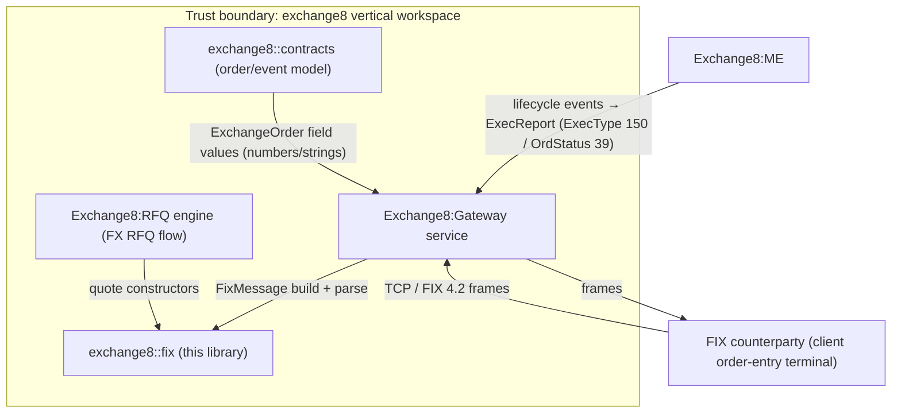
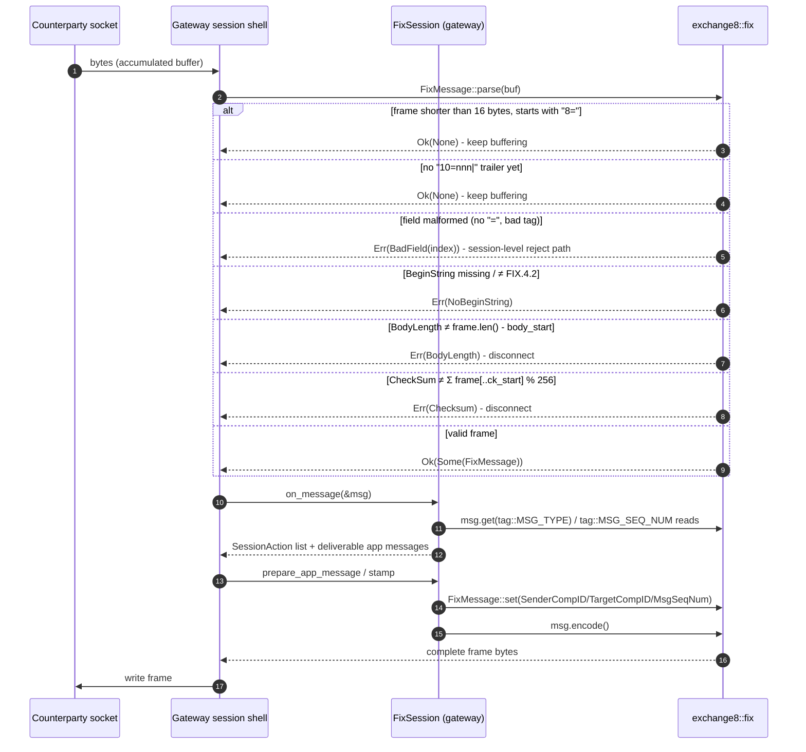
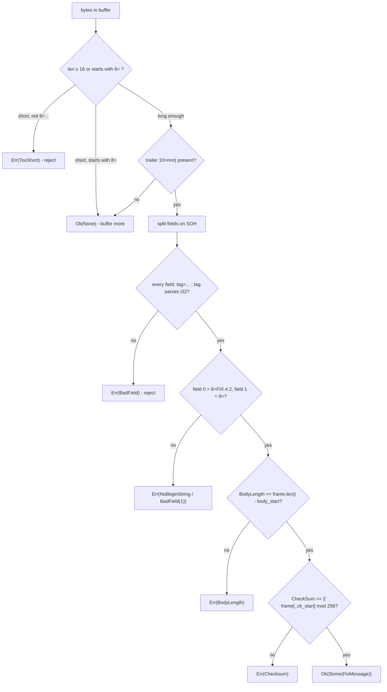
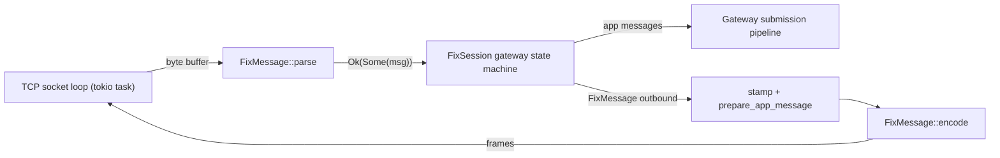
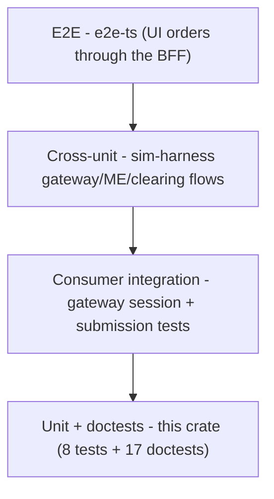

# exchange8::fix - Detailed Design Document

## 1. Scope & Context

### The library owns

- The FIX 4.2 tagvalue wire format: framing constants
  (`SOH`, `FIX_42_BEGIN_STRING`, heartbeat bounds), the complete-frame
  codec (`FixMessage::encode` / `FixMessage::parse`), the message value
  model (`FixMessage`), the MsgType (35) vocabulary (`msg_type`), the tag
  vocabulary (`tag` - standard, venue-dialect custom 6749-9730, FX quote
  family), and the parse-error taxonomy (`FixError`).
- The FX RFQ quote message shapes as constructors: `quote_request`,
  `quote`, `quote_accept`, `quote_status`.

### The library does NOT own (delegated to other units)

| Concern | Owner |
|---|---|
| FIX session state machine (logon, heartbeat scheduling, gap detection, ResendRequest serving, PossDup re-delivery, logout) | Exchange8:Gateway `services/gateway/src/session.rs` |
| FIX listener sockets / TCP framing extraction | Exchange8:Gateway service shell |
| Credentials & session authentication (session keys are Sentin8:Auth-issued) | Exchange8:Gateway + Sentin8:Auth |
| Order-field semantic validation (symbol resolution, risk, tick/lot) | Exchange8:Gateway submission pipeline + Exchange8:Risk |
| ExecutionReport field selection from ME events | Exchange8:Gateway `exec_report.rs` |
| Price/quantity scaled-decimal arithmetic | `exchange8::fixed` (values cross as strings only) |
| FIX 5.0 / FIXT session negotiation (`FixVersion`) | Exchange8:Gateway `submission.rs` |
| ITCH / OUCH / stamp byte protocols | `exchange8::itch`, `exchange8::ouch` (gateway), `exchange8::stamp` |
| Persistence of session counters / resend store | Exchange8:Gateway tables (`exchange8_fix_session_state`, `exchange8_fix_message`) |

### System context



Container-level note: as a library, `exchange8::fix` runs **inside**
Exchange8:Gateway's process - there is no separate deployment, database, or
network surface. The container diagram is therefore the process-internal
component view in §2.

## 2. Runtime Architecture

There is no runtime of its own: the crate is linked into its consumers and
executes synchronously on the caller's stack. Internally it is five public
items plus three private helpers.

### Module map

| Unit | Visibility | Role |
|---|---|---|
| `FixMessage` | public | Ordered `(tag, value)` field list + `encode`/`parse` + accessors + FX quote constructors |
| `msg_type` | public module | MsgType (35) `&str` constants |
| `tag` | public module | Tag-number `i32` constants (std / dialect / FX sections) |
| `FixError` | public enum | Parse failure taxonomy (`thiserror`) |
| `SOH`, `FIX_42_BEGIN_STRING`, heartbeat consts | public consts | Framing/session constants |
| `checksum(&[u8])` | private fn | Modulo-256 byte sum |
| `find_body_start(&[u8])` | private fn | Offset after the second SOH |
| `find_checksum_start(&[u8])` | private fn | Trailer position (`10=` + 3 digits + SOH; fallback scan) |

### Parse → use → encode lifecycle

One full round in the gateway session loop. Error and buffering branches
are drawn explicitly - they are part of the contract.



## 3. Data Model

The library owns no tables. Its data model is two value shapes: the
in-memory message list and the on-wire frame layout.

### In-memory model

| Structure | Shape | Notes |
|---|---|---|
| `FixMessage.fields` | `Vec<(i32, String)>` | Wire order; repeating tags stored as repeated entries; values lossy-UTF-8 |
| `FixError` | `enum` | `TooShort` / `NoBeginString` / `BadField(usize)` / `BodyLength { declared, computed }` / `Checksum { declared, computed }` |
| constants | `u8` / `&str` / `u32` | `SOH = 0x01`, `FIX_42_BEGIN_STRING = "FIX.4.2"`, heartbeat 30 default / 10 min / 120 max |

### FIX 4.2 tagvalue wire format (as implemented)

```
Offset  Field            Bytes
------ ------------ -------------------------------
start   BeginString      "8=FIX.4.2" + SOH
next    BodyLength       "9=<len>" + SOH       (len = body + 7)
next    MsgType          "35=<MsgType>" + SOH  (hoisted first in body)
body    app fields       "<tag>=<value>" + SOH (stored order)
end     CheckSum         "10=<nnn>" + SOH      (nnn = Σ before 10= % 256)
```

Validation gate on `parse`: field 0 = tag 8 = `FIX.4.2`; field 1 = tag 9
(else `BadField(1)`); `declared == frame.len() - body_start` (the trailer
included); CheckSum equality. Failure of any gate returns the matching
`FixError` - see §6.

### Vocabularies

- `msg_type`: `0` Heartbeat, `1` TestRequest, `2` ResendRequest, `3`
  Reject, `4` SequenceReset, `5` Logout, `A` Logon, `D` NewOrderSingle,
  `F` OrderCancelRequest, `G` OrderCancelReplaceRequest, `H`
  OrderStatusRequest, `8` ExecutionReport, `9` OrderCancelReject, `j`
  BusinessMessageReject, `R` QuoteRequest, `s` Quote, `aj` QuoteResponse,
  `AJ` QuoteStatusReport.
- `tag`: standard FIX 4.2 tags 1-373 as used by the gateway; venue-dialect
  custom tags 6749-9730 (UMIR identity/program-trade cluster 6749-6763,
  bypass/protection 6791-6821, book/match 6888-6889, display/routing
  9303-9501, liquidity 9730); FX quote tags 131, 299, 693, 694, 537, 297,
  132, 133, 62, 64, 15, 38, 193, 32.
- FX message shapes: `quote_request` sets 35=R + QuoteReqID(131), 55
  symbol, 54 side, 38 qty, 58 tenor; `quote` sets 35=s + 131/299/55/132/
  133/537(=1)/38/62 + optional 64; `quote_accept` sets 35=aj + 131/299/
  694(=0); `quote_status` sets 35=AJ + 131/297/299 + optional 58 reason.

## 4. API Surface

Library crate - no HTTP, no endpoints, no bus events. The public API
inventory:

| Item | Signature (essentials) | Used by |
|---|---|---|
| `FixMessage::new()` | `-> Self` | Any consumer |
| `FixMessage::typed` | `(msg_type: &str) -> Self` | Gateway session engine |
| `FixMessage::set` | `(&mut self, tag: i32, value: impl ToString) -> &mut Self` | Gateway (stamp SeqNum/CompIDs), quote constructors |
| `FixMessage::get` | `(&self, tag: i32) -> Option<&str>` | Gateway dispatch/parse reads |
| `FixMessage::msg_type` | `(&self) -> Option<&str>` | Gateway dispatch |
| `FixMessage::as_i64` | `(&self, tag_no: i32) -> Option<i64>` | Numeric field reads |
| `FixMessage::encode` | `(&self) -> Vec<u8>` | Session shell writes |
| `FixMessage::parse` | `(frame: &[u8]) -> Result<Option<FixMessage>, FixError>` | Session shell reads |
| `FixMessage::quote_request` | `(quote_req_id, symbol, side, qty: u64, tenor) -> Self` | FX RFQ client flow |
| `FixMessage::quote` | `(quote_req_id, quote_id, symbol, bid_px, offer_px, qty: u64, valid_until, settl_date: Option<&str>) -> Self` | FX RFQ venue flow |
| `FixMessage::quote_accept` | `(quote_req_id, quote_id) -> Self` | FX RFQ client hit |
| `FixMessage::quote_status` | `(quote_req_id, quote_id, status, reason: Option<&str>) -> Self` | FX RFQ terminal states |
| `FixError` | `enum` (5 variants) | Frame-accept decision |
| `SOH` | `pub const u8` | Gateway framing checks (e.g. exec-report tests) |
| `FIX_42_BEGIN_STRING` | `pub const &str` | BeginString comparisons |
| `DEFT_HEART_BT_INT` / `MIN_HEART_BT_INT` / `MAX_HEART_BT_INT` | `pub const u32` | Logon heartbeat negotiation clamps |
| `msg_type` | `pub mod` (18 constants) | Session/admin/app/quote MsgType selection |
| `tag` | `pub mod` (~80 constants) | Field addressing |

Consumers reach these through the workspace facade: `use
exchange8::fix::{FixMessage, msg_type, tag, …}` (`sdk/rust/exchange8`
re-exports `exchange8_fix as fix`); Exchange8:Gateway declares the
`exchange8-fix` workspace dependency directly.

## 5. Cross-Cutting Concerns

### Wire fidelity

- Encode and parse are exact inverses on the framing contract: an
  `encode`→`parse` round-trip yields identical field content (round-trip
  unit test owns this invariant).
- BodyLength covers the CheckSum trailer (`body + 7`); CheckSum is the
  modulo-256 sum of everything before `10=`. These are the platform wire
  spec's numbers (`design/behavior-catalog/wire-formats.json`) and are
  pinned by tests (`encode_parse_round_trip`, checksum-corruption tests).
- Trailing delimiter: every frame ends with a SOH after the CheckSum -
  the checksum locator relies on this to distinguish a complete frame from
  a partial one.

### Precision

- No numeric conversion happens inside the codec: prices and quantities
  cross as strings. Scaled-decimal arithmetic (`i128`/`u64` with scales)
  is `exchange8::fixed` territory; the gateway converts at its boundary.
  The codec therefore never rounds or re-scales a counterparty value.
- `String::from_utf8_lossy` in parse means invalid UTF-8 in a value
  replaces bytes with the replacement character rather than failing
  framing - values are validated by the semantic layer, framing by the
  codec.

### Message-validation posture

- The codec validates **framing** (structure, length, checksum), never
  **meaning** (required fields per MsgType, enumerations). A semantically
  empty `8=FIX.4.2|9=16|35=8|...10=|` frame parses fine; order-field
  validation is the gateway submission pipeline's jurisdiction. This split
  is deliberate: it keeps the codec reusable for dialect variants and
  keeps the 8-step authorization pipeline (Gateway) as the single semantic
  gate.
- Session protocol gating (message before logon, low sequence, gaps) is
  likewise outside the codec - `FixSession` in the gateway performs it on
  the parsed message.

### Concurrency note for callers

`FixMessage` is `Send` (owned `Vec<(i32, String)>`); the codec methods
take `&self` / `&[u8]` and mutate nothing shared. Calls are pure and
re-entrant; no global state exists.

## 6. Failure Modes & Recovery

As a library the crate cannot crash, retry, or lose data - failure
signalling is `Result<Option<_>, FixError>` and recovery is the consumer's
policy. The full taxonomy and its meaning for the session loop:

| Variant | Trigger | Gateway recovery |
|---|---|---|
| `Ok(None)` (not an error) | < 16 bytes starting with `8=`, or no `10=nnn|` trailer yet | Accumulate more bytes and re-parse |
| `TooShort` | < 16 bytes and not starting with `8=` | Non-FIX garbage - reject at the framing layer |
| `NoBeginString` | Field 0 missing/mis-typed/wrong version | Protocol mismatch - the shell's logout decision |
| `BadField(index)` | Field without `=`, non-numeric tag; field 1 not `9=` | Session-level reject (`35=3`) or disconnect per gateway dialect |
| `BodyLength` | Declared ≠ computed (includes trailer) | Framing corruption - disconnect |
| `Checksum` | Declared ≠ Σ % 256 | Byte corruption in transit - disconnect; peer re-sends |



Malformed-framing branch semantics (gateway session loop contract):

- `Err(...)` is a **hard structural reject** - the gateway drops the frame
  and applies its dialect (session Reject for recoverable defects,
  disconnect for length/checksum corruption). No half-parsed message
  reaches the business layer.
- `Ok(None)` is **not** an error - the shell keeps the buffer and retries
  after more bytes arrive (a frame may legitimately arrive across TCP
  segments).

## 7. Concurrency & Performance Model

- **No tasks, locks, channels, or pools.** The crate has no interior
  state; every call is a pure transformation on caller-owned data.
- **Async context**: methods are synchronous plain functions; callers
  invoke them from tokio tasks on raw byte slices - no async runtime
  interaction, no `await` points, no blocking risk.
- **Allocation profile**: `parse` allocates one `String` per field value;
  `encode` allocates one body buffer plus one frame buffer
  (`Vec::with_capacity(32 + body.len())` for the frame). No per-call
  temporary string formatting beyond the field serialization.
- **Hot path**: `get` is a linear first-match scan of the field list -
  FIX bodies are small (tens of fields), so `O(n)` find is fast in
  practice and cache-friendly; no index/hash is maintained (correctness
  and order preservation preferred over `O(1)` lookup at this `n`).
- **Frame sizing**: message sizes are bounded by the gateway's order-flow
  profile (order entry is a few dozen fields); worst-case frames stay in
  the low KB even with repeating groups.

Component view of the in-process pipeline (all inside the gateway's
process):



## 8. Invariants, Insecure-Defaults Rejected, Unsafe Rationale

**Invariants (always true)**

1. Every `Some(FixMessage)` returned by `parse` passed BeginString,
   BodyLength, CheckSum validation, in that order.
2. Every frame from `encode` ends with `10=nnn` + SOH and its BodyLength
   equals body + 7; re-parsing it succeeds with identical fields.
3. BodyLength/CheckSum present in a field list are never re-emitted stale;
   both are recomputed from the body.
4. `set` replaces the first occurrence in place or appends; field order is
   otherwise never rearranged (tag 35 is hoisted only at encode time).
5. No `Err` return is ever accompanied by a partially decoded message.
6. The crate contains no `unsafe`; soundness needs no invariants beyond
   Rust's standard guarantees. (Byte slices are read-only; values are
   produced via `from_utf8_lossy`, never unchecked casts.)

**Insecure-defaults rejected**

- No plaintext-credential handling: tag 98 (EncryptedMethod) is a marker
  constant only; logon credentials ride the transport's secure channel
  (Sentin8 session keys), never reconstructed from codec fields.
- No "trust declared length/ checksum" mode: a consumer cannot opt out of
  length/checksum validation to gain throughput - the checks are
  unconditional, so a corrupted frame can never be decoded and processed.
- No permissive BeginString acceptance: parse accepts exactly
  `FIX.4.2`; version negotiation for other dialects is the session layer's
  explicit decision (Exchange8:Gateway `FixVersion`), not a codec default.

## 9. Testing Strategy

Ownership: this library's correctness is pinned by its own unit tests
(8 in-crate tests + 17 doctests) and exercised end-to-end by Exchange8:Gateway's
session tests (logon/gap/resend flows) and by the workspace `sim-harness`
test flows. The codec deliberately does not re-test semantic order
validation (gateway submission pipeline) or session sequencing (gateway
session tests).

| Layer | Location | Owns |
|---|---|---|
| Unit (`#[test]`) | `crates/fix/src/lib.rs` `mod tests` | Round-trip encode/parse with order fields; partial-frame `Ok(None)`; corrupt-checksum rejection; BodyLength-mismatch rejection (checksum recomputed to isolate the failure); custom-tag round trip (BOOK_CODE/PROTECTION/POST_ONLY) with absent-tag `None`; FX quote-family round trips (R/s/aj/AJ with tag content assertions) |
| Doctests | `//!` crate docs + `///` item examples | Compilable public-API usage snippets (quick-start, encode/parse, accessors, quote constructors, error taxonomy) |
| Consumer integration | `services/gateway` session/submission tests | Real session flows (logon negotiation clamps, gap queue + ResendRequest, resend PossDup/GapFill serving), exec-report framing checks (SOH placement) |
| E2E | `e2e-ts/` (platform) | Human-visible order entry through the BFF/UI, not the wire codec |
| Cross-unit parity | `crates/sim-harness` | Gateway→ME→Clearing order flows over the real codec |



Deliberately NOT tested here: FIX 5.0 framing (not negotiated on this
codec's path), transport/TCP behaviour, session sequence semantics, and
order-semantic validation - each belongs to its owning unit (gateway
shell, gateway session, gateway submission).

## 10. Open Questions

- **Multi-version framing**: whether to extend this codec to `FIXT.1.1`
  frames (headers grow to 49/56-in-body) once a FIX 5.0 order-entry
  consumer materializes, or to accept the gateway's current approach
  (5.0 negotiation at the session layer, 4.2 frames on this codec).
- **Repeating-group API**: repeated tag entries round-trip today, but a
  first-class group reader/writer (e.g. NoContraBrokers on fills) may be
  required as reporting richness grows.
- **Trailer strictness**: the checksum locator's fallback scan tolerates
  non-canonical trailing `10=` placements; tightening this risks
  interop friction with counterparty dialects - an interop decision, not
  an implementation one.
- **Binary encodings**: SBE/FAST are out of scope for this vertical's
  current surface; if a market-data-grade binary path is ever required to
  the counterparty, that is a sibling codec, not an extension of this one.

---

**Architecture & Design:** exchange8:fix and its underlying concepts were designed by [Hamid Jahanzad](https://www.linkedin.com/in/hamidjahanzad/).
