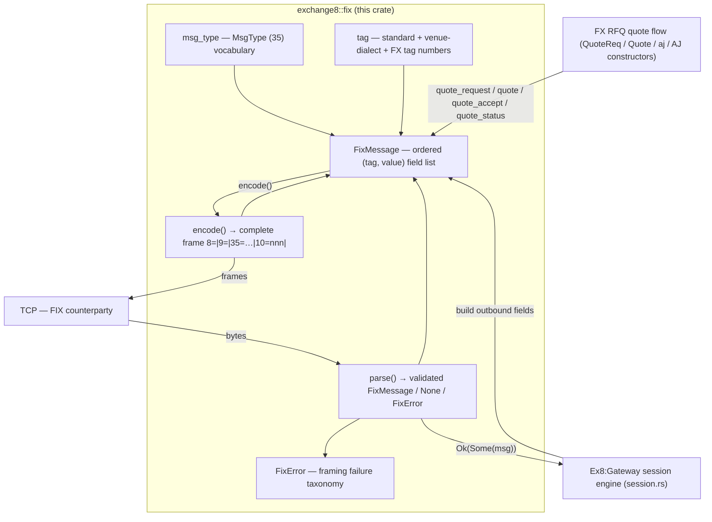

# README.md: exchange8::fix

## 1. Summary

`exchange8::fix` (crate `exchange8-fix`) is the minimal FIX 4.2 tagvalue
codec of the exchange8 vertical: it models a FIX message as an ordered
`(tag, value)` field list, writes complete wire frames, and reads byte
streams back into validated messages. It is a pure, synchronous, dependency
-light library (`thiserror` only) with no I/O, no session state, and no
persistence. Ex8:Gateway is the sole in-workspace consumer; it uses the
codec as the data plane of its FIX 4.2 order-entry sessions, plus the FIX
4.4 RFQ quote family constructors for the FX business.

## 2. Motivation

The FIX order-entry path needs one narrow guarantee: every byte written to
a counterparty socket must be a well-formed FIX 4.2 frame, and every frame
accepted from a counterparty must be validated before any of its fields are
acted on. Hand-rolling framing per session spreads the
`BodyLength`/CheckSum arithmetic across call sites, and every divergence
becomes a reconnect-storm or drop-reason incident. A single codec owns:

- the framing math (BodyLength covers the `10=` trailer; CheckSum is the
  modulo-256 byte sum of everything before `10=`);
- the header contract (8, 9, 35 in order, tag 35 hoisted ahead of the body);
- the MsgType and tag vocabularies (standard FIX 4.2, the venue-dialect
  custom tags 6749–9730, and the FX quote family);
- streaming-friendliness: a truncated but recognizable frame yields
  `Ok(None)` instead of an error, so callers simply keep buffering.

## 3. Architecture & High-Level Design

The crate is a data plane: stateless value construction plus two directional
transformations (encode, parse). The session state machine that decides
*what* to send and *whether* an inbound message is in sequence lives in
Ex8:Gateway's `session.rs` and consumes this crate through the workspace
facade (`exchange8::fix`).



## 4. Key Traits and Data Structures

- **`struct FixMessage`** — the single message representation: a
  `pub fields: Vec<(i32, String)>` in wire order. Derived
  `Debug/Clone/PartialEq/Eq/Default`. Schema-less by design; repeating
  groups are stored as repeated list entries.
  - `FixMessage::new()` — empty message.
  - `FixMessage::typed(msg_type)` — empty message with MsgType (35) preset.
  - `set(tag, value)` — set/replace the first occurrence of a tag; chains
    via `&mut Self`.
  - `get(tag)` / `msg_type()` / `as_i64(tag)` — first-occurrence accessors.
  - `encode()` — full frame write (framing recomputed, never trusted).
  - `parse(frame)` — full frame read with length + checksum validation.
  - FX quote constructors: `quote_request` (35=R), `quote` (35=s),
    `quote_accept` (35=aj), `quote_status` (35=AJ).
- **`pub const SOH: u8 = 0x01`** — the sole field delimiter on the wire.
- **`pub const FIX_42_BEGIN_STRING`** — `FIX.4.2`, the only accepted
  BeginString.
- **Heartbeat bounds** — `DEFT_HEART_BT_INT` (30 s default), `MIN_HEART_BT_INT`
  (10 s lower clamp), `MAX_HEART_BT_INT` (120 s upper clamp); the session
  shell (Ex8:Gateway) applies the clamps.
- **`pub mod msg_type`** — MsgType (35) string constants: session admin
  (`0`, `1`, `2`, `3`, `4`, `5`, `A`), order entry (`D`, `F`, `G`, `H`),
  lifecycle reports (`8`, `9`, `j`), and the FIX 4.4 FX RFQ family
  (`R`, `s`, `aj`, `AJ`).
- **`pub mod tag`** — FIX tag numbers as `i32` constants: the standard FIX
  4.2 tags the gateway speaks (1–373), the venue-dialect custom tags
  6749–9730 (`UMIR_*`, `BOOK_CODE`, `PROTECTION`, `ORDER_POST_ONLY`,
  `LIQUIDITY_FLAG`, …), and the FX quote tags (131/299/693/694/537/297/
  132/133/62/64/15/38/193/32).
- **`pub enum FixError`** — `TooShort`, `NoBeginString`, `BadField(index)`,
  `BodyLength { declared, computed }`, `Checksum { declared, computed }`
  (a `thiserror::Error`).

The FIX wire format as implemented:

```
8=FIX.4.2<SOH>9=<BodyLength><SOH>35=<MsgType><SOH><tag>=<value><SOH>…10=<nnn><SOH>
```

- `BodyLength` = body bytes **+ 7** (the `10=xxx`+SOH trailer).
- `CheckSum` = sum of all bytes before `10=`, modulo 256, three digits.

## 5. Rationale, Trade-offs, and Alternatives

- **Schema-less `Vec<(i32, String)>` over typed message structs.** Typed
  structs per `MsgType` would give compile-time field checking but would
  hard-code a schema for every message, freeze field order, and make
  venue-dialect tags and repeating groups awkward. The ordered field list
  round-trips any dialect verbatim; the codec stays identical for order
  entry, reports, and quotes. The trade: field-level mistakes surface at
  the consumer (Gateway validates order fields in its submission pipeline),
  not at codec compile time.
- **Single `String` values over typed values.** FIX is text on the wire;
  storing bytes as lossy UTF-8 strings keeps `get` allocation-free to a
  borrow and leaves number/string interpretation to the caller
  (`as_i64` as the typed escape hatch). No precision loss, no parsing
  surprises for identifiers that look numeric.
- **`Ok(None)` for `Option<FixMessage>` parse results.** A half-received
  frame is not an error — it is "keep buffering". Returning
  `Result<Option<_>, FixError>` lets the socket loop distinguish partial
  frames (`None`) from malformed frames (`Err`) without sentinel values.
- **Whole-frame `parse` over incremental header parsing.** Frames are small
  (dozens to hundreds of bytes) relative to the socket loop; locating the
  trailer first and parsing once is simpler and avoids mid-header state
  machine bugs. Rejected alternative: a streaming parser — unjustified
  complexity at the observed message sizes.
- **CheckSum recomputed, never trusted.** Encoding ignores any BodyLength/
  CheckSum already present in the field list, eliminating stale-digest
  corruption (a classic failure mode when messages are cached for resend).
- **No transport, no session state in the library.** Rejected alternative:
  a full FIX engine crate — Ex8:Gateway already owns sequence/resend/
  logout semantics against its DB-persisted counters; embedding session
  state in a codec would couple it to a transport and block the gateway
  testability (pure `FixSession` over an abstract transport).

## 6. Internal Implementation & Invariants (Private Design)

- **Encode pipeline**: body is built with tag 35 hoisted first; tags 9 and
  10 in the field list are skipped; `body_len = body.len() + 7`; header
  `8=FIX.4.2|9=len|` is written, body appended, checksum computed over
  everything written so far, and `10=%03u|` appended.
- **Parse pipeline**: (1) frames shorter than 16 bytes return `Ok(None)` if
  they start with `8=` (still possibly a valid frame prefix) else
  `TooShort`; (2) the `10=` trailer is located (`find_checksum_start` —
  exact tail match `10=nnn|`, falling back to the last `10=` occurrence for
  resend-restamped frames); a frame without a trailer yet returns `Ok(None)`;
  (3) fields are split on SOH, each requiring at least one `=` and a
  parseable integer tag, else `BadField(pos)`; (4) structural validation:
  field 0 is tag 8 with value `FIX.4.2`, field 1 is tag 9 (else
  `BadField(1)`); (5) BodyLength is compared with `frame.len() -
  body_start` (`find_body_start` = after the second SOH), mismatch →
  `BodyLength`; (6) CheckSum compared against the modulo-256 sum of
  `frame[..ck_start]`, mismatch → `Checksum`.

Invariants that are always true:

1. A message returned by `parse` (the `Some` arm) has passed BeginString,
   BodyLength, and CheckSum validation in that order.
2. `encode` output always ends with `10=nnn` + SOH and its declared
   BodyLength always equals `body.len() + 7`; re-parsing an `encode` frame
   succeeds with identical field content (round-trip invariant).
3. BodyLength and CheckSum fields present in a field list are never
   re-emitted as stored; both are recomputed.
4. `set` preserves field-list ordering for existing tags and appends new
   ones; `get`/`set`/`msg_type`/`as_i64` operate on the first occurrence.
5. Parse errors are pure data: no partial `FixMessage` is ever returned
   alongside an `Err`.
6. No allocation occurs per field beyond the value `String` itself; tag
   lookup is a linear first-match scan (small-N by FIX construction).

## 7. Unresolved Questions / Future Designs

- FIX 5.0 frames (`FIXT.1.1`) are negotiated at the session layer
  (Ex8:Gateway `submission.rs`); this codec's frames are always
  `FIX.4.2`-stamped. Whether a multi-BeginString codec belongs in this
  crate is a future design once a 5.0 order-entry consumer exists.
- Repeating groups (e.g. NoContraBrokers 382 on executions) are stored as
  repeated field entries but have no first-class group API; the gateway
  currently reads them by tag scans.
- The quote constructors set only the tags the FX flow needs today; full
  FIX 4.4 quote-message field coverage (e.g. no- leg repeats for
  multi-leg FX swaps beyond `FUT_SETT_DATE_2`) is a future design when a
  consumer requires it.
- `find_checksum_start`'s fallback scan accepts any trailing `10=nnn`
  occurrence rather than enforcing the strict trailer position on
  non-canonical counterparty framing; whether to harden this is an open
  interop question.

---

**Design attribution:** exchange8:fix and its underlying concepts were designed by Hamid Jahanzad <Hamid@Jahanzad.com>.
