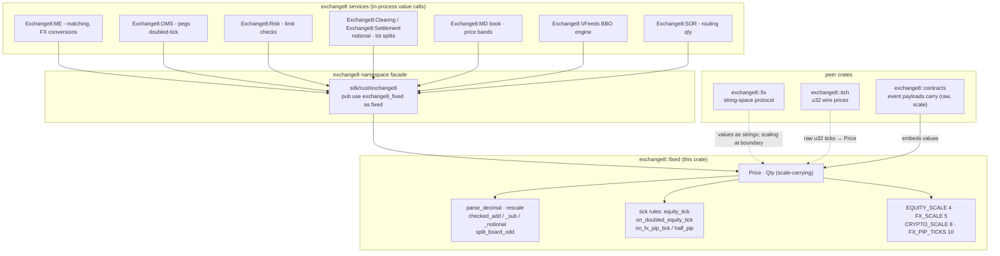
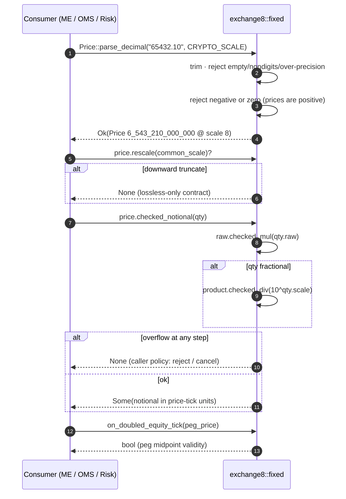
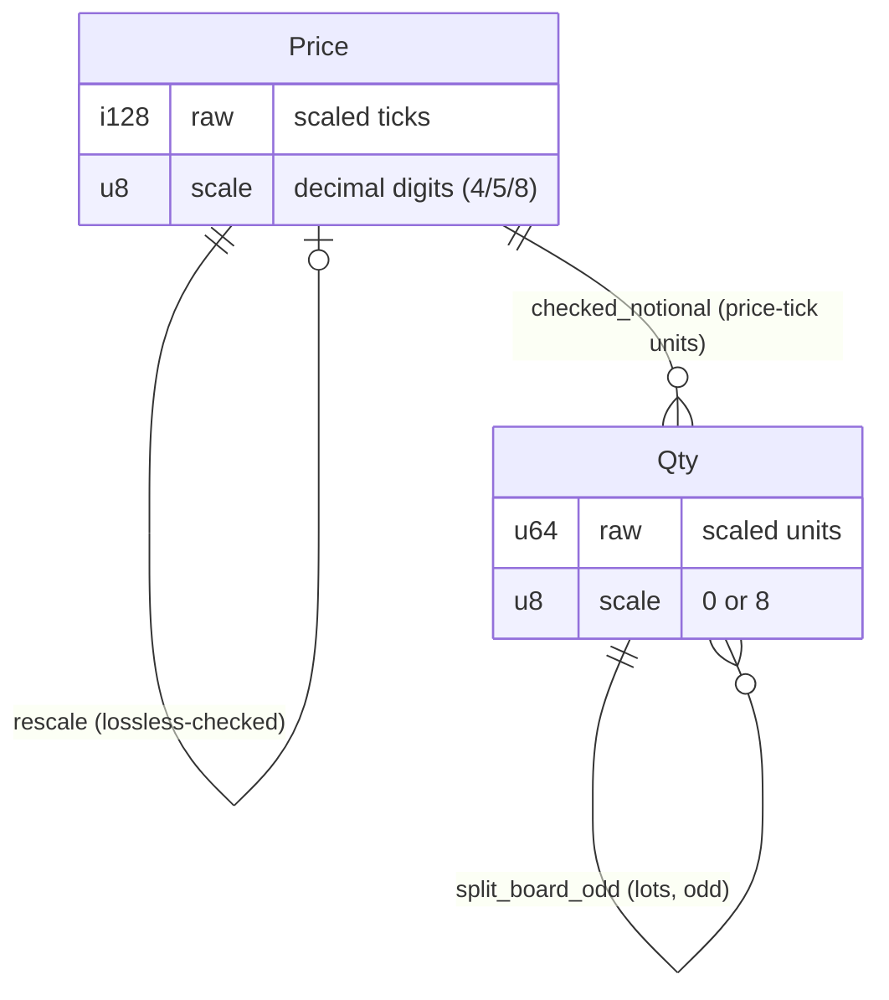
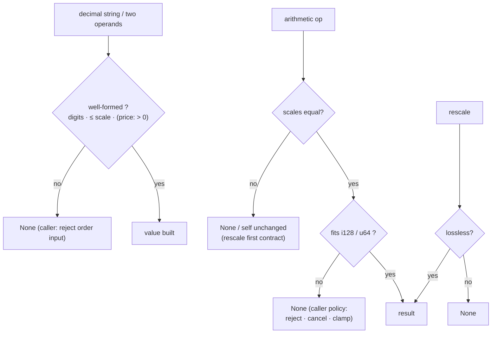
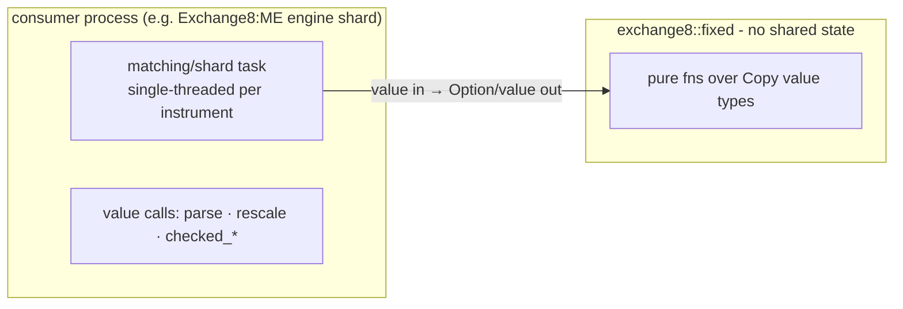
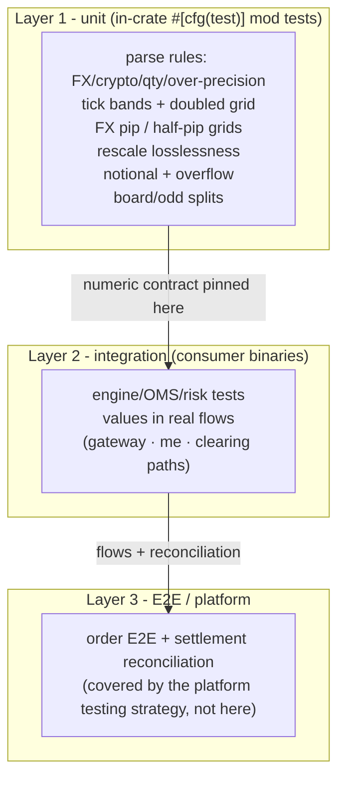

# exchange8::fixed - Detailed Design Document

## 1. Scope & Context

`exchange8::fixed` owns the exchange8 vertical's value number system: the
`Price`/`Qty` types, the per-asset-class scale conventions, lossless
rescaling, checked notional arithmetic, board/odd-lot decomposition, and the
tick-grid validation rules. It explicitly does **not** own:

- book state and matching - Exchange8:ME (`crates/book` models), not a value crate;
- order lifecycle and pegging rules - Exchange8:OMS (which *calls* the doubled-tick
  check);
- limit policy - Exchange8:Risk consumes the checked values;
- protocol string forms - FIX formatting is `exchange8::fix` (gateway
  boundary), venue text decoding is `exchange8::itch` (both convert at their
  edge);
- display - consumers render decimals.

There is no HTTP surface, no database presence, no event emission, no
runtime of its own: the crate is a pure value library compiled into the
facade `exchange8::fixed` (package `exchange8-fixed`, workspace member
`crates/fixed`) and statically linked into every consumer binary.

### System context

## 2. Runtime Architecture

The runtime-architecture section of the service template does not apply:
the library has no tasks, routers, workers, caches, or background jobs.
Its "architecture" is the module map of one file and the call shape the
consumers drive.

### Module map (`src/lib.rs`)

| Unit | Visibility | Responsibility |
|---|---|---|
| Scale constants (`EQUITY_SCALE`, `FX_SCALE`, `FX_PIP_TICKS`, `CRYPTO_SCALE`, `QTY_SCALE_INT`, `QTY_SCALE_FRAC`) | `pub const` | The asset-class precision conventions and the FX pip magnitude (10 raw units at scale 5 = 0.0001) |
| `pow10(exp: u8) -> i128` | `const fn` (private) | Checked 10ⁿ table; non-wrapping const loop |
| `Price` | `pub struct` | `raw: i128` ticks + `scale: u8`; constructors, checked ops, notional |
| `Qty` | `pub struct` | `raw: u64` + `scale: u8`; constructors, checked ops, lot split |
| Tick rules (`equity_tick`, `on_equity_tick`, `on_doubled_equity_tick`, `on_fx_pip_tick`, `on_fx_half_pip_tick`) | `pub fn` | Price-band validation functions |

### Core value path (parse → validate → compute)

## 3. Data Model

The library owns no tables. Its "data model" is the two value types and
their serialized boundary form.

| Structure | Fields | Boundary representation |
|---|---|---|
| `Price` | `raw: i128`, `scale: u8` | serde `(raw, scale)` pair; `raw` = decimal × 10^scale |
| `Qty` | `raw: u64`, `scale: u8` | serde `(raw, scale)`; scale 0 = integer board lots |

- Both types derive `Debug + Clone + Copy + PartialEq + Eq + Hash`
  (`Price` also `Serialize + Deserialize`); `Qty` additionally derives
  `PartialOrd + Ord` (rankable quantities for book ordering).
- Scale constants: equity 4 (10⁴), FX 5 (10⁵), crypto 8 (10⁸); quantity
  scales: integer (0) and fractional (8). `FX_PIP_TICKS` = 10 (= 0.0001
  at scale 5).
- No endianness, no alignment - the types are in-memory only; the wire
  forms live in protocol crates (`itch` carries `u32` ticks at a fixed
  venue scale; `fix` caries strings).

## 4. API Surface

Public API inventory (library audience: exchange8 services; no
authorization gate applies - there are no endpoints, scopes, or tenant
contexts to gate):

| Item | Kind | Contract |
|---|---|---|
| `EQUITY_SCALE` / `FX_SCALE` / `CRYPTO_SCALE` | consts | 4 / 5 / 8 decimal digits |
| `FX_PIP_TICKS` | const | 10 (= 0.0001 at scale 5) |
| `QTY_SCALE_INT` / `QTY_SCALE_FRAC` | consts | 0 / 8 |
| `Price::from_scaled(raw, scale)` | ctor | Already-scaled value (wire input) |
| `Price::equity(raw)` | ctor | Scale-4 shorthand |
| `Price::parse_decimal(s, scale)` | static | Rejects empty/nondigit/over-length/**non-positive** input; `Option` |
| `Price::rescale(to)` | method | Lossless both directions or `None`; upward always lossless |
| `Price::checked_add(rhs)` / `checked_add_ticks(ticks)` | methods | Scale-must-match / 1-tick step; `Option` |
| `Price::checked_notional(qty)` | method | Multiply-then-divide; result in **price-tick** units; `Option` |
| `Qty::ZERO` / `units(raw)` / `from_scaled(raw, scale)` | ctors | Integer-lot and scaled forms |
| `Qty::parse_decimal(s, scale)` | static | Rejects empty/nondigit/over-length; `Option` (zero IS valid for qty) |
| `Qty::checked_sub(rhs)` | method | Scale-matched subtraction; `None` on mismatch or underflow |
| `Qty::saturating_add(rhs)` | method | Saturating; mismatch returns self unchanged |
| `Qty::split_board_odd(lot)` | method | `(whole-lot count, odd-lot volume)`; fractional ⇒ all-odd |
| `equity_tick(price)` / `on_equity_tick(price)` | fns | ≥ $0.50 → 100 (1¢); else 50 (0.5¢) |
| `on_doubled_equity_tick(price)` | fn | Doubled grid for midpoint/peg prices |
| `on_fx_pip_tick(price)` / `on_fx_half_pip_tick(price)` | fns | Whole-pip / half-pip grids at scale 5 |

Emissions: none. The library emits no domain events and participates in no
outbox/trigger chain - the event-flow diagram of the service template does
not apply.

## 5. Cross-Cutting Concerns

Each service-template concern below is either answered for a pure library
or explicitly does not apply.

- **Determinism.** Same inputs → same outputs, always: no environment
  reads, no clock, no RNG, no locale-dependent parsing (ASCII-only digit
  validation).
- **Precision.** The crate IS the precision layer: scale carried in-band,
  lossless rescale only, multiply-before-divide notional, never floats.
  Rounding is never performed inside the crate - truncating conversions
  are refused.
- **Wire fidelity.** Not applicable at the value level - protocol string
  and binary forms belong to `fix`/`itch`/`stamp`; they convert to
  `Price`/`Qty` at their boundary via `parse_decimal`/`from_scaled`.
- **Idempotency / exactly-once.** Not applicable at the library level;
  replaying an event with identical values yields identical notionals
  (a property E2E settlement reconciliation relies on).
- **Authentication / authorization / RLS / tenant context / audit /
  rate limiting / drain / TLS.** Not applicable - no endpoints, no
  database, no sockets, no caller identity; statically linked in-process
  code.

## 6. Failure Modes & Recovery

The library performs no I/O; failure is value-level, deterministic, and
total - every arithmetic surface completes (`Some`/value) or refuses the
whole operation (`None`/unchanged), never partially.

- **Parse rejections** are the platform's order-gate: malformed client
  input surfaces as `None` at the service boundary, never as a defaulted
  tick.
- **Overflow policy** stays with the caller (reject order / cancel
  request / clamp accumulation); the crate guarantees the report.
- **Debug-scale assertions** in tick rules fire on programming error at
  the call site (wrong scale passed), not on user input.

## 7. Concurrency & Performance Model

- **`Copy` value types, no shared state.** `Price`/`Qty` are `Copy`,
  trivially `Send`/`Sync`, and all functions are pure - any number of
  threads or shards may call concurrently with zero synchronization.
- **Hot path.** Arithmetic is integer multiply/add/compare (`i128`
  native-width ops); `pow10` is a const-loop of ≤ 8 multiplies; parses
  are short ASCII scans. Notional is one `checked_mul` plus an optional
  `checked_div` - the matching engine's per-fill cost is negligible
  against book mechanics.
- **No allocation.** No `String` output, no `Vec` on the hot path;
  parse allocates nothing (string-slice walking only).
- **Task topology** is entirely the consumer's (per-shard single-threaded
  engines in Exchange8:ME; tokio tasks in services).

## 8. Invariants, Insecure-Defaults Rejected, Unsafe Rationale

**Invariants** (enforced structurally, by `debug_assert`, and by tests):

1. Prices are strictly positive; zero/negative never parse into a
   `Price`.
2. Scale is always carried in-band; two-operand operations refuse
   scale mismatch rather than merging.
3. All overflow-capable operations return `Option`; nothing wraps,
   nothing panics on input (debug asserts cover call-site misuse only).
4. Rescaling is lossless or refused - downward requires exact division.
5. Notional multiplies before dividing and is expressed in the price's
   tick units.
6. `split_board_odd(lots, odd)` satisfies `lots×lot_size + odd == qty`
   for scale-0 quantities.

**Insecure defaults rejected:**

- *Floating-point prices* - binary fractions misrepresent decimal ticks;
  reconciliation across services would drift. Rejected outright.
- *Auto-promoting scale merge* (e.g. always to 10⁸) - makes cross-class
  mixing silent, inflates magnitude, hides instrumentation bugs.
- *Wrapping / panicking arithmetic* - a wrapped notional is a solvency
  bug; a panic in the hot loop takes down a shard. Checked `Option`
  paths keep the failure typed and local.
- *Silent truncation on rescale* - a truncated price is a different
  price; refused instead.
- *Permissive decimal parse* (accept any digit count, clamp) - silently
  degrades user intent; rejected for strict rejection.

**Unsafe rationale:** none - the crate contains no `unsafe` blocks and
no FFI; everything is safe integer arithmetic over `i128`/`u64`.

## 9. Testing Strategy

- **Owned here (unit):** the numeric contract, in the crate's test module -
  FX parse + pip grids (`parse_fx_decimal`, `fx_pip_tick_rules`), crypto
  parse precision (`parse_crypto_decimal`), rescale losslessness
  (`rescale_up_lossless`), equity tick bands and doubled grid
  (`equity_tick_bands`), board/odd splits (`split_board_odd`), notional
  correctness + overflow (`notional_checked`), quantity parsing
  (`qty_parse`).
- **Deliberately NOT tested here:** matching/book/OMS/risk behavior
  (consumer crates), protocol string forms (`fix`/`itch`), and end-to-end
  money flows (platform testing strategy).
- **Run:** part of the vertical workspace gate - in `cargo test -p
  exchange8-fixed` inside `make build-rust`/test pipelines.

## 10. Open Questions

- **Per-instrument quantity scale** - whether refdata metadata should own
  quantity precision rather than the global 0/8 convention.
- **Decimal-string rendering** - a shared `Display`/`to_decimal_string`
  helper for consumers, keeping presentation formats uniform.
- **`saturating_add` mismatch policy** - returning `self` on scale
  mismatch is subtle; a `Result` return may be worth the churn.
- **Benchmarks** - matching-engine sizing quotes are transport-driven;
  no dedicated value-op benchmark harness exists in this crate yet.

---

**Design attribution:** exchange8:fixed and its underlying concepts were designed by Hamid Jahanzad <Hamid@Jahanzad.com>.
