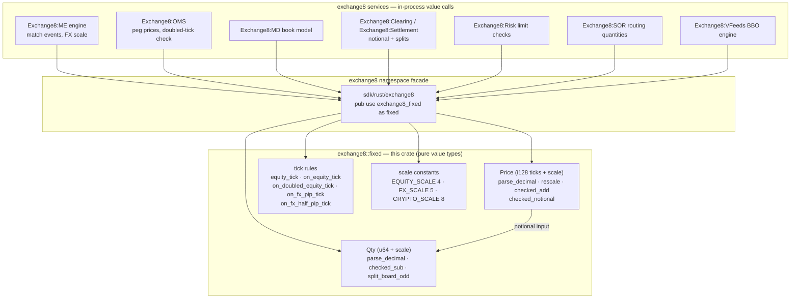

# README.md: exchange8::fixed

## 1. Summary

`exchange8::fixed` is the fixed-point numeric core of the exchange8 vertical.
It defines the two value types every market quantity flows through — `Price`
(an `i128` tick value plus a per-value decimal `scale`) and `Qty` (a `u64`
scaled quantity) — together with the per-asset-class scaling conventions
(equities ×10⁴, FX ×10⁵, crypto ×10⁸), checked notional arithmetic, and the
tick-size validation rules (equity band ticks, FX pip/pipette, doubled
midpoint ticks). It is a pure library: no I/O, no database, no endpoints, and
no process of its own.

## 2. Motivation

Money arithmetic on an exchange must never overflow silently, never mix
scales accidentally, and never round invisibly. Floating point is unusable
for prices (binary representation cannot express 0.05 exactly), and raw
integers without a scale are worse (a crypto price and an equity price would
be indistinguishable raw integers). The crate answers this with:

- **Scale-carrying values.** `Price` and `Qty` carry their decimal exponent
  in-band; a scale-4 price and a scale-8 price are different types of fact
  at runtime even though both are integers underneath. Rescaling is
  explicit and losslessness-checked.
- **Total arithmetic on `i128`.** Every operation that can overflow —
  addition, tick stepping, notional multiplication — is `checked_*` and
  returns `None` rather than wrapping.
- **Asset-class conventions in one place.** The scales (`EQUITY_SCALE` 4,
  `FX_SCALE` 5, `CRYPTO_SCALE` 8), the pips and tick grids, and the
  board-lot/odd-lot split rules are named constants and functions, so
  `book`, `me`, `oms`, `clearing`, `settlement`, `risk`, `sor`, `md`,
  and `vfeeds` never re-derive a scale or a tick locally.
- **Determinism.** No environment reads, no randomness: the same inputs
  produce the same value on every host, which replay and cross-service
  reconciliation depend on.

## 3. Architecture & High-Level Design

The crate is a single module (`src/lib.rs`) of value types and free
functions. Consumers import it through the `exchange8` facade as
`exchange8::fixed`; the matching-engine core, order management, book
models, and every service that prices an instrument call it in-process.

- **Values are dumb, consumers are smart.** The crate knows how to parse,
  rescale, compare, add, and multiply scaled integers; it knows nothing
  about orders, books, or venues.
- **The tick rules are tables, not heuristics** — equity sub-$0.50 half-cent
  bands and FX pip/pipette grids are encoded once and pinned by tests.
- **Scale discipline is manual but typed.** Mixing two scales returns
  `None` (or the caller rescales explicitly first); the platform never
  auto-normalizes.

## 4. Key Traits and Data Structures

No traits, no dispatch, no generics — two final value types and the rule
functions over them.

- **`Price`** — `raw: i128` (scaled ticks) + `scale: u8` (decimal digits).
  Constructors: `from_scaled` (already-scaled), `equity` (scale 4), and
  `parse_decimal` (a decimal string at any scale, rejecting negative,
  zero, over-length, and non-digit input). Operations: `rescale`
  (lossless-checked both directions), `checked_add`,
  `checked_add_ticks`, and `checked_notional` (price × qty, multiply-first
  divide-later, result expressed in the **price's** tick units).
- **`Qty`** — `raw: u64` + `scale: u8`. Constructors: `ZERO`, `units`
  (integer board lots), `from_scaled`, `parse_decimal`. Operations:
  `checked_sub` (scale-mismatch is `None`), `saturating_add`
  (scale-mismatch returns self unchanged), and `split_board_odd`
  (whole-lot count + odd-lot volume; fractional quantities are all-odd).
- **Scale constants** — `EQUITY_SCALE` (4), `FX_SCALE` (5), `CRYPTO_SCALE`
  (8), `FX_PIP_TICKS` (10 at scale 5 = 0.0001), `QTY_SCALE_INT` (0) and
  `QTY_SCALE_FRAC` (8).
- **Tick-rule functions** — `equity_tick` (≥ $0.50 → 1¢, else 0.5¢),
  `on_equity_tick`, `on_doubled_equity_tick` (midpoint/dark pegs may land
  on a half-tick, so validation doubles the grid), `on_fx_pip_tick`, and
  `on_fx_half_pip_tick`.
- **`Serialize`/`Deserialize`** — both value types derive serde; values
  cross service boundaries as `(raw, scale)` pairs.

## 5. Rationale, Trade-offs, and Alternatives

- **`i128` price + `u64` quantity instead of a fixed-width ticks type.**
  `i128` absorbs the worst-case product of two scale-8 operands
  (crypto notional) without overflow at realistic magnitudes, while
  remaining a plain integer that serde, debug printing, and SQL drivers
  handle. A dedicated newtype per asset class would have prevented
  scale-mismatch compile-time, but multiplied constructors across nine
  consumers for no runtime benefit — the per-value `scale` achieves the
  same with one type.
- **Scale-in-band rather than scale-in-type.** Rescaling is explicit
  (`rescale`) and only upward re-scaling is always lossless; downward
  rescale succeeds only when it divides exactly. An automatic
  common-denominator scheme (e.g. always promote to 10⁸) was rejected:
  it inflates storage and makes accidental cross-scale mixing *silent*
  rather than explicit.
- **`Option`-returning checked operators instead of panicking arithmetic.**
  A panic in the matching hot path aborts a whole book shard; every
  arithmetic surface therefore returns `None` on overflow or
  scale mismatch, and the error policy stays with the caller
  (reject/cancel/clamp).
- **Notional semantics: price-scale result, multiply-then-divide.** A
  notional expressed in price ticks keeps unit tracking trivial
  (price units × count), and multiplying before dividing keeps
  fractional-quantity precision (0.5 crypto BTC at a scale-8 price loses
  nothing). Dividing first would truncate half the precision.
- **`debug_assert` on scale in tick rules.** `equity_tick` and the FX
  rules assert the expected scale in debug builds and simply compute in
  release — the rules are meaningless at other scales, but the cost of a
  runtime branch on every tick check in the hot path was not worth it.
- **Rejected: floats.** No `f64`/`f32` exists anywhere in the crate;
  binary fractions cannot represent decimal tick grids exactly and would
  break cross-service reconciliation.

## 6. Internal Implementation & Invariants (Private Design)

- **`pow10` is a `const fn`** — a checked (non-wrapping) 10ⁿ loop used by
  parse, rescale, and notional; exponents beyond the scale constants
  (max 8) stay far inside `i128` headroom, but every multiplication in
  call sites is still `checked`.
- **Parse discipline** — both parsers trim, reject an empty integer part,
  validate every byte as an ASCII digit, reject more fractional digits
  than the scale, right-pad the fractional value, and (for prices)
  reject negatives and zero (exchange prices are strictly positive).
- **Rescale rounding is never silent** — downward rescale requires
  `raw % 10^(scale−to) == 0`; upward rescale multiplies step-by-step
  with `checked_mul`.
- **`split_board_odd` semantics** — returns `(whole-lot *count*,
  odd-lot *volume*)`; the count must be multiplied by the lot size to
  become board volume. A fractional quantity or a zero lot returns
  `(0, self)` — everything is odd.
- **Invariants held across the crate:**
  1. A `Price` is always strictly positive (`parse_decimal` rejects ≤ 0;
     direct constructors feed order-gate checks).
  2. Same-`scale` is a precondition of every two-operand operation;
     mismatch is `None` (or self, for `saturating_add`), never a merge.
  3. All overflow paths return `Option::None`; no wrapping, no panic on
     arithmetic input.
  4. Notional results carry the price's exponent, and the fractional
     qty divisor `10^qty.scale` divides only after the multiply.
  5. Tick rules are pure functions of the raw value — no per-instrument
     state, no lookup tables to go stale.

## 7. Unresolved Questions / Future Designs

- **Per-instrument quantity scale.** `QTY_SCALE_FRAC` (8) is a global
  convention; instruments that need a different fractional scale
  (e.g. 6-digit tokenized funds) would pass `scale` explicitly at
  construction today — whether a per-instrument metadata table should
  own the mapping is a refdata-level question.
- **Display/formatting layer.** The crate parses decimals but has no
  `Display` rendering (decimal-string output); presentation belongs to
  consumers today. A shared `to_decimal_string` helper is a candidate
  addition.
- **`saturating_add` scale-mismatch policy.** Returning `self`
  unchanged on mismatch is defensible for limit accumulation but subtle;
  a return-type change (e.g. `Result`) may be worth the churn.
- **U128 ceiling.** Crypto notional at max price × large fractional qty
  approaches `i128` limits; the checked paths already handle it, but
  whether far-future instrument classes need `u128` quantities is open.

---

**Design attribution:** exchange8:fixed and its underlying concepts were designed by Hamid Jahanzad <Hamid@Jahanzad.com>.
