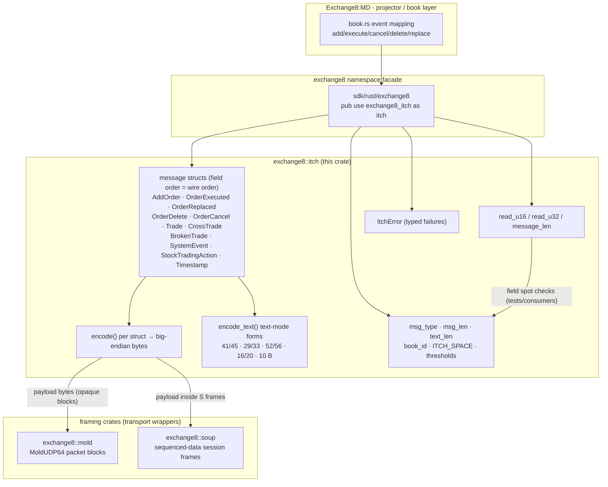
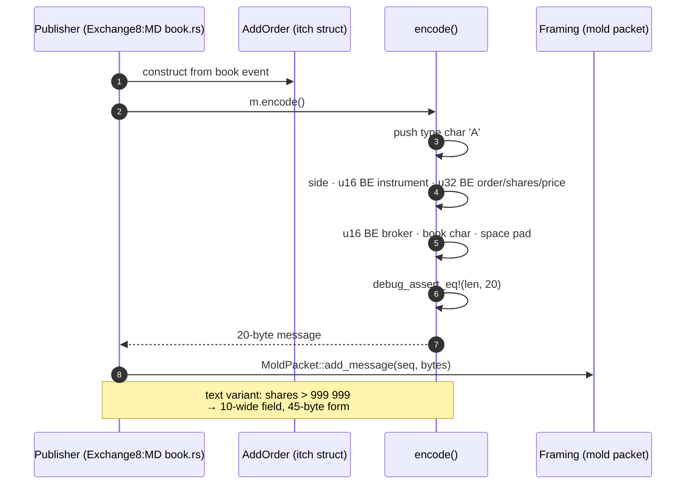
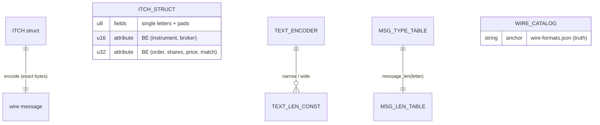
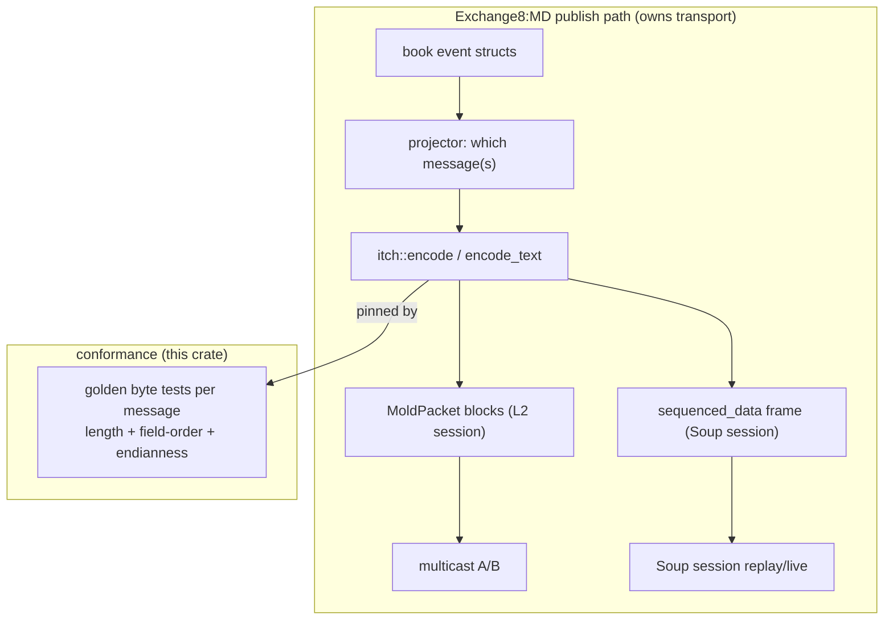
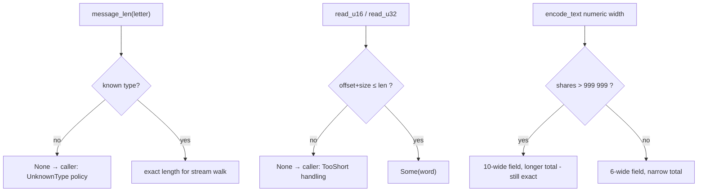
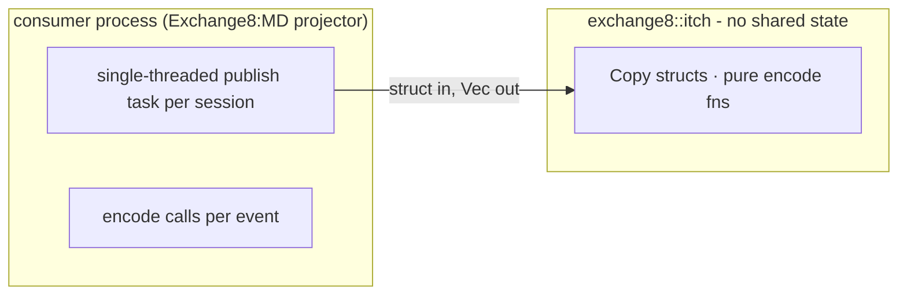
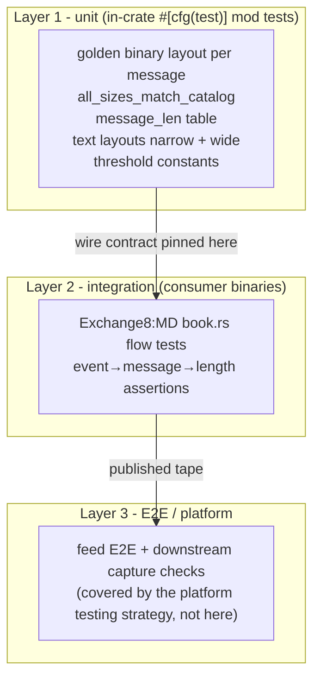

# exchange8::itch - Detailed Design Document

## 1. Scope & Context

`exchange8::itch` owns the exchange8 vertical's published-market-data
wire formats: the fourteen VER2 binary ITCH message layouts (adds,
executions, replaces, cancels, deletes, trades, crosses, busts, system
events, trading actions, directories, timestamp markers), the
text-mode families and their width-expansion rules, the safe big-endian
word readers, and the type→length table. It explicitly does **not** own:

- event→message policy - which internal event becomes which message is
  Exchange8:MD's projector (per the market-data design §4.2);
- transport - MoldUDP64 packets (`exchange8::mold`) and SoupBinTCP
  frames (`exchange8::soup`) carry ITCH bytes;
- numeric semantics - wire `u32` ticks ↔ `exchange8::fixed` conversions
  happen at the consumer boundary;
- the protocol dialect - this is the **proprietary VER2 layout**, not
  the standard NASDAQ ITCH 4.1 spec; `design/behavior-catalog/
  wire-formats.json` is the truth anchor.

There is no HTTP surface, no database presence, no event emission, no
runtime of its own: the crate is a pure codec compiled into the facade
`exchange8::itch` (package `exchange8-itch`, workspace member
`crates/itch`) and statically linked into consumer binaries.

### System context

## 2. Runtime Architecture

The runtime-architecture section of the service template does not apply:
the library has no tasks, routers, workers, caches, or background jobs.
Its "architecture" is the module map of one file and the encode/verify
call shapes the consumers drive.

### Module map (`src/lib.rs`)

| Unit | Visibility | Responsibility |
|---|---|---|
| `ITCH_SPACE` (`0x20`) | `pub const` | The universal pad byte (reserved fields, padding) |
| `book_id` (4 constants) | `pub mod` | Book identifiers: `D` dark pool, `L` lit, `Q` QLX, `O` MEMP (default) |
| `msg_type` (14 constants) | `pub mod` | Message letters `A E U D X T M S R r H P Q B` |
| `msg_len` (14 constants) | `pub mod` | Binary wire lengths (4 … 61 bytes, type char incl.) |
| `text_len` (9 constants) | `pub mod` | Text-mode lengths: 41/45, 29/33, 52/56, 16/20, 10 |
| `ITCH_MAX_SHARES_6` / `ITCH_MAX_PRICE_10` | `pub const` | Width-expansion thresholds (999 999 shares; 9 999 999 999 price) |
| Message structs (11) | `pub struct` | Field order == wire order; `Debug + Clone + Copy + PartialEq + Eq` |
| `encode()` per struct | `pub fn` | Struct → exact-length big-endian bytes (`debug_assert` on length) |
| `encode_text()` (AddOrder, OrderExecuted, Trade, OrderCancel, OrderDelete) | `pub fn` | Text-mode forms with 6/10-wide share expansion |
| `read_u16` / `read_u32` | `pub fn` | Safe big-endian reads returning `Option` |
| `message_len(type_char)` | `pub fn` | Type letter → expected length, `None` = unknown |
| `pad_num` / `pad_str` | private fn | Blank-pad right-aligned / left-aligned-clamped text fields |
| `push_u16` / `push_u32` / `push_pad3` | private fn | Encoder emit helpers |
| `ItchError { TooShort, UnknownType }` | `pub enum` | Typed failure surface |

### Core encode walk (binary) and text-width decision

## 3. Data Model

The library owns no tables. Its "data model" is the message structs and
their byte-exact wire encodings.

### Binary message inventory (VER2 layout, big-endian, from the wire catalog)

| Type | Struct | Bytes | Field order (after type char) |
|---|---|---|---|
| `A` | `AddOrder` | 20 | side `char`, instrumentId `u16`, orderId `u32`, shares `u32`, price `u32`, broker `u16`, bookId `char`, reserved `char` |
| `E` | `OrderExecuted` | 16 | marker `char`, contraBroker `u16`, orderId `u32`, shares `u32`, matchNumber `u32` |
| `U` | `OrderReplaced` | 20 | reserved `char[3]`, origOrderId `u32`, orderId `u32`, shares `u32`, price `u32` |
| `D` | `OrderDelete` | 8 | reserved `char[3]`, orderId `u32` |
| `X` | `OrderCancel` | 12 | reserved `char[3]`, orderId `u32`, shares `u32` |
| `T` / `M` | `Timestamp` (kind passed to `encode`) | 8 | reserved `char[3]`, second/milliSecond `u32` |
| `S` | `SystemEvent` | 4 | systemEvent `char`, reserved `char[2]` |
| `R` | StockDirectory | 32 | (vocabulary present; no dedicated struct today) |
| `r` | ExtendedStockDirectory | 61 | (vocabulary present; no dedicated struct today) |
| `H` | `StockTradingAction` | 4 | tradingState `char`, instrumentId `u16` |
| `P` | `Trade` | 24 | bookId, instrumentId `u16`, orderId `u32`, shares `u32`, price `u32`, matchNumber `u32`, broker `u16`, contraBroker `u16` |
| `Q` | `CrossTrade` | 24 | crossType, instrumentId `u16`, shares `u32`, price `u32`, matchNumber `u32`, buyBroker `u16`, sellBroker `u16`, bookId, bypass, reserved `char[2]` |
| `B` | `BrokenTrade` | 8 | reserved `char[3]`, matchNumber `u32` |

### Text-mode families (blank-padded, `%Nu`-width fields)

| Family | Narrow | Wide (shares > 999 999) |
|---|---|---|
| AddOrder | 41 (`%1c%9u%1c%6u%-10s%10lu%3u%1c`) | 45 (10-wide shares) |
| OrderExecuted | 29 (`%1c%9u%6u%9u%3u%1c`) | 33 |
| Trade | 52 (`%1c%9u%1c%6u%-10s%10lu%9u%3u%3u`) | 56 |
| OrderCancel | 16 (`%1c%9u%6u`) | 20 |
| OrderDelete | 10 (`%1c%9u`) | (no expansion - id field is fixed 9) |

## 4. API Surface

Public API inventory (library audience: exchange8 services; no
authorization gate applies - there are no endpoints, scopes, or tenant
contexts to gate):

| Item | Kind | Contract |
|---|---|---|
| `ITCH_SPACE` | const | `0x20` pad byte |
| `book_id::{DARK_POOL, LIT, QLX, MEMP}` | consts | `D`/`L`/`Q`/`O` |
| `msg_type::*` (14 letters) | consts | Message type letters |
| `msg_len::*` (14 lengths) | consts | Exact binary wire lengths |
| `text_len::*` (9 lengths) | consts | Text-mode lengths (incl. wide variants) |
| `ITCH_MAX_SHARES_6` / `ITCH_MAX_PRICE_10` | consts | 999 999 / 9 999 999 999 width thresholds |
| 11 message structs | struct | Field order == wire order; `Copy` value types |
| `<struct>::encode() -> Vec<u8>` | method | Byte-exact serialization with `debug_assert` length check |
| `AddOrder/OrderExecuted/Trade/OrderCancel/OrderDelete::encode_text()` | method | Text-mode wire; 6↔10-wide share expansion |
| `Timestamp::encode(kind)` | method | `T` (seconds) or `M` (millis) form selection by caller |
| `read_u16(buf, off) / read_u32(buf, off)` | fns | Safe BE reads → `Option` |
| `message_len(type_char) -> Option<usize>` | fn | Length table; `None` for unknown letters |
| `ItchError { TooShort, UnknownType }` | enum | Whole failure surface; `Display` part of contract |

Emissions: none. The library emits no domain events and participates in
no outbox/trigger chain - the event-flow diagram of the service template
does not apply.

## 5. Cross-Cutting Concerns

Each service-template concern below is either answered for a pure library
or explicitly does not apply.

- **Deterministic outcomes.** Same struct → same bytes, always; no
  environment, clock, or RNG (timestamp values are caller-supplied,
  never read from a clock here).
- **Wire fidelity.** All multi-byte integers are **big-endian**
  (`network byte order`); reserved padding is `0x20`; every encoder
  `debug_assert`s its catalog length. Golden tests pin byte values
  field-by-field against the wire catalog.
- **Precision.** The crate re-derives nothing: prices are venue-scale
  `u32` ticks exactly as published; conversion to/from
  `exchange8::fixed` semantics happens in consumers (`from_scaled`).
- **Idempotency / exactly-once.** Not applicable at the codec level -
  match numbers and order ids carry the platform's identities; dedupe
  and replay sequencing are the publisher's session semantics.
- **Authentication / authorization / RLS / tenant context / audit /
  rate limiting / drain / TLS.** Not applicable - no endpoints, no
  database, no sockets, no caller identity; statically linked
  in-process code.

## 6. Failure Modes & Recovery

The library performs no I/O; failure is value-level: encoders are total
(structs are complete values), and the only fallible surface is the
length table and word readers.

- **No partial messages.** Encoders build the exact-length buffer in one
  pass with a `debug_assert` guard; a malformed struct cannot produce a
  wrong-length message in debug builds and never truncates in release.
- **Unknown types.** `message_len` returns `None` rather than guessing -
  a stream walker must stop or skip by policy, never by invented length.
- **Caller-side recovery.** Receive-side handling (unknown letters in a
  live stream, short buffers at a stream tail) belongs to the consumer;
  the codec supplies the typed signals.

## 7. Concurrency & Performance Model

- **`Copy` structs, no shared state.** Every message struct is
  `Copy + Send + Sync`; encode functions are pure - any number of tasks
  may encode concurrently with zero synchronization.
- **Allocation profile.** One small `Vec` per encoded message,
  `with_capacity(msg_len)` pre-sized - no reallocation on the hot path.
  Text encoders build one `String` at the exact final width.
- **Hot path.** Encode is sequential byte pushes + BE byte-array appends;
  a debug length assert is compiled out in release. Text encoders add a
  single threshold branch (`6`-vs-`10` wide) per message.
- **Throughput posture.** Feed sizing (~4k msg/s per published session)
  is transport-driven; per-message codec cost is negligible against
  framing/socket work inside the projector's existing task budget.

## 8. Invariants, Insecure-Defaults Rejected, Unsafe Rationale

**Invariants** (pinned by golden tests; debug-asserted in encoders):

1. The type letter is byte 0 of every message (binary and text).
2. Every binary message is exactly its `msg_len` constant; every text
   form its `text_len` (narrow or wide by the shares threshold).
3. All multi-byte numerics are big-endian; all reserved/pad bytes are
   `ITCH_SPACE`.
4. Struct field order equals wire order - encoders emit fields in
   declaration order, so the struct is the layout's single source.
5. Width expansion is a pure function of the numeric threshold
   (999 999), consistent across all five text families.
6. `message_len` maps every `msg_type` letter exactly once; unknown
   letters return `None`.

**Insecure defaults rejected:**

- *Standard-spec compliance drift* (encoding NASDAQ ITCH 4.1 shapes
  instead of the VER2 layout) - would break every external consumer
  pinned to the venue dialect; the catalog is the truth, the public spec
  is not.
- *Runtime length recomputation* (formatting with `format!` into a
  dynamic buffer) - risks drift; fixed `with_capacity` + debug assert
  pins total sizes.
- *Guessing lengths for unknown types* - poisons stream walk-throughs;
  `None` + typed error path instead.
- *Zero padding* - the venue dialect pads reserved fields with spaces
  (0x20); zero bytes would break consumer golden checks.
- *Interpreting prices inside the codec* - the wire `u32` is echoed
  verbatim; scale semantics belong to `exchange8::fixed` at the
  boundary.

**Unsafe rationale:** none - the crate contains no `unsafe` blocks and
no FFI; all byte assembly is safe `Vec`/slice operations.

## 9. Testing Strategy

- **Owned here (unit):** per-message golden byte assertions -
  `add_order_golden_bytes`, `order_executed_golden_bytes`,
  `trade_and_cross_golden_bytes`, `all_sizes_match_catalog`,
  `message_len_table`, `spot-check` big-endian ordering; text-mode
  layouts - `text_add_order_layout`, `text_add_order_wide_shares_variant`,
  `text_order_executed_layout`, `text_order_executed_wide_variant`,
  `text_trade_layout`, `text_order_cancel_layout` (+ wide),
  `text_order_delete_layout`, and `text_length_constants_match_spec`
  (pins the whole text block). All tests are pure byte assertions.
- **Deliberately NOT tested here:** transport framing (`mold`/`soup`),
  event→message policy (Exchange8:MD), and end-to-end feed flows
  (platform-level).
- **Run:** part of the vertical workspace gate - inside
  `cargo test -p exchange8-itch` in the workspace test pipeline.

## 10. Open Questions

- **Full binary decode structs.** Word readers `read_u16`/`read_u32`
  exist for stream walk-throughs; dedicated per-message decode structs
  (directory/extended-directory in particular) await the receive-path
  consumer that would use them.
- **Text-mode retirement policy.** The text-mode encoders are wired
  for consumers that parse them; retiring them is an integration-census
  decision, not a codec one.
- **Directory field modeling.** `StockDirectory`/`ExtendedStockDirectory`
  vocabulary is length-pinned; field-level structs (round-lot size,
  shortable, ISIN…) are unmodelled pending consumer demand.
- **Cross-type semantics docs.** The cross/bypass letter meanings are
  preserved verbatim; a business-readable cross-type table belongs to
  the MD service design rather than this codec.

---

**Design attribution:** exchange8:itch and its underlying concepts were designed by Hamid Jahanzad <Hamid@Jahanzad.com>.
