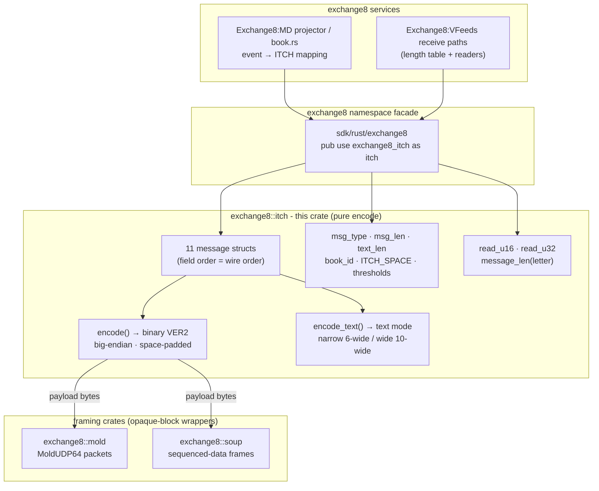

# exchange8::itch

## 1. Summary

`exchange8::itch` is the exchange8 vertical's published market-data codec:
it encodes the platform's book and trade events as VER2 ITCH messages -
the venue's proprietary market-data wire format, **not** the standard
NASDAQ ITCH 4.1 spec - in both the binary packet forms (14 message types,
4-61 bytes, big-endian, space-padded) and the fixed-width
text-mode forms including their width-expansion variants. It is a pure
library: no sockets, no database, no endpoints, no process of its own.
Message content policy (which event becomes which message) belongs to the
Exchange8:MD projector; transport framing to `exchange8::mold` / `exchange8::soup`.

## 2. Motivation

Downstream subscribers consume the market in the venue's published
language; the publisher must therefore emit bytes that look exactly like
the established feed, byte for byte:

- **Catalog-pinned layouts.** Every message's length, field order, and
  pad bytes come from `design/behavior-catalog/wire-formats.json`; golden
  in-crate tests pin encoders against it so upgrades cannot drift the
  wire.
- **Two consumers, one codec.** Binary ITCH serves book builders;
  the fixed-width text forms (with their 10-wide "large" variants when
  counts overflow the narrow fields) serve text-mode receivers - both
  are encoded from the same value structs.
- **Structs are the schema.** Field declaration order equals wire order,
  so a struct is simultaneously the Rust model and the layout definition
  - no second mapping to drift.
- **Safe vocabulary access.** Message letters, book-id letters, exact
  lengths, and width thresholds are named constants; `message_len`
  gates stream walk-throughs without guessing.

## 3. Architecture & High-Level Design

The crate is a single module (`src/lib.rs`) of value structs and pure
encode functions. Exchange8:MD's projector constructs structs from engine
events and encodes them; `mold`/`soup` wrap the bytes for transport; the
length table and word readers support consumers parsing a stream back.
The `exchange8` namespace facade exposes the crate as `exchange8::itch`.

- **Encode-only core, decode on demand.** Binary encoders exist for all
  fourteen types; field reading is covered by safe `read_u16`/`read_u32`
  helpers plus the length table, with full decode structs available
  where consumers need them (order-family shapes are exercised via
  struct round-trips in the consumer's tests).
- **Nothing but bytes in and out.** No I/O, no state, no policy - the
  crate is trivially testable and embeddable.

## 4. Key Traits and Data Structures

No traits, no dyn dispatch - value structs plus module tables.

- **Message structs** - `AddOrder`, `OrderExecuted`, `OrderReplaced`,
  `OrderDelete`, `OrderCancel`, `Trade`, `CrossTrade`, `BrokenTrade`,
  `SystemEvent`, `StockTradingAction`, `Timestamp`: plain `Copy + Eq`
  value types whose fields encode in wire order.
- **`msg_type` module** - the fourteen type letters (`A E U D X T M S R
  r H P Q B`) as named `u8` constants.
- **`msg_len` module** - exact binary wire length per type (SystemEvent
  4 … ExtendedStockDirectory 61), type char included.
- **`text_len` module** - text-mode lengths with wide variants
  (ADD_ORDER 41/45, ORDER_EXECUTED 29/33, TRADE 52/56, ORDER_CANCEL
  16/20, ORDER_DELETE 10).
- **`book_id` module** - book letter codes (`D` dark pool, `L` lit,
  `Q` QLX, `O` MEMP - the venue default).
- **Threshold constants** - `ITCH_MAX_SHARES_6` (999 999: the narrow
  text share field's ceiling) and `ITCH_MAX_PRICE_10` (9 999 999 999).
- **`encode()` / `encode_text()`** - the per-struct serializers; binary
  encoders `debug_assert` the catalog length; text encoders flip the
  6↔10-wide share field at the threshold (OrderDelete has no wide form).
- **`read_u16` / `read_u32`** - safe, bounds-checked big-endian reads
  (`Option`); **`message_len`** - type letter → catalog length or
  `None`.
- **`ItchError`** - typed failures (`TooShort`, `UnknownType`) for the
  decode-support surface.

## 5. Rationale, Trade-offs, and Alternatives

- **Encode-only structs with wire-order fields.** The consume path
  (external receivers) does not exist inside the platform yet; the
  platform's own need is *emitting* the tape. Full per-field decode
  structs would duplicate layouts for an unmaterialized consumer and
  double the golden-test surface; safe word readers + the length table
  cover today's parse duties (see README §7 for the pending decision).
- **`Copy` value structs over builder/parameter lists.** Event
  constructors are trivially constructed inline in the projector tests
  and compared with `==`; builders would add ceremony to fourteen tiny
  types with zero safety gain.
- **`debug_assert` on encoded length.** Wire drift is the one failure
  mode that matters; the assert is free in release and fails loud in
  debug/test. A runtime `Result` on every encode would tax the hot
  publish path for a condition the golden tests make impossible.
- **Text-mode widths as data, not special cases.** The wide-variant
  lengths are constants and the width choice is one threshold
  comparison per message - mirroring the venue's `%Nu` blank-padding
  semantics exactly. A generalized "format language" engine was
  rejected as over-abstraction for five fixed layouts.
- **Module-scoped constant tables over enums.** Type letters and
  lengths are wire facts, not closed Rust enums; tables let consumers
  pattern-match bytes directly (`msg_type::ADD_ORDER == b[0]`) and
  support unknown-letter policy (`message_len` → `None`) without
  fallback arms.
- **No serde, no async, no I/O.** The crate keeps `thiserror` alone so
  it compiles into the projector, test harnesses, and any future
  retransmission tooling unchanged.

## 6. Internal Implementation & Invariants (Private Design)

- **Encoders are single-pass appends** - private helpers `push_u16`,
  `push_u32`, `push_pad3` emit in field order; the final
  `debug_assert_eq!(len, msg_len::X)` pins the total. Reserved fields
  are never modeled: their space bytes are appended structurally.
- **Text padding helpers** - `pad_num(value, width)` right-aligns
  (blank-fill then digits); `pad_str(s, width)` left-aligns and clamps
  - reproducing the venue's `%Nu`/`%-Ns` semantics, which pad with
  spaces, not zeros.
- **Wide-variant decision** - `encode_text` computes `wide = shares >
  ITCH_MAX_SHARES_6` once, then the share width (6/10) and the total
  length (`_LF` constant) together, keeping the two always consistent.
- **`Timestamp::encode(kind)`** - one struct, two letter choices (`T`
  seconds / `M` millis) passed by the caller; identical 8-byte layout
  differs only in byte 0.
- **Invariants held across the crate:**
  1. Byte 0 of every encoded form (binary and text) is the type letter.
  2. Encoded length equals the `msg_len`/`text_len` constant
     (debug-asserted; golden tests in release CI too).
  3. All multi-byte numerics are big-endian; all pads/reserved bytes
     are `0x20`.
  4. Field order in structs == field order on the wire.
  5. `message_len` never lies to a stream walker: every known letter
     maps to its catalog length, unknown letters to `None`.

## 7. Unresolved Questions / Future Designs

- **Binary decode structs.** `read_u16`/`read_u32` plus
  `message_len` support stream walk-throughs; per-message decode
  structs (especially Directory/ExtendedDirectory, which have vocabulary
  but no struct today) would arrive with a platform-side receive path.
- **Text-mode retirement census.** The text encoders exist to satisfy
  consumers that parse them; a formal consumer census decides if/when
  they can go (the binary forms are the primary contract).
- **Timestamp emission cadence.** Which sessions emit `T`/`M` markers,
  and when, is publisher policy (Exchange8:MD), not codec work - the codec
  models the message only.
- **Streaming encode helpers.** Writing messages directly into a
  session buffer (avoiding per-message `Vec`s) could shave allocations
  in the hottest publish path; the current per-message returns keep the
  API composable with framing crates.

---

**Architecture & Design:** exchange8:itch and its underlying concepts were designed by [Hamid Jahanzad](https://www.linkedin.com/in/hamidjahanzad/).
