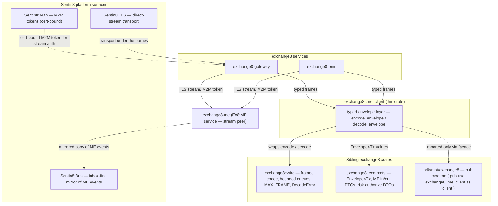
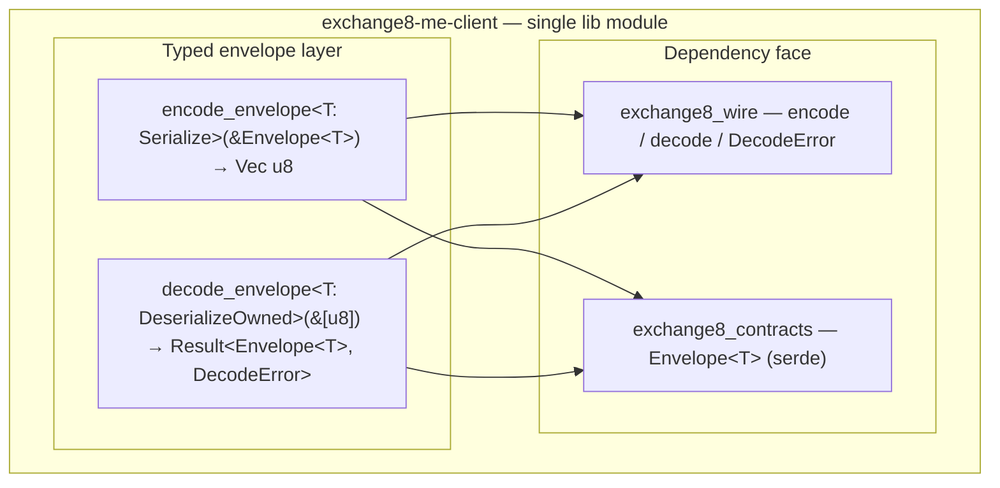
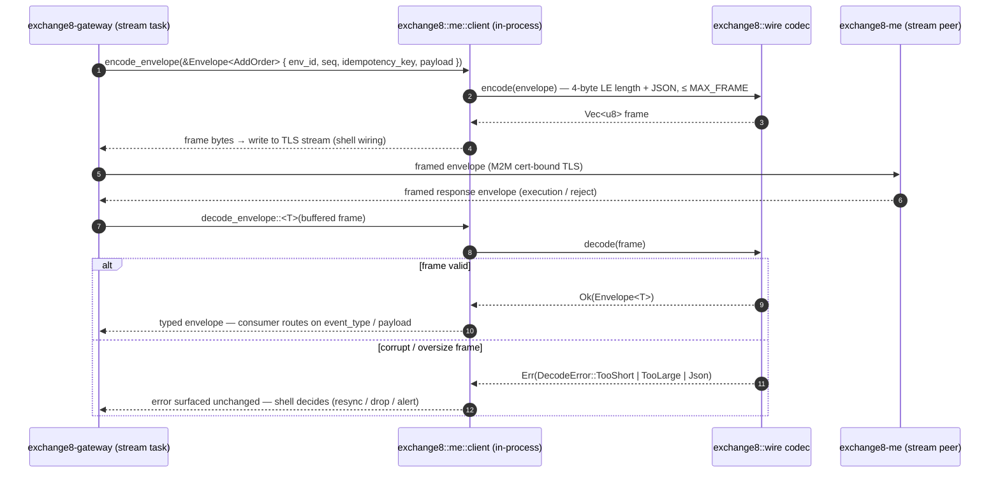
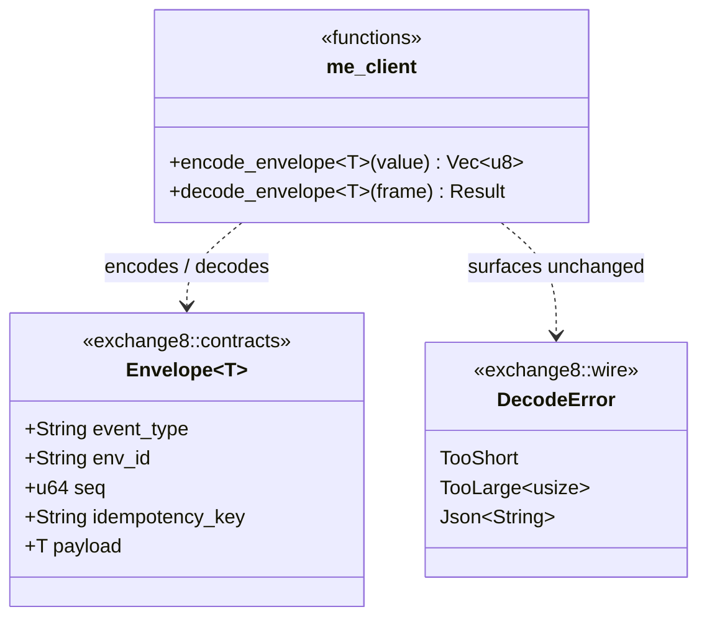
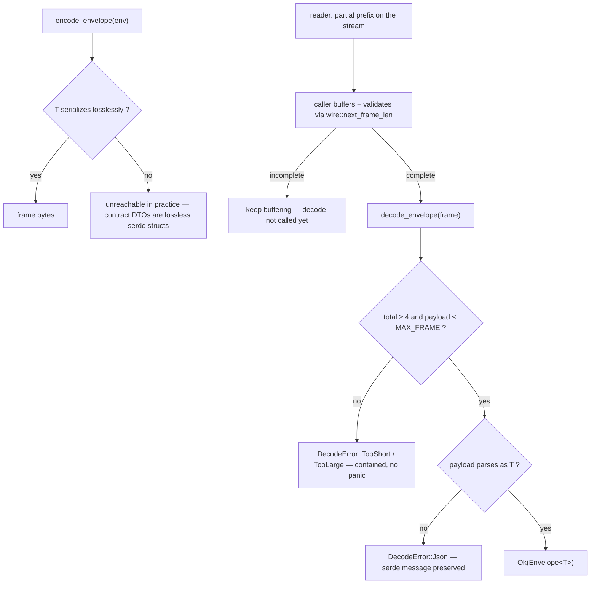
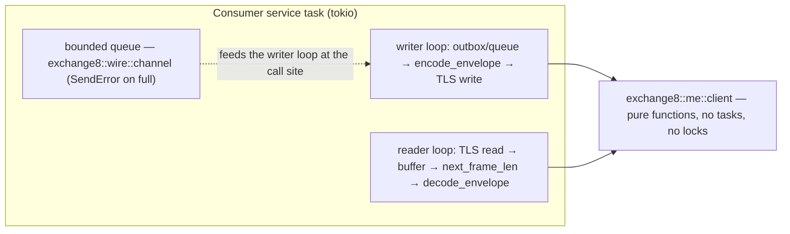
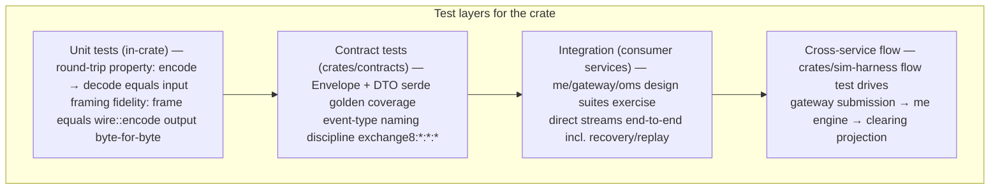

# DESIGN.md: exchange8::me::client — Detailed Design Document

> Deep, implementation-complete design for the `exchange8-me-client` library
> crate (facade `exchange8::me::client`, sources `crates/me/client/src/lib.rs`).
> Companion documents: `README.md` (overview) and `BUSINESS.md` (business
> requirements). Vertical context:
> `design/sentin8-exchange8-technical-design.md` §4.1 (namespace conformance),
> §5.2/§7.2 (transport tiers — direct ME streams),
> `design/sentin8-exchange8-matching-engine-technical-design.md` (ME stream
> families).

## 1. Scope & Context

`exchange8::me::client` is an **in-process library** on the trading hot path.
It owns exactly one concern: turning typed `exchange8::contracts::Envelope<T>`
values into `exchange8::wire` frames and back — the typed codec surface for
the ME direct streams (order entry + lifecycle + recovery).

It explicitly does **not** own:

- the framing byte layout — `exchange8::wire`'s codec does
  (`encode` / `decode` / `next_frame_len` / `MAX_FRAME` / `DecodeError`);
- transport session concerns — TLS dialing, M2M token sourcing, bounded
  queues, reconnect policy are `sentin8::shell` wiring at the consumer;
- any domain DTO — all ME in/out payloads (order entry, executions,
  rejects, lifecycle) live in `exchange8::contracts::events`;
- cross-service API surface shared by two services — the Gateway↔Risk
  authorize DTOs (`AuthorizeRequest` / `AuthorizeResponse` / `Decision`) live
  in `exchange8::contracts::risk` per the §2.1 nesting rule, **not** here.

**Trust boundaries.** The crate is post-authorization plumbing: frames are
produced and consumed inside service shells that already ran the standard
authorization pipeline. Stream authentication is M2M (cert-bound) on the TLS
transport, owned by the consuming shell — the crate handles no credentials,
holds no token and opens no socket. The `env_id` inside every envelope is the
tenant marker the consumer already verified before encoding.

## 2. Runtime Architecture

**No runtime of its own.** The crate is a library with two free functions and
no state; there are no tasks, no channels, no routers, no HTTP surface. The
module map is a single module with an in-crate concept split:

**Core path — a direct-stream message round trip.** The lifecycle worth
diagramming is one order-entry exchange between Gateway and ME across the
framed stream (error branch shown: frame corruption on the reader side):

There is no other lifecycle: no background task, no cache, no retry loop in
the crate.

## 3. Data Model

**No database tables are owned.** The crate declares none, reads none and
writes none — no DSN, no pool, no RLS. Its "data model" is the single value
it carries across the wire, shown as a class diagram (value layout, not an
entity relationship — the service-template ER diagram does not apply to a
library that owns no entities):

- `Envelope<T>` is owned by `exchange8::contracts` — the crate only *reads*
  and *emits* it. Fields carry tenant (`env_id`), ordering (`seq`), dedup
  (`idempotency_key`) and routing (`event_type`) exactly as the Sentin8:Bus
  produce path expects, so a message is transport-portable between the two
  tiers with no reshaping.
- No state machine tables, no lifecycle state of any kind exists in the crate.

## 4. API Surface

This is a library: there are **no HTTP endpoints** (the
`Authorization/API` surface of the service template does not apply in its
HTTP form). The public API is two functions plus borrowed types; consumers
are exchange8 services and crates only — never an end client.

| Item | Signature | Role | Consumer gate |
|---|---|---|---|
| `encode_envelope` | `pub fn encode_envelope<T: Serialize>(value: &Envelope<T>) -> Vec<u8>` | serialize a full typed envelope into one wire frame | services tier — after the caller's authorization pipeline |
| `decode_envelope` | `pub fn decode_envelope<T: DeserializeOwned>(frame: &[u8]) -> Result<Envelope<T>, exchange8_wire::DecodeError>` | decode a complete frame into a typed envelope | services tier |

Borrowed types (not re-exported — imported from their owning crates):
`exchange8::contracts::Envelope<T>`, `exchange8::wire::DecodeError`
(`TooShort` / `TooLarge` / `Json`).

**Events — none emitted, none consumed.** The crate is not wired to
Sentin8:Bus; the envelopes it encodes are the *same message bodies* that ride
the bus as mirrored copies (master design §7.2 — ME fans a mirrored copy of
its stream to the bus for Clearing/MD persistence), which is why the payload
shape, the `env_id` and `idempotency_key` disciplines are identical across
both transport tiers.

**Multi-party interaction** (already diagrammed in §2): the sequence
diagram is the `Gateway → codec → TLS → ME` round trip with its decode-error
branch — the only multi-party interaction the crate participates in.

## 5. Cross-Cutting Concerns

- **Authentication / authorization.** Not applicable inside the crate — no
  token inspection, no scope check, no policy decision. Frames leave the
  consumer *after* its shell ran the 8-step authorization pipeline; stream
  authentication is the M2M cert-bound TLS session the shell establishes.
- **Tenant resolution / RLS.** No database access and no tenant-context
  setting. `env_id` rides inside every envelope as the tenant marker; unique
  per-tenant interpretation (e.g. which `env_id` a stream serves) is the
  consumer's routing decision, not the crate's.
- **Idempotency / exactly-once.** Enforced by the envelope's
  `idempotency_key` — the crate carries it faithfully in both directions and
  does nothing else. Deduplication happens at consumers (inbox-first for the
  bus mirror, consumer-side seq/idem tracking for direct streams).
- **Ordering.** `seq` is a monotonic per-emitter counter that the encoder
  transports unchanged; the crate never reorders, batches or re-sequences —
  point-to-point framed streams preserve write order by construction.
- **Rate limiting / bot protection / audit journaling / graceful drain / TLS
  posture.** All handled by the consuming service shell and the platform
  (Sentin8:TLS transport, platform audit on the services' domain events).
  The crate contributes nothing to these concerns and must not grow there.
- **Determinism.** Encoding is a pure function of the envelope value:
  identical envelopes always produce identical frames, so recorded-session
  replay produces byte-identical streams — the property deterministic tests
  (sim-harness, ME recovery tests) rely on.

## 6. Failure Modes & Recovery

- **Decode failure (the real failure path).** A corrupt, truncated or
  oversize frame returns a contained `DecodeError`; no panic, no silent
  truncation, no partial value. **Recovery is the consumer's policy** — a
  direct-stream reader typically resynchronizes on the next
  `next_frame_len`-validated frame (per-frame length prefixes make framing
  self-delimiting), or tears the stream down for rejoin/replay. The crate
  contributes no retry loop by design.
- **Encode failure.** Contract DTOs are plain serde structs without
  non-string-serializable fields; serialization cannot fail in the contract
  set. A hypothetical non-lossless payload type would surface as the natural
  serde/JSON error path of `wire::encode` — not a special crate behavior.
- **Stream-level failures** (peer disconnect, TLS reset, backpressure) live
  entirely outside the crate: the shell owns reconnect/rejoin (ME recovery
  messages or full replay per master design §11) and the bounded-queue
  backpressure contract (`SendError` value hand-back). The crate's frames are
  stateless, so nothing is lost by re-encoding after a reconnect.
- **No durable state → no durability recovery.** There is nothing to
  rebuild, replay or DLQ inside the crate itself.

## 7. Concurrency & Performance Model

- **Task layout.** None spawned by the crate. Callers are tokio tasks inside
  service binaries (gateway order-entry stream writers, ME stream readers,
  OMS links); `encode_envelope` / `decode_envelope` are called inline on those
  tasks before/after the transport write/read.
- **Locking strategy.** None — the functions are pure and reentrant; no
  shared mutable state exists.
- **Hot path and cost.** One `serde_json` serialization plus one 4-byte
  `Vec` prefix prepend per message; decode is one bounds check, one parse.
  The frame layout (`MAX_FRAME`, length prefix) bounds copy sizes, keeping
  envelope encoding within the §11 matching latency envelope
  («matching < 100 µs P50» context: codec cost is sub-microsecond JSON work
  on the hot-path message sizes).
- **Zero-copy trade-off.** `encode_envelope` allocates a fresh `Vec<u8>`
  per call rather than writing into a caller-provided buffer. Chosen for
  API simplicity at current message sizes; a `write_envelope_into(&mut
  impl BufMut)` variant is the natural evolution if profiling shows
  allocation pressure (an Open Question in §10).
- **Backpressure behavior.** None in the crate; bounded-queue pressure at
  the consumer's wiring point returns `SendError` with the value, upstream of
  any encode call.

## 8. Invariants, Insecure-Defaults Rejected, Unsafe Rationale

**Invariants (always true):**
1. The frame layout is exactly `exchange8::wire`'s: 4-byte little-endian
   `u32` length prefix + JSON payload, payload ≤ `MAX_FRAME`. The crate adds
   no bytes, headers or versioning of its own.
2. `decode_envelope(encode_envelope(env)) == env` for every lossless
   contract payload type.
3. All five envelope fields (`event_type`, `env_id`, `seq`,
   `idempotency_key`, `payload`) are transported; the crate never drops or
   defaults any of them.
4. Every codec error passes through with its original taxonomy — the crate
   defines no error type and performs no error-mapping.
5. No panic is reachable from corrupt input: all truncation/oversize/bad-JSON
   inputs return errors.

**Insecure defaults rejected:**
- **Payload-only encoding** (envelope assembled ad hoc by callers) — rejected:
  it invites divergent or missing `env_id` / `idempotency_key`, the fields that
  make cross-tenant safety and dedup auditable. The whole envelope is the unit
  of encode.
- **A crate-owned session/transport with embedded credentials** — rejected:
  secrets and M2M token sourcing must stay in the service shell and platform
  crates (secret references policy); a client library holding tokens would
  create a second secret surface.
- **Silent truncation on oversize payloads** — rejected: `MAX_FRAME` violations
  surface as `DecodeError::TooLarge`, mirroring the codec's containment rule;
  silent truncation would corrupt seq/idempotency integrity downstream.

**Unsafe rationale:** the crate contains **no `unsafe` code** — nothing to
rationale.

## 9. Testing Strategy

- **What this crate's layer owns:** the two round-trip/frame-identity
  properties above; error-propagation (every `DecodeError` variant passes
  through); the no-panic-on-corrupt-input property.
- **What sibling layers own and this crate deliberately does not re-test:**
  frame byte layout (covered by `crates/wire` golden tests), DTO fidelity
  (`crates/contracts`), stream session behavior (consumer services), and
  cross-service flow (sim-harness flow test).
- **Deliberately NOT tested here:** TLS, tokens, backpressure, reconnect —
  they are out of the crate's surface; the test pyramid stays aligned with
  the platform testing strategy doc.
- **Property worth preserving in CI:** encoding the same envelope twice
  yields identical bytes (determinism), and a `MAX_FRAME`-oversize envelope
  decode returns `TooLarge` rather than truncating.

## 10. Open Questions

- **Buffer-reuse encode variant.** `write_envelope`-style API writing into a
  caller-provided buffer to eliminate the per-message `Vec` allocation on the
  hottest order-entry path — pending profiling evidence.
- **Typed per-family stream APIs.** Dedicated envelope sets / newtype helpers
  for the three stream families (order entry, lifecycle, recovery) to give
  ME/GW/OMS one shared typed definition per stream, instead of raw
  `Envelope<serde_json::Value>` at connection edges.
- **Reader-side per-stream seq tracking.** Whether the crate should own
  "next expected seq" bookkeeping for direct-stream readers (with a
  gap/reorder policy) or leave it to each consumer; current state leaves it
  to consumers by design.
- **Rehydration/replay helper for recorded sessions.** A typed iterator over
  a recorded frame file to support deterministic state-recovery tooling
  (aligned with the §11 determinism/replay requirement), without pulling in
  any storage dependency into this crate.

---

**Design attribution:** exchange8:client and its underlying concepts were designed by Hamid Jahanzad <Hamid@Jahanzad.com>.
