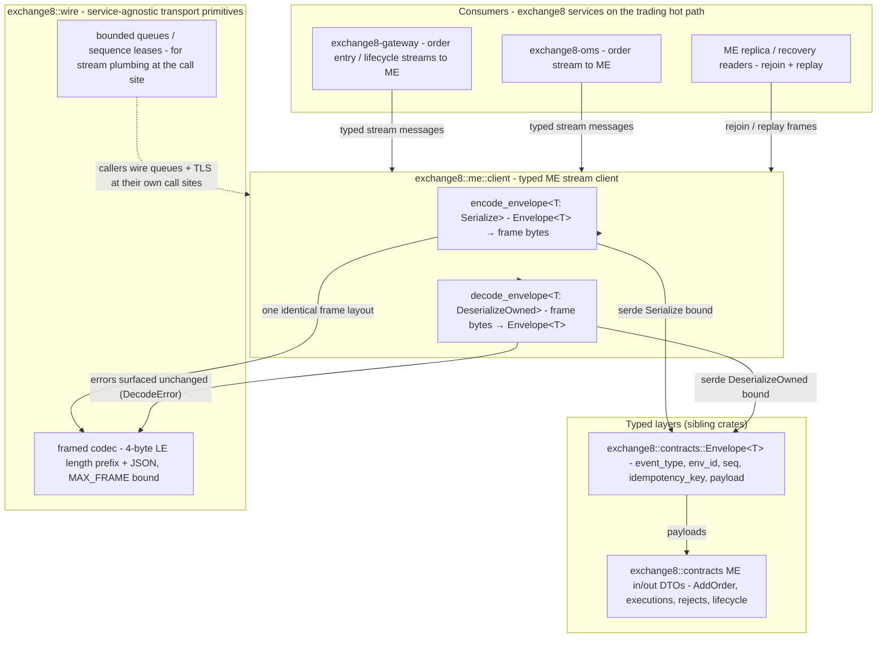

# exchange8::me::client

## 1. Summary

`exchange8::me::client` (package `exchange8-me-client`, sources in
`crates/me/client/src/lib.rs`) is the typed client library for the exchange8
**direct ME streams** - the point-to-point channels over which Exchange8:Gateway,
Exchange8:OMS and other order-flow participants exchange `Envelope<T>` messages with
Exchange8:ME. It provides exactly two functions today, `encode_envelope` and
`decode_envelope`, which wrap the service-agnostic framing codec
(`exchange8::wire`) around the typed `exchange8::contracts::Envelope<T>` shape.

By design the crate is deliberately tiny: everything transport-generic (the
framed codec, bounded queues, sequence leases) stays at `exchange8::wire`, and
everything cross-service typed (the Gateway↔Risk authorize DTOs, all event and
message DTOs) stays in `exchange8::contracts`. This crate owns only the
"typed ME stream client" concern.

## 2. Motivation

- **A named home for the ME-stream client concern.** The master design
  (§5.2, §7.2) defines two transport tiers: Sentin8:Bus inbox-first for
  persistence/observer traffic, and **direct framed streams** for the trading
  hot path (ME ↔ Gateway ↔ OMS) where matching latency and deterministic
  per-instrument ordering rule out bus relays. A consumer that opens such a
  stream needs a single place that says "encode this typed envelope onto the
  ME stream" - that place is this crate.
- **Keep the wire byte format one decision.** Consumers must not hand-roll a
  length prefix or re-serialize an envelope; a single `encode_envelope` call
  guarantees every participant (ME, GW, OMS, replicas) speaks one identical
  frame layout.
- **Namespace discipline** (architecture principles §2.1): the package name is
  the `::`-free transliteration of the facade import path -
  `exchange8::me::client` ↔ `exchange8-me-client` - and because it is
  scoped to one service's streams it nests under `pub mod me` in the
  facade rather than sitting at a top level.

## 3. Architecture & High-Level Design

The crate is a thin, stateless wrapper layer between the typed event world
(`exchange8::contracts::Envelope<T>`) and the byte world
(`exchange8::wire` framing). It has no runtime, no tasks, no channels of its
own: callers bring the transport (a Sentin8:TLS stream or in-process pipe)
from their shell, and the crate converts values to and from frames.

Everything the crate *produces or consumes* is a frame of the
`exchange8::wire` layout; the crate contributes no framing bytes of its own and
no serialization of its own (serde derives from `contracts`).
The same `Envelope<T>` shape encodes both bus produce payloads and these
framed direct streams - the two transport tiers differ in delivery semantics
(point-to-point vs. inbox-durable), not in message shape.

## 4. Key Traits and Data Structures

The crate defines **no types, no traits** of its own - it is a two-function
generic API over a single existing structure:

- **`Envelope<T>`** (`exchange8::contracts::events::Envelope`) - the only value
  the crate touches in and out of the wire. Its five fields are the entire
  stream contract: `event_type`
  (`exchange8:<service>:<resource>:<operation>`), `env_id` (tenant), `seq`
  (monotonic per-emitter), `idempotency_key` (exactly-once dedup) and
  `payload` (a ME in/out DTO such as `AddOrder`, `OrderKilled`, an execution
  or a reject).
- **`encode_envelope<T: Serialize>(value: &Envelope<T>) -> Vec<u8>`** - serializes
  the *whole envelope* (never the payload alone) into one frame:
  4-byte little-endian length prefix + JSON.
- **`decode_envelope<T: DeserializeOwned>(frame: &[u8]) ->
  Result<Envelope<T>, exchange8_wire::DecodeError>`** - the inverse; framing
  errors surface as the `DecodeError` taxonomy (`TooShort`, `TooLarge`,
  `Json`), never a panic.

Generic bounds rather than a trait: because `Envelope<T>` is a plain serde
struct, typed encode/decode is expressed as a Serialize/DeserializeOwned bound
with no added trait indirection - callers name the payload type at the decode
site and get a typed envelope back.

## 5. Rationale, Trade-offs, and Alternatives

- **Two functions instead of a client struct.** A session-managing client
  (connect, handshake, drain, reconnect) would duplicate what the consumer's
  `sentin8::shell` wiring already provides (TLS dialing, M2M token sourcing,
  bounded queues). The crate instead gives the *typed codec* surface and lets
  each service shell own the session; the result is a dependency-light crate
  (`serde` + `contracts` + `wire` - no tokio, no platform crates) usable
  anywhere, including tools and tests.
- **Envelope-level API instead of payload-level.** Encoding only `payload`
  would force every caller to re-wrap with `event_type/env_id/seq/…` and invites
  divergent field-population. Encoding the envelope keeps tenant
  (`env_id`), ordering (`seq`) and idempotency (`idempotency_key`) inside the
  one shape that both transports (bus and direct streams) already share.
- **Why not put these functions in `exchange8::wire`.** `wire` is
  service-agnostic by spec and must not know the `Envelope` type (it would
  drag `exchange8-contracts` into every codec consumer). The ME-specific
  wrapper is the smallest possible reason to keep this crate alive; if the
  stream surface widens, this crate is where session codecs (per-stream seq
  stamping, request/response pairing) will land.
- **Rejected alternative: re-exporting the whole `wire` codec here.** Re-export
  would couple the public doc surface of a ME-scoped crate to transport
  primitives that other (non-ME) streams also use; callers already import
  `exchange8::wire` for `channel`/`SequenceLease`. The crate stays at the two
  typed functions and references `wire` only through its types
  (`DecodeError`, encoded `Vec<u8>`).

## 6. Internal Implementation & Invariants (Private Design)

- **The entire implementation is two three-line functions** in
  `crates/me/client/src/lib.rs`; they contain no logic, no state and no
  panics. This is intentional - the crate is a *contract anchor* (a stable
  import path for the ME-stream concern), not a feature.
- **Invariants:**
  1. `decode_envelope(encode_envelope(env))` round-trips to an equal envelope
     for every payload `T` with lossless serde representation.
  2. The crate encodes the envelope with its `event_type`, `env_id`, `seq`,
     `idempotency_key` and payload all present - it never invents or mutates
     any envelope field.
  3. The frame layout is exactly `exchange8::wire`'s (4-byte LE length +
     JSON, `MAX_FRAME` bound) - the crate adds no bytes of its own.
  4. Error propagation is total: every `DecodeError` from the codec passes
     through unchanged; the crate adds no error type and swallows nothing.
- **No unsound/unsafe code.** The crate contains no `unsafe`, no threads, no
  filesystem, no network access.

## 7. Unresolved Questions / Future Designs

- **Per-stream sequence stamping.** The envelope already carries `seq`, but
  stream *connection* framing (per-stream next-expected tracking on the
  reader side) is not yet part of the crate; direct-stream readers are wired
  by service shells today. A future design may add a small `stream::Reader` /
  `stream::Writer` helper over `exchange8::wire`'s bounded queues and
  `next_frame_len` buffered reads.
- **Session-level typed entry points.** Typed helpers for the three stream
  families (order entry, lifecycle, recovery) - e.g. type-aliased envelope
  sets per family - may be introduced so ME/GW/OMS share one definition of
  "the messages that ride each stream."
- **Recovery/replay helper.** A typed replay walker (decode a recorded frame
  file → `Vec<Envelope<MeEventPayload>>` in order) is a candidate addition to
  support deterministic state-recovery tests, mirroring the sim-harness
  philosophy.

---

**Architecture & Design:** exchange8:me and its underlying concepts were designed by [Hamid Jahanzad](https://www.linkedin.com/in/hamidjahanzad/).
