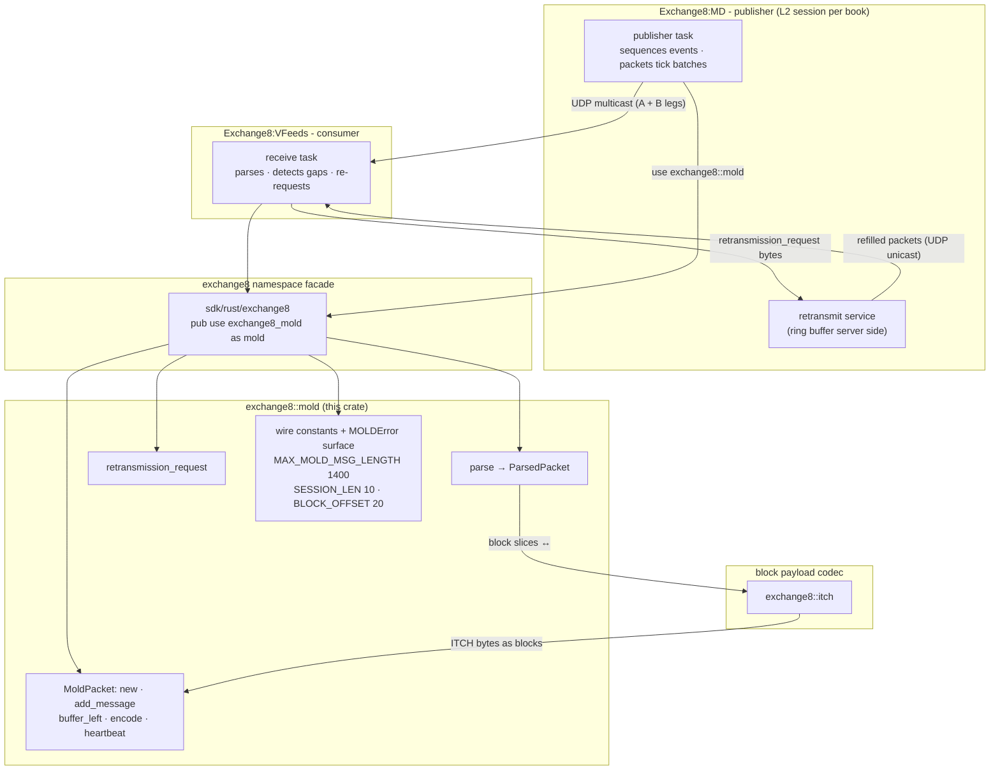
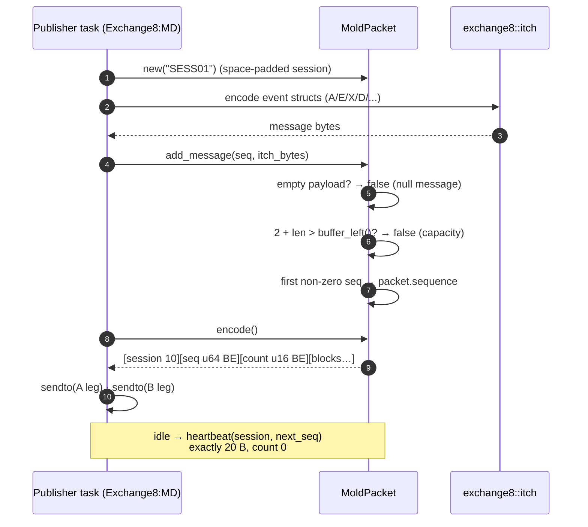
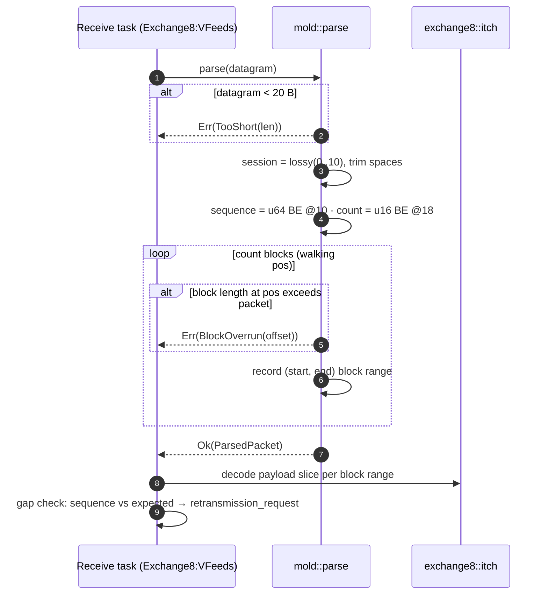
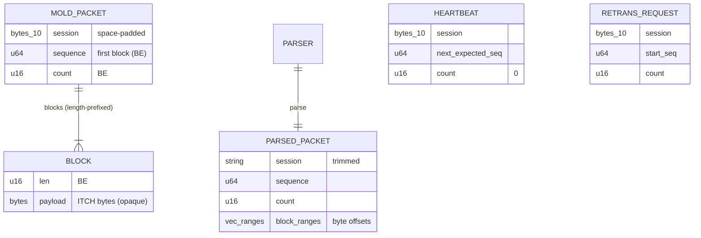
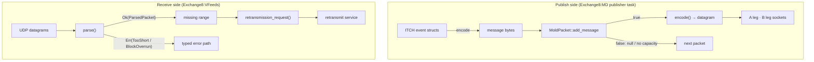
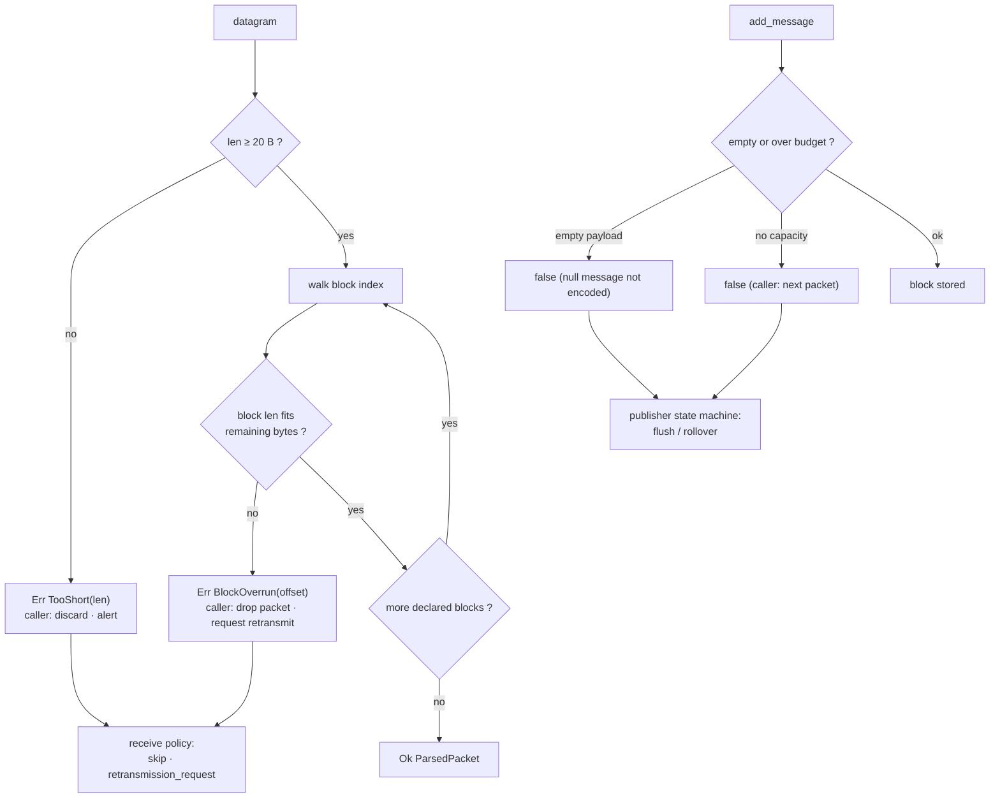
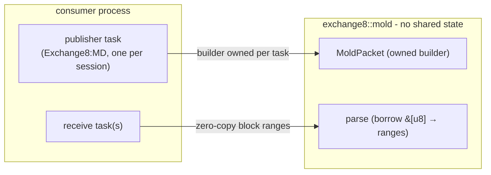
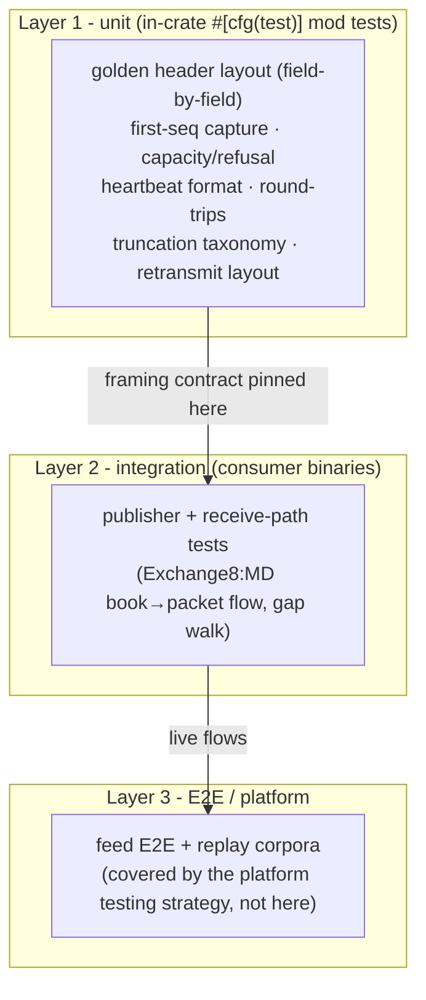

# exchange8::mold - Detailed Design Document

## 1. Scope & Context

`exchange8::mold` owns the MoldUDP64 downstream packet grammar for the
exchange8 vertical: the header layout (session 10 · sequence `u64` big
-endian · count `u16` big-endian), the length-prefixed message-block
framing, the 1400-byte packet cap, the count-0 heartbeat form, and the
20-byte retransmission request. It explicitly does **not** own:

- block payloads - ITCH VER2 message bytes are `exchange8::itch`'s
  (the crate is payload-agnostic by design);
- transport - sockets, multicast A/B legs, heartbeat intervals, and the
  retransmit server are the consuming services' (Exchange8:MD publisher,
  Exchange8:VFeeds) per the market-data design §4.3;
- sequencing policy - increments, snapshot-from-seq semantics, and the
  per-stream ring buffers live with the publisher session model;
- SoupBinTCP session framing - `exchange8::soup`.

There is no HTTP surface, no database presence, no event emission, no
runtime of its own: the crate is a pure framing library compiled into the
facade `exchange8::mold` (package `exchange8-mold`, workspace member
`crates/mold`) and statically linked into consumer binaries.

### System context

## 2. Runtime Architecture

The runtime-architecture section of the service template does not apply:
the library has no tasks, routers, workers, caches, or background jobs.
Its "architecture" is the module map of one file and the two call shapes
(publish-side build; receive-side parse) the consumers drive.

### Module map (`src/lib.rs`)

| Unit | Visibility | Responsibility |
|---|---|---|
| `MAX_MOLD_MSG_LENGTH` (1400) | `pub const` | Wire packet cap (fits a UDP datagram without fragmentation) |
| `SESSION_LEN` / `SEQ_OFFSET` / `SEQ_LEN` / `COUNT_OFFSET` / `COUNT_LEN` / `BLOCK_OFFSET` / `BLOCK_LEN_LEN` | `pub const` | The wire's fixed geometry |
| `ITCH_SPACE` (`0x20`) | `pub const` (private to tests/consumers via facade) | Session padding byte |
| `MoldError` | `pub enum` | `TooShort(usize)`, `BlockOverrun(usize)`, `TooLarge` - typed failure surface |
| `MoldPacket` | `pub struct` | Outbound builder: session buffer, first-block sequence, `blocks: Vec<Vec<u8>>` |
| `ParsedPacket` | `pub struct` | Inbound view: session `String`, `sequence`, `count`, `block_ranges: Vec<(usize, usize)>` |
| `parse(&[u8])` | `pub fn` | Header decode + block-index walk |
| `retransmission_request(session, start_seq, count)` | `pub fn` | 20-byte request builder |

### Build/encode path (publish)

### Parse path (receive, with failure branches)

## 3. Data Model

The library owns no tables. Its "data model" is the packet framing and
the builder/parse views over it.

| Structure | Fields | Wire representation |
|---|---|---|
| `MoldPacket` | `session: [u8; 10]`, `sequence: u64`, `blocks: Vec<Vec<u8>>` (private) | `session[0..10]` + `sequence u64 BE @10` + `count u16 BE @18` + per block `len u16 BE` + payload |
| `ParsedPacket` | `session: String`, `sequence: u64`, `count: u16`, `block_ranges: Vec<(usize, usize)>` | Ranges index the *caller's* buffer; no payload copies |
| heartbeat | - | 20 bytes: session + next-expected seq + count 0 |
| retransmission_request | `session`, `start_seq: u64`, `count: u16` | 20 bytes: session + seq `u64 BE` + count `u16 BE` |

- Types derive `Debug + Clone + PartialEq + Eq`; all multi-byte integers
  are **big-endian** (`to_be_bytes` / `from_be_bytes`).
- Block framing: each message is a `u16` BE length prefix followed by the
  payload; a block's declared length must fit the packet (checked during
  parse; structural at build via `buffer_left`).

## 4. API Surface

Public API inventory (library audience: exchange8 services; no
authorization gate applies - there are no endpoints, scopes, or tenant
contexts to gate):

| Item | Kind | Contract |
|---|---|---|
| `MAX_MOLD_MSG_LENGTH` | const | 1400-byte packet cap (pub) |
| `SESSION_LEN` … `BLOCK_LEN_LEN` | consts | Wire geometry: 10 / 10 / 8 / 18 / 2 / 20 / 2 |
| `MoldPacket::new(session)` | ctor | Space-padded 10-byte session; sequence 0, no blocks |
| `MoldPacket::buffer_left()` | method | Remaining bytes for blocks within the 1400 cap |
| `MoldPacket::add_message(seq, payload) -> bool` | method | Appends a block; `false` when empty (null) or when it does not fit; first non-zero seq captured |
| `MoldPacket::message_count() -> u16` | method | Current block count |
| `MoldPacket::encode() -> Vec<u8>` | method | Full big-endian serialization |
| `MoldPacket::heartbeat(session, next_seq) -> Vec<u8>` | static | Count-0 keepalive, exactly 20 bytes |
| `parse(packet) -> Result<ParsedPacket, MoldError>` | fn | Header + block-index walk; typed failures |
| `retransmission_request(session, start_seq, count)` | fn | 20-byte request builder |
| `MoldError { TooShort, BlockOverrun, TooLarge }` | enum | Whole failure surface; `Display` messages part of the contract |

Emissions: none. The library emits no domain events and participates in
no outbox/trigger chain - the event-flow diagram of the service template
does not apply.

## 5. Cross-Cutting Concerns

Each service-template concern below is either answered for a pure library
or explicitly does not apply.

- **Deterministic outcomes.** Same builder calls → same packet bytes;
  same datagram → same parse result. No environment, clock, or RNG.
- **Wire fidelity.** The crate IS a wire-fidelity layer: offsets,
  endianness, padding, and the 1400 cap are pinned by in-crate byte-level
  tests, making accidental drift a failing build.
- **Precision / endianness.** Binary-numeric, uniformly **big-endian**
  (`u64` sequence, `u16` count and block lengths); sessions are plain
  bytes echoed lossily-tolerated.
- **Idempotency / exactly-once.** Not applicable at the library level -
  sequence semantics (a packet's first block sequence, receivers'
  next-expected tracking) are the caller's; re-encoding an identical
  builder state yields identical bytes.
- **Authentication / authorization / RLS / tenant context / audit /
  rate limiting / drain / TLS.** Not applicable - no endpoints, no
  database, no sockets, no caller identity; statically linked in-process
  code. Multicast transport protection is the session/venue layer's
  concern, not this codec's.

## 6. Failure Modes & Recovery

The library performs no I/O; failure is value-level, deterministic, and
total - `parse` either yields the complete packet view or one typed
error.

- **Truncated datagrams.** UDP does not deliver partial datagrams
  silently, so `TooShort`/`BlockOverrun` guard against corrupt capture
  sources and mis-typed pipes; the response policy (drop + retransmit)
  belongs to the consumer.
- **Capacity pressure.** `add_message` returns `false` without mutating
  state when the block would exceed the cap - the publisher rolls to the
  next packet; no packet is ever partially filled then truncated.
- **Caller-side recovery.** Gap detection (expected sequence vs packet
  sequence) is the consumer's; the codec supplies the exact 20-byte
  request framing for the refill path.

## 7. Concurrency & Performance Model

- **No shared state.** Builders are task-local owned values; `parse`
  borrows the input and allocates only the range `Vec`. Any number of
  tasks may call concurrently - no mutexes, no pools.
- **Allocation profile.** Build side: one `Vec` per block (payload
  ownership) plus the encoded output buffer. Receive side: one range
  `Vec`; payloads stay in the caller's buffer (zero copies).
- **Hot path.** Encode is header memcpy + per-block length-prefix emit;
  parse is a linear block walk (`O(blocks)`); `buffer_left` is an
  arithmetic sum maintained without caching.
- **Throughput posture.** The 1400-byte cap keeps each packet on the
  small side of MTU-class datagrams; per-packet codec cost is negligible
  against socket work inside the publisher task's existing budget.

## 8. Invariants, Insecure-Defaults Rejected, Unsafe Rationale

**Invariants** (enforced structurally and by the conformance tests):

1. Header geometry is fixed: 10 / 8 / 2 byte fields at offsets 0 / 10 /
   18; blocks begin at 20.
2. All multi-byte integers are big-endian; sessions are space-padded
   (0x20) to exactly 10 bytes and trimmed on parse.
3. Builder packets never exceed `MAX_MOLD_MSG_LENGTH`; a heartbeat is
   exactly 20 bytes with count 0.
4. `parse(encode(p))` reproduces session, sequence, count, and block
   payloads for any builder-produced packet.
5. `ParsedPacket.block_ranges` always contains exactly `count` ranges,
   each within the packet's bounds and mutually disjoint, in order.
6. An empty payload is never encoded into a block.
7. `add_message` failing (fit/empty) leaves the builder state unchanged.

**Insecure defaults rejected:**

- *Silent truncation of oversized packets* - an over-MTU datagram would
  fragment (loss amplification) or vanish at the NIC; refused instead.
- *Lossy parse defaults* (zero-filling short fields) - corrupts sequence
  accounting and gap detection; typed rejection instead.
- *Auto-incrementing sequence in the builder* - the wire must say what
  the caller intends; an invented sequence poisons receiver gap logic.
- *Encoding empty blocks* - unparseable at receivers; refused at build.
- *Strict-UTF-8 session parse with rejection* - session fields are
  echoed protocol metadata; lossy tolerance avoids rejecting packets
  over cosmetic bytes while never treating the field as security input.

**Unsafe rationale:** none - the crate contains no `unsafe` blocks and
no FFI; all access is safe slice arithmetic with `try_into` conversions
(`expect` guards there are unreachable because preceding length checks
guarantee the slice sizes).

## 9. Testing Strategy

- **Owned here (unit):** byte layout pinning (`header_layout_golden`),
  sequence capture semantics (`first_seq_stored_only_once`), capacity and
  null-message behavior (`overflow_rejected`), heartbeat form
  (`heartbeat_format`), parse/encode round-trip (`parse_round_trip`),
  error branches under truncation (`parse_truncated_rejected`), and
  retransmission-request layout (`retrans_request_layout`). All tests
  are pure byte assertions with no fixtures outside the crate.
- **Deliberately NOT tested here:** ITCH payload correctness (
  `exchange8::itch` owns it), socket/multicast behavior and A/B loss
  handling (service session tasks), and end-to-end feed flows
  (platform-level).
- **Run:** part of the vertical workspace gate - inside
  `cargo test -p exchange8-mold` in the workspace test pipeline.

## 10. Open Questions

- **Retransmit-server builder.** Whether the server side (ring-buffer
  replies) wants a symmetric encoding helper in this crate once the
  publisher's retransmit service is built out.
- **Zero-copy receive accessor.** Payload `&[u8]` per block (borrowed
  from the caller's buffer) may supersede range tuples when the receive
  consumer lands.
- **Parse-side 1400 policy.** Whether `parse` should enforce the packet
  cap itself rather than documenting it for the caller.
- **Sequence semantics for unsequenced transport.** The builder captures
  the first non-zero sequence only; whether future flows need explicit
  per-block sequence support is undecided.

---

**Design attribution:** exchange8:mold and its underlying concepts were designed by Hamid Jahanzad <Hamid@Jahanzad.com>.
