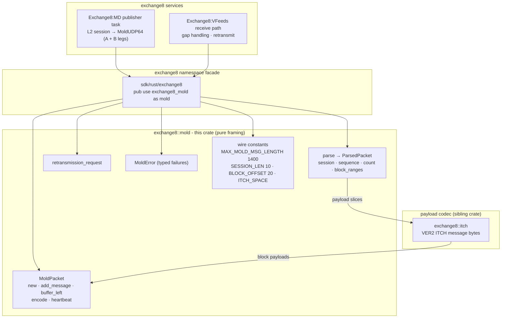

# exchange8::mold

## 1. Summary

`exchange8::mold` is the MoldUDP64 downstream packet codec of the exchange8
vertical: it builds outbound multicast packets (header + length-prefixed
message blocks), parses inbound packets back into header + block ranges, and
formats retransmission requests. It is a pure library - no sockets, no
database, no endpoints, and no process of its own. Packet framing is
everything it owns; the session lifecycle, heartbeat intervals, A/B legs,
and socket I/O belong to the consuming services (Exchange8:MD publisher,
Exchange8:VFeeds session tasks).

## 2. Motivation

The L2 order-by-order stream leaves the platform as MoldUDP64 multicast: a
10-byte session, a 64-bit big-endian sequence, a 16-bit message count, then
message blocks each prefixed by a 16-bit big-endian length. The codec exists
so that publisher and retransmission paths have one exact, tested definition
of that framing:

- **Byte-exact packets.** Encode output is pinned field-by-field
  (offsets, endianness, space padding) by in-crate tests, so a publisher
  upgrade can never silently drift the wire.
- **Gap recovery as a first-class frame.** The count-0 heartbeat carrying
  the next-expected sequence and the 20-byte retransmission request are
  produced by dedicated helpers - the recovery conversation is codec, not
  ad-hoc bytes.
- **Malformed input is typed, never repaired.** A short packet or a block
  that overruns the buffer is a `MoldError`, not a panic and not a
  lossy guess.
- **Determinism.** Bytes-in/bytes-out with no I/O means replay corpora
  and conformance tests run without any service scaffolding.

## 3. Architecture & High-Level Design

The crate is a single module (`src/lib.rs`) of pure functions and builder
values. The consumer owns the UDP socket, the session sequencing, and the
heartbeat timer; it calls `add_message`/`encode` per outbound tick and
`parse` per inbound datagram. The `exchange8` namespace facade exposes the
crate as `exchange8::mold`.

- **The codec is the payload container, not the payload.** Blocks are
  opaque bytes to `mold`; ITCH messages are produced/consumed by the
  sibling crate.
- **Sequencing lives with the caller.** The packet records the sequence
  it is told (first block's), and heartbeats carry whatever next-expected
  sequence the session passes; the codec never invents sequence numbers.
- **One packet, one mechanism.** Encode, parse, heartbeat, and
  retransmission are four independent pure surfaces.

## 4. Key Traits and Data Structures

There are no traits, no dyn dispatch - data-oriented builders and a
parse result.

- **`MoldPacket`** - the outbound builder: `session` (fixed 10-byte
  ASCII, space-padded), `sequence` (first block's), private `blocks`.
  `new` pads/claims the session; `buffer_left` reports remaining
  1400-byte budget; `add_message(seq, payload)` appends a block
  (returning `false` when it does not fit or the payload is empty -
  the protocol's "null message" is ignored); `message_count` reports
  the block count; `encode` serializes header + length-prefixed blocks.
  `heartbeat(session, next_seq)` builds the count-0 keepalive packet.
- **`ParsedPacket`** - the inbound view: `session` (trimmed `String`),
  `sequence` (`u64`), `count` (`u16`), and `block_ranges`
  (`Vec<(start, end)>` byte offsets into the original buffer for each
  block, decodable by the caller or the ITCH crate).
- **`MoldError`** - the codec's whole failure surface: `TooShort(len)`
  (under 20-byte header), `BlockOverrun(offset)` (declared block length
  exceeds the packet), `TooLarge`.
- **Wire constants** - `MAX_MOLD_MSG_LENGTH` (1400), `SESSION_LEN` (10),
  `SEQ_OFFSET` (10), `SEQ_LEN` (8), `COUNT_OFFSET` (18), `COUNT_LEN`
  (2), `BLOCK_OFFSET` (20), `BLOCK_LEN_LEN` (2), and `ITCH_SPACE`
  (`0x20` padding).

## 5. Rationale, Trade-offs, and Alternatives

- **Builder + offsets instead of zero-copy views.** Outbound blocks are
  stored as owned `Vec<u8>` chunks and encoded to one `Vec`; inbound
  parsing yields *offset ranges* into the caller's buffer rather than
  owned copies. Mixed approach chosen deliberately: build-side packets
  are small, frequently mutated buffers (owned is simplest and safe),
  while the receive side stays allocation-free where it matters - the
  hot fan-out path copies nothing but the ranges (`Vec` of 2-tuples).
- **1400-byte cap checked at build time.** `buffer_left` +
  `add_message`'s fit check keep the builder under the wire maximum
  structurally; `MoldError::TooLarge` documents the constraint for
  external callers who bypass the builder. A silently-overflowing UDP
  datagram would be dropped by the NIC or fragmented (loss amplification)
  - reject-early is the only safe default.
- **Null message (empty payload) rejections.** A zero-length block is
  not representable in the wire grammar (`AddMessageData` ignores
  count-0/empty blocks per the protocol); the builder refuses it rather
  than encoding an unparseable packet.
- **Heartbeats as a separate constructor, not a mode.** A heartbeat is a
  count-0 packet - the same header, no blocks - so a dedicated function
  avoids a builder state machine and makes "heartbeat == next-expected
  sequence" explicit at the call site.
- **`String::from_utf8_lossy` on session echo.** Parsing adopts the
  documented session semantics: ASCII space-trimmed, lossy-tolerated
  (a session field is protocol metadata echoed back to senders, never
  security content; malformed bytes are reflected, not rejected). A
  strict-UTF-8 parse would reject packets over cosmetic field bytes.
- **No `serde`, no async, no I/O.** The crate is deliberately
  dependency-minimal (`thiserror` only) so it can compile into any
  consumer, including test harnesses and future retransmission daemons.

## 6. Internal Implementation & Invariants (Private Design)

- **Session fields** - `new`/`heartbeat`/`retransmission_request` all
  copy up to 10 bytes of the caller's session string into a space-filled
  (0x20) fixed array; `parse` trims trailing spaces back. A session is
  echoed, never interpreted.
- **`add_message` sequence capture** - only the first non-zero sequence
  is stored as the packet's `sequence` (subsequent blocks belong to
  consecutive sequence positions by protocol contract; the builder
  records the packet start). An empty payload is refused (protocol null
  message) and an over-budget block returns `false` without mutating
  state.
- **Encode layout** - `session[0..10]`, `sequence.to_be_bytes()`
  (big-endian, 8 bytes) at 10, `message_count` (`u16` BE) at 18, then
  per block `(len u16 BE, payload)`. Heartbeat is exactly `BLOCK_OFFSET`
  (20) bytes with count 0.
- **Parse walks the block index** - it validates each declared block
  against the actual packet length as it walks, so the *first* bad block
  is reported (with its offset), not an aggregate.
- **Invariants held across encode/parse:**
  1. `parse(encode(p))` yields the same session/sequence/count and block
     payloads (round-trip pinned by tests).
  2. `encode` output length is ≤ `MAX_MOLD_MSG_LENGTH` for builder
     packets (fit-checked at `add_message`), and a heartbeat is exactly
     20 bytes.
  3. `message_count == blocks.len()`; the header count and the block
     ranges are always consistent.
  4. Sequence semantics: heartbeat packets carry the next-expected
     sequence with count 0; data packets record the first block's
     sequence.
  5. All multi-byte integers are big-endian; sessions are space-padded
     ASCII (`ITCH_SPACE`).

## 7. Unresolved Questions / Future Designs

- **Retransmission server support.** The crate emits the 20-byte
  retransmission *request* format; the ring-buffer server side (which
  answers requests) lives in the MD publisher design and is not
  represented by a builder in this crate - whether it needs one is open
  until that service work lands.
- **Zero-copy parse API.** `ParsedPacket` already references buffers by
  offset; a borrowed-view accessor (payload `&[u8]` per block with the
  buffer by reference) may supersede `block_ranges` once the receive
  path consumer lands.
- **`TooLarge` reachability.** The builder prevents oversized packets;
  `parse` accepts larger headers defensively. Whether parse should
  enforce the 1400 cap (rather than leaving the policy to the caller)
  is undecided.
- **Checksum/CRC.** The MoldUDP64 grammar carries no checksum (UDP has
  its own); any platform-level integrity policy belongs to the session
  layer.

---

**Architecture & Design:** exchange8:mold and its underlying concepts were designed by [Hamid Jahanzad](https://www.linkedin.com/in/hamidjahanzad/).
