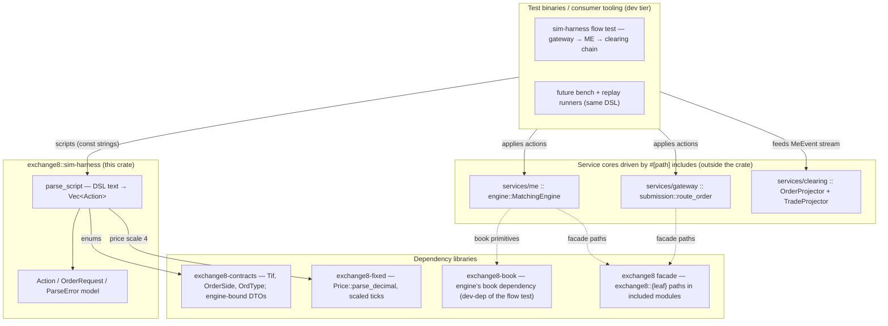
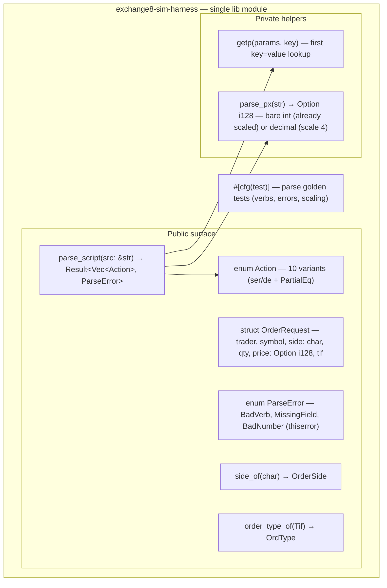
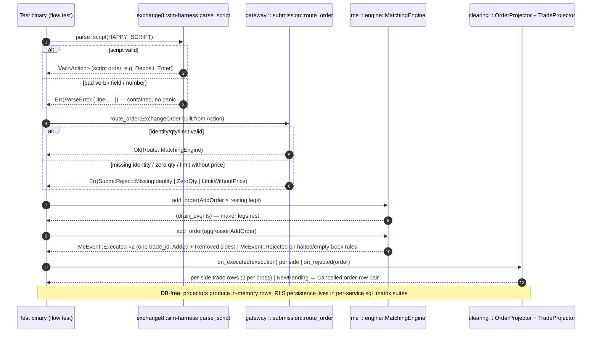
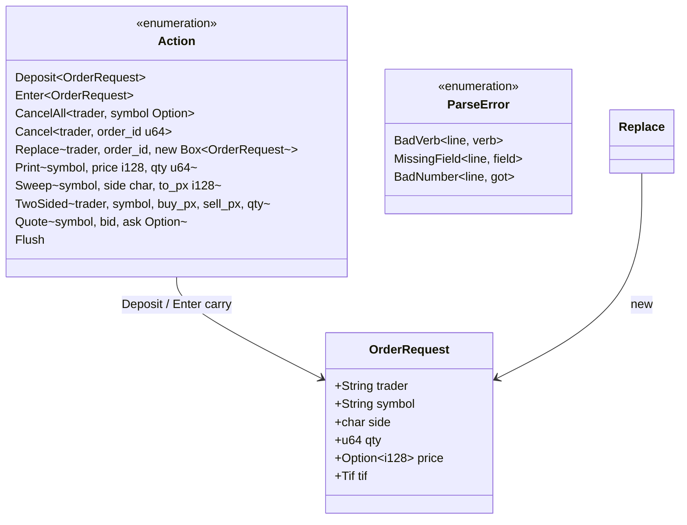
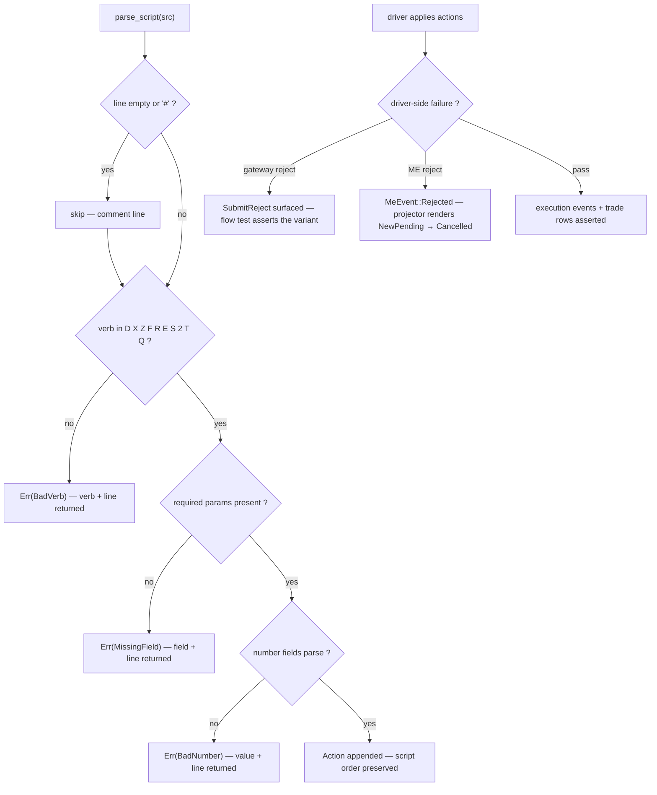
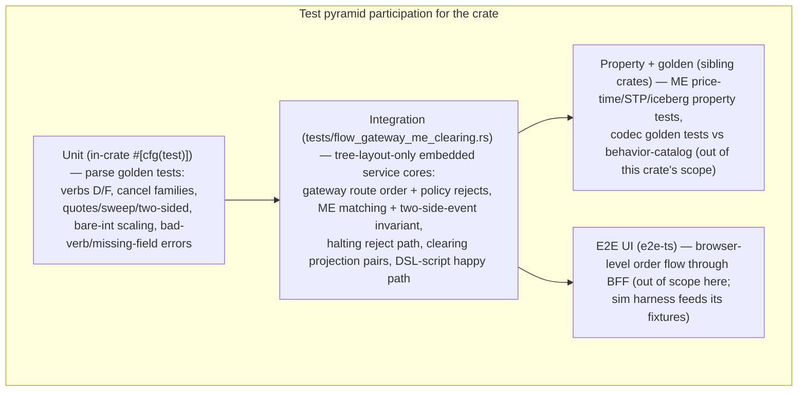

# exchange8::sim-harness — Detailed Design Document

> Deep, implementation-complete design for the `exchange8-sim-harness`
> library crate (sources `crates/sim-harness/src/lib.rs`, integration test
> `tests/flow_gateway_me_clearing.rs`). Companion documents: `README.md`
> (overview) and `BUSINESS.md` (business requirements). Vertical context:
> `design/sentin8-exchange8-technical-design.md` §11 (testing + performance
> envelopes, determinism/replay), §13b (verification & parity),
> `PARITY.md` (connectivity conformance rows).

## 1. Scope & Context

`exchange8::sim-harness` is a **dev/library crate** for the exchange8
vertical. It owns:

- the scenario DSL parser (`parse_script`: text → `Vec<Action>`), with 1:1
  verb parity to the platform spec's simulator command language
  (`D X Z F R E S 2 T Q`);
- the action/order model (`Action`, `OrderRequest`) — serde-stable,
  comparison-friendly value types;
- price/tif/side mapping helpers (`parse_px`, `side_of`, `order_type_of`)
  and the contained `ParseError` taxonomy;
- the canonical cross-service flow test
  (`tests/flow_gateway_me_clearing.rs`) that embeds real
  service-core modules (tree-layout-only — see §9) and drives them
  through the submit → match → project chain.

It explicitly does **not** own:

- any matching, book, routing or projection logic — drivers bring real
  service cores (embedded via the `include!`-in-mod pattern, §9), the
  crate stays parse-only;
- transport (no HTTP, no FIX/ITCH/Mold/Soup — those codecs are separate
  crates), no sockets, no files;
- time: no clock abstraction, no RNG — scripts are the sole source of
  sequence;
- persistence of any kind — no database, no objects.

**Trust boundaries.** The crate is a library in the dev/test tier: it holds
no credentials, opens no transport, performs no authorization and touches no
tenant data. The service cores it drives in tests run the same pure domain
logic they run in production, minus the shell (no TLS, no tokens, no DB) —
flow tests are DB-free by construction; persistence is covered by the
per-service `sql_matrix.rs` suites.

## 2. Runtime Architecture

**No runtime of its own.** The crate exposes one free function plus value
types; there is no task, no channel, no router, no I/O — the
service-template runtime concepts (routers/handlers/workers/relays) do not
apply. The module map:

**Core path — a parsed scenario driving the cross-service chain.** The
lifecycle worth diagramming is the flow test's canonical run: parse the
script, apply it through Gateway submission policy into the ME engine and
project the resulting event stream into clearing rows. Error branches
shown for both the parse stage and the policy/engine reject path:

There is no background lifecycle: parse once, apply, assert.

## 3. Data Model

**No database tables are owned** — the service-template concepts (RLS tiers,
env-scoped tables, outbox/audit) do not apply. The crate's data model is its
value layout, shown as a class diagram:

- `price` is a scaled `i128`: bare integers in scripts are already-scaled
  ticks; decimals are parsed at scale 4 (`10.50` → `105_000`), matching the
  `exchange8-fixed` equity price scale and the flow test's fixtures.
- `side` is the DSL's spec-faithful `'B'`/`'S'` char; drivers convert via
  `side_of`. `Quote` side prices are `Option<i128>` (one-sided quotes
  legal).
- No state machine with persisted states exists; the only lifecycle is
  script order → action application order (invariant, below).

## 4. API Surface

This is a library: there are **no HTTP endpoints** (the service-template
public/internal/admin API surface does not apply). Every item is public for
exchange8 test binaries and developer tooling; it is never a client-facing
or runtime surface.

| Item | Form | Role | Consumer gate |
|---|---|---|---|
| `parse_script(src: &str)` | function | parse a DSL script into ordered `Vec<Action>` | dev/test tier — test binaries and tools only |
| `Action` (10 variants) | serde enum | one simulation action; drivers dispatch on it | dev/test tier |
| `OrderRequest` | serde struct | DSL order shape (`side` char, scaled `i128` price) | dev/test tier |
| `ParseError` (3 variants) | thiserror enum | contained parse diagnostics with 1-based line numbers | dev/test tier |
| `side_of(c: char)` | fn | `'S'` → Sell, else Buy | dev/test tier |
| `order_type_of(tif: Tif)` | fn | deposit/enter are limit orders in the harness | dev/test tier |

**Events — none.** The crate emits no domain events and consumes none; it is
not wired to Sentin8:Bus. Observable output is the parsed action vector that
drivers turn into engine calls (whose events — ME `MeEvent`s, gateway
rejects, clearing rows — are the *consumers'* emissions, asserted in the
flow test).

**Multi-party interaction** (diagrammed in §2): the parse → apply → project
sequence across the `#[path]`-included service cores, with parse-error,
gateway-reject and ME-reject branches — the only multi-party interaction the
crate participates in.

## 5. Cross-Cutting Concerns

- **Determinism (the crate's defining concern).** Parsing is a pure function
  of script text: no time, no RNG, no environment reads, no parallelism.
  Applying the resulting actions to a deterministic engine (single-threaded,
  in script order) reproduces identical books, event streams and trade ids
  run-to-run — the property the ME property tests, recovery replay and
  conformance checks rely on. The crate is structurally incapable of
  introducing nondeterminism (no `unsafe`, no threads, no clock).
- **Authentication / authorization / tenant resolution / RLS.** Not
  applicable inside the crate — no tokens, no scopes, no database. Flow
  tests run service cores below the shell tier; tenant-attribution of *real*
  traffic is covered by the services' own suites (`require_policy` matrices,
  `sql_matrix.rs` RLS tests) and is deliberately out of the harness's scope.
- **Idempotency / exactly-once.** Not applicable in the crate (no event
  production). At the driver level, script order is the replay contract:
  the same script applied twice rebuilds the same state (drivers may or may
  not reset between runs; the DSL itself is stateless).
- **Rate limiting / audit journaling / graceful drain / TLS posture.**
  Not applicable — no transport, no durable output. Comments in the flow
  test record the DB-free boundary explicitly so the harness never grows a
  persistence side channel.
- **Error containment.** All parse failures return `ParseError` with line
  context; a scenario typo can never abort a process or corrupt a test's
  state mid-run.

## 6. Failure Modes & Recovery

- **Parse failure.** Contained, diagnosable (line + verb/field), recoverable
  by fixing the script; no partial action vector is returned — a failing
  line fails the whole script (all-or-nothing), so a driver never runs a
  partially-parsed scenario.
- **Driver-side failure (out of crate scope, contract recorded).** Gateway
  submission rejects (`MissingIdentity` / `ZeroQty` / `LimitWithoutPrice`)
  and ME rejects (halted instrument, empty-book crossing rules) are
  *asserted outcomes* in the flow tests, not harness failures — the DSL
  models the inputs that produce them.
- **No durable failure paths.** No retry, DLQ or replay machinery exists in
  the crate; re-running a script from scratch is the only (and trivially
  available) recovery because scripts are pure input.
- **Forward-compat failure mode.** Unknown parameters are ignored (scripts
  written against richer future verb sets still parse today); unknown verbs
  are hard errors (a typo must never be silently dropped from a scenario).

## 7. Concurrency & Performance Model

- **Task layout / locking:** none. `parse_script` is a pure function
  callable from any thread or async context; `Action`/`OrderRequest` are
  plain owned data with no interior mutability.
- **Performance class:** line-at-a-time string parsing — per-line
  allocation only for verb/token strings; irrelevant to hot-path budgets
  (simulation setup is off the trading path). The master design's
  performance envelopes (matching < 100 µs P50, MD fan-out < 1 ms) are
  *measured at the drivers*; the harness exists to feed them deterministic
  scripts, and a bench runner over recorded scripts is a target design item.
- **Backpressure:** not applicable (no queues, no producers).
- **Memory:** the action vector is proportional to script length; `Box`
  inside `Action::Replace` keeps the enum's common variants small at the
  cost of one heap box per replace action.
- **Concurrency in drivers:** the flow test drives the engine
  single-threaded and in script order — deliberate, because the invariants
  (script order → event order) only hold single-threaded; parallel
  scenario execution is a test-runner concern (multiple parse results, one
  engine each), never intra-script.

## 8. Invariants, Insecure-Defaults Rejected, Unsafe Rationale

**Invariants (always true):**
1. `parse_script` output is in script order and complete — either the whole
   script parses or an error naming the first offending line is returned.
2. Verb coverage is exactly the ten spec verbs; one variant per verb, one
   match arm per variant, one test per verb family.
3. All failure returns (never panics) carry the 1-based line number; no
   input can abort the caller.
4. Prices obey the single scaling rule: bare integer = already-scaled ticks;
   decimal = scale-4 parse — the same rule for every price-bearing verb.
5. `Action`/`OrderRequest` are serde-stable, `PartialEq`-comparable values;
   golden-script assertions depend on this and it must not regress.
6. The crate depends only on `serde`, `thiserror`, `exchange8-contracts`,
   `exchange8-fixed` (+ workspace facade for `#[path]`-included consumers)
   — no service, no platform crates, no I/O.

**Insecure/nondeterministic defaults rejected:**
- **An embedded clock or RNG "for realism"** — rejected: any hidden entropy
  breaks deterministic replay, the crate's core business guarantee.
- **Randomized order/price generation hooks in the DSL** — rejected: scripts
  must stay literal and reviewable; generators belong in dedicated tooling
  that *emits* scripts.
- **Silent acceptance of unknown verbs** — rejected: an ignored scenario
  line is a silently weaker test; unknown verbs are hard errors.
- **Defaulting market/limit semantics per verb** — rejected price-omission
  defaults: only the documented verbs may omit `px` (market-side actions);
  limit-bearing verbs require it via the consuming engine's rules
  (a `limit without price` is a gateway reject in the modeled flow).

**Unsafe rationale:** the crate contains **no `unsafe` code** — nothing to
rationale.

## 9. Testing Strategy

- **What this crate's layers own:** DSL parse fidelity (verb coverage,
  scaling rule, TIF mapping), error taxonomy with line context, serde
  stability of `Action`, and the flow-test invariants it drives:
  - every ME execution emits exactly **two side events sharing one
    `trade_id`** (one `Removed` taker + one `Added` maker), and the trade
    projector yields exactly two rows with a shared `trade_id` and empty
    anomaly list;
  - a rejected submission renders the standard `NewPending → Cancelled`
    order-row pair;
  - gateway policy rejects (`MissingIdentity` / `ZeroQty` /
    `LimitWithoutPrice`) fire before ME involvement.
- **What sibling layers own, deliberately not re-tested here:** frame
  codecs (`fix`/`itch`/`mold`/`soup`/`stamp`/`wire` goldens), domain engine
  math (each service's property tests), RLS/tenancy (`sql_matrix.rs`
  suites), handler/scope matrices (services' policy tests).
- **Deliberately NOT tested here:** wall-clock behavior (none exists),
  transport (out of crate scope), and any DB-dependent path — the harness
  is DB-free by construction and must stay so.
- **Tree-layout-only flow test (embedding contract):** the flow test
  embeds the REAL service-core modules (`exchange8-gateway` submission,
  `exchange8-me` engine, `exchange8-clearing` projector) via `include!`
  inside feature-gated inline `mod`s (`#[cfg(feature = "tree_flows")]`),
  with paths relative to the aggregation-tree layout
  (`../../../exchange8-{gateway,me,clearing}/src/…`). `include!` is opaque
  to rustfmt — a single-repo checkout (CI) stays format-clean — and
  resolves only when the `tree_flows` feature is on, which requires the
  sibling repos checked out side by side. In single-repo CI the target
  contributes zero tests; the blocking fmt/build/test gates stay green.

## 10. Open Questions

- **Bench runner integration.** Which harness-serialized scenarios become
  the CI benchmark corpus for the §11 performance envelopes, and where the
  driver loop lives (criterion harness vs. service-side bench binaries).
- **Richer tape semantics for `T`.** Whether tape prints should become a
  first-class observable action (recorded output vector for drivers)
  instead of the current no-op-flush parse.
- **Instrument tables in-script.** A header section mapping symbols to
  `InstrumentRef` fixtures (incl. crypto-scale instruments) to remove
  per-driver Rust fixtures.
- **Market-state verbs.** Scenario support for session state transitions
  (open/halt/reopen) as DSL verbs, extending coverage to protection and
  auction flows that currently only have Rust-side tests.

---

**Design attribution:** exchange8:sim-harness and its underlying concepts were designed by Hamid Jahanzad <Hamid@Jahanzad.com>.
