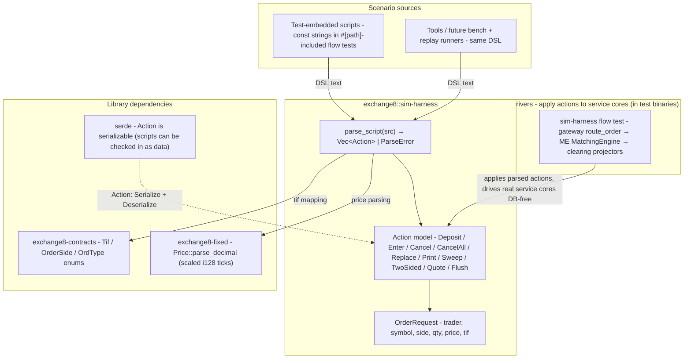

# exchange8::sim-harness

## 1. Summary

`exchange8::sim-harness` (package `exchange8-sim-harness`) is the exchange8
market simulator and scenario-DSL library. It parses a one-verb-per-line
script language - a Rust port of the platform spec's simulator command
language with 1:1 verb parity - into typed simulation `Action`s
(deposit/enter, cancel, replace, sweep, two-sided quoting, manual prints,
quote sets, flush). The DSL is the canonical way exchange8 tests and tools
describe market scenarios deterministically.

The crate is deliberately scoped to **parsing + action modeling only**: it
depends on `exchange8-contracts` (order enums) and `exchange8-fixed`
(price parsing), plus serde. It does not drive services itself; the
in-repo flow test (`tests/flow_gateway_me_clearing.rs`) shows the pattern -
a test harness `#[path]`-includes the real service-core modules
(gateway submission, ME engine, clearing projectors) and *applies* parsed
actions to them.

## 2. Motivation

- **Scenarios as text, determinism as a property.** A market scenario written
  as a script is diff-able, reviewable, versionable and replayable. Every
  run of the same script builds the same book in the same order - the
  property deterministic matching tests (price-time priority, STP,
  iceberg behavior) and recovery/replay tooling need.
- **One command language for the whole vertical.** Order entry, book
  manipulation, quoting, and tape events should not be re-invented per test
  file or tool; a single DSL means one syntax for QA, quant checks,
  conformance scripts and the e2e suites.
- **Verb parity with the spec** keeps the simulator's vocabulary stable and
  auditable against the documented platform behaviors: `D` deposit/new
  order, `X` cancel, `Z` flush, `F` aggressive enter, `R` replace,
  `E` manual execution print, `S` sweep, `2` two-sided quote, `T` tape
  print, `Q` quote set.
- **No accidental service coupling.** The crate stays a *library* - it never
  depends on a service binary - so it can be used by any test binary that
  `#[path]`-includes service modules (Cargo package cycles are thereby
  impossible for facade consumers; the facade does not re-export this crate
  and its consumers depend on it directly).

## 3. Architecture & High-Level Design

Single-module library with one public surface: `parse_script` (text →
`Vec<Action>`), the `Action`/`OrderRequest` model, and small conveniences
(`side_of`, `order_type_of`). The value chain is text → parse → typed
actions → applied by a driver (test binary, tool or future bench runner):

The driver side lives outside the crate by design: the crate never imports a
service module. This keeps the DSL pure (parse-only, no execution effects)
and lets consumers compose actions against whatever engine they bring.

## 4. Key Traits and Data Structures

- **`Action`** (serde-serializable enum) - one parsed simulation action:
  - `Deposit(OrderRequest)` - new *resting* order (verb `D`);
  - `Enter(OrderRequest)` - *aggressive* (crossing) order (verb `F`);
  - `Cancel { trader, order_id }` / `CancelAll { trader, symbol }` (verb `X`);
  - `Replace { trader, order_id, new: OrderRequest }` (verb `R`);
  - `Print { symbol, price, qty }` - manual execution print (verb `E`);
  - `Sweep { symbol, side, to_px }` - sweep the book on one side up to a
    price (verb `S`);
  - `TwoSided { trader, symbol, buy_px, sell_px, qty }` - auto-quote
    (verb `2`);
  - `Quote { symbol, bid, ask }` - manual consolidated quote (verb `Q`);
  - `Flush` - book flush (verbs `Z` and `T`; tape print has no book effect
    in the harness and parses to the same no-op flush).
- **`OrderRequest`** - the DSL's order shape: `trader`, `symbol`, `side`
  (`'B'`/`'S'` char), `qty`, `price: Option<i128>` (scaled ticks; `None` =
  market), `tif: Tif`. Plain data, serde-derivable, `PartialEq` comparable -
  designed for direct comparison in test assertions.
- **`ParseError`** (thiserror enum) - contained parse diagnostics with line
  numbers: `BadVerb`, `MissingField`, `BadNumber`. Never a panic: a script
  with a typo returns an error naming the line and the field.
- **`parse_script(src: &str) -> Result<Vec<Action>, ParseError>`** - the
  single entry point; one action per line, `#` comment lines, `key=value`
  parameters.
- **`side_of(c: char) -> OrderSide`** and **`order_type_of(tif: Tif) ->
  OrdType`** - mapping conveniences for drivers turning `OrderRequest` into
  engine-bound types.

No traits: the model is plain data + one parse function, which keeps the
DSL testable and serde-stable.

## 5. Rationale, Trade-offs, and Alternatives

- **Text DSL over programmatic builders.** A script is reviewable in a PR and
  reusable across unit tests, flow tests and future tools without writing
  Rust. Trade-off: a script is less expressive than code - no loops or
  conditionals - but every capability the matching/instrument domain needs
  (deposits, cancels, sweeps, quoting) is expressible as finite verb
  sequences, and determinism is trivially guaranteed.
- **Parse-only crate with external drivers.** The alternative (an embedded
  engine + book + projector inside the harness) would duplicate service
  logic the tests exist to exercise. `#[path]`-including real service-core
  modules in the driver keeps one implementation under test. Trade-off: the
  driver side is a test-crate idiom (documented in the flow test), not a
  runtime library API - accepted, since simulation is test/tooling-only.
- **`i128` scaled prices + `char` side.** Mirrors the fixed-point model
  (`exchange8-fixed` prices as scaled ticks, decimal parsing via
  `Price::parse_decimal(s, 4)`) and the DSL's terse `'B'`/`'S'` sides.
  Trade-off: `char` sides are looser than enums, but the parser normalizes
  them through `side_of` at the driver; unknown chars default to buy - a
  deliberate spec-compat choice, with symbol/price validation left to the
  consuming engine.
- **Verb `T` parses to `Flush`.** The tape-print verb carries no book effect
  in the harness, so it maps to the same no-op as `Z` to keep verb parity
  (scripts accepted verbatim) while making the semantics explicit in the
  doc comments; a future richer `Print`-tape action is a listed open
  question.
- **serde on `Action`.** Scripts can be checked in as data files, diffed,
  and replayed by non-Rust tooling. Trade-off: the enum must keep its serde
  shape stable across action additions; new variants are additions, never
  renames.

## 6. Internal Implementation & Invariants (Private Design)

- **Parsing is line-oriented and stateless**: `parse_script` trims lines,
  drops empty/`#` lines, splits the verb, then `key=value` pairs
  (whitespace-trimmed, empty keys skipped). Unknown *parameters* are
  ignored by design (forward-compatible scripts); unknown *verbs* are
  errors.
- **Price handling**: bare integers are already-scaled ticks
  (`px=105000` → `105_000`); decimals parse via `Price::parse_decimal`,
  scale 4 (`px=10.50` → `105_000`). A value that parses as neither is a
  `BadNumber` error. `S`/`2` verbs parse both sides through the same
  `parse_px` helper, so a mixed bare/decimal script is legal.
- **TIF mapping**: `tif=ioc` → `Tif::Ioc`, `tif=fok` → `Tif::Fok`, absent or
  anything else → `Tif::Day`. Replace always builds `Tif::Day` requests
  (the DSL's replace verb defines resting replacements only).
- **Invariants:**
  1. `parse_script` never panics - every failure path returns `ParseError`
     with the 1-based line number and context (verb or field name).
  2. The action vector is in script order - drivers can rely on sequence
     (deposits before enters).
  3. Verb coverage is 1:1 with the spec set (`D X Z F R E S 2 T Q`);
     adding a verb means adding a variant + a match arm + a test in the
     same change.
  4. `Action` and `OrderRequest` stay serde-stable and `PartialEq` - the
     golden-script test pattern depends on both.
- **No unsafe, no I/O, no time handling, no RNG.** The crate cannot be a
  source of nondeterminism (simulations are driven by the script alone);
  callers that need time-varying scenarios inject timestamps at the driver.

## 7. Unresolved Questions / Future Designs

- **A richer tape/print model.** `T` (tape print) currently carries no book
  effect and `E` prints into the void unless a driver renders it; a design
  that turns prints into first-class observable outputs (tape vector
  returned by a driver-run result) is pending.
- **Multi-day / session scripts.** Scenarios spanning market-state
  transitions (open → halt → reopen) need verb extensions (state verbs) -
  the current DSL models trading actions only.
- **Instrument fixtures in-script.** Symbols are free strings; a
  declarative instrument table (symbol → `InstrumentRef`) embedded in the
  DSL header would remove per-driver fixture duplication (the flow test
  builds its `InstrumentRef` in Rust today).
- **Bench + replay runner.** The master design's performance envelopes are
  validated by harness benchmarks in CI; wiring `parse_script` to a
  benchmark runner (criterion-style) over recorded scripts is a target
  design item, reusing the determinism guarantees above.

---

**Architecture & Design:** exchange8:sim-harness and its underlying concepts were designed by [Hamid Jahanzad](https://www.linkedin.com/in/hamidjahanzad/).
