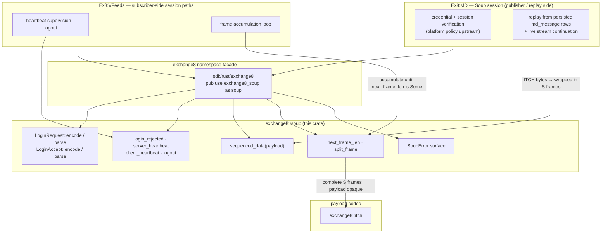
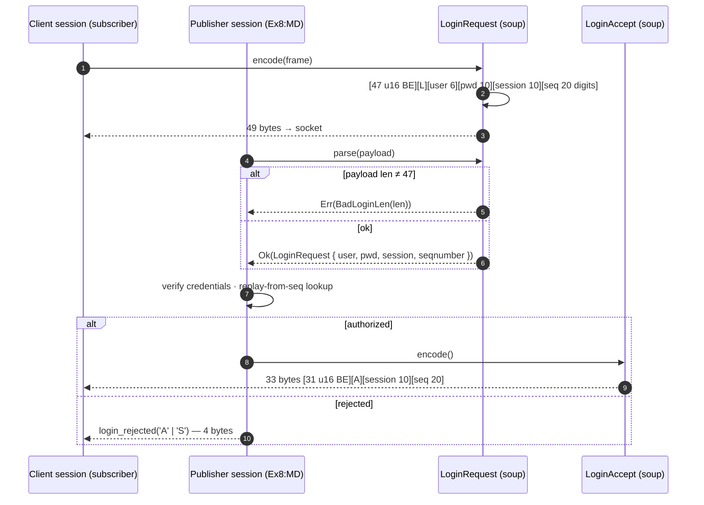
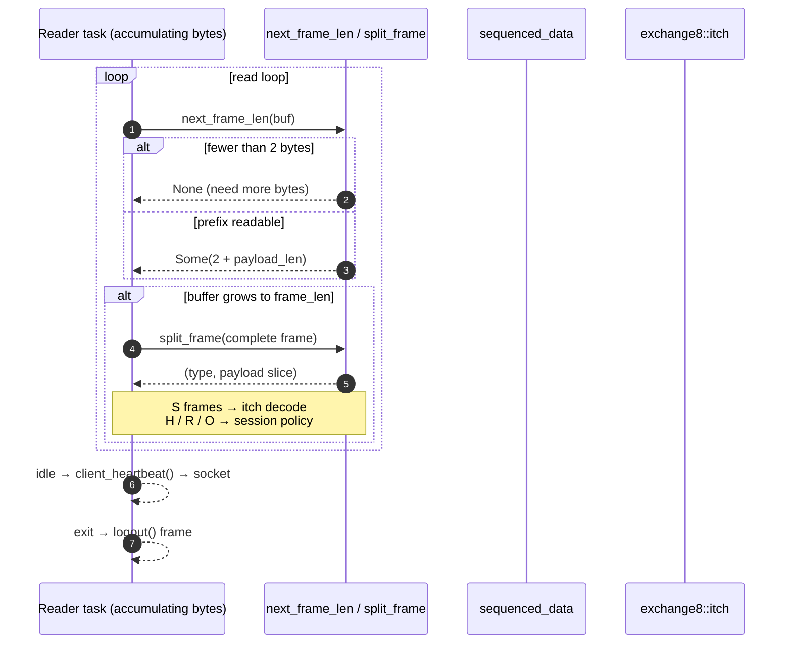
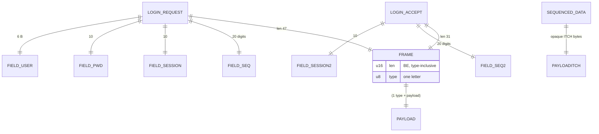
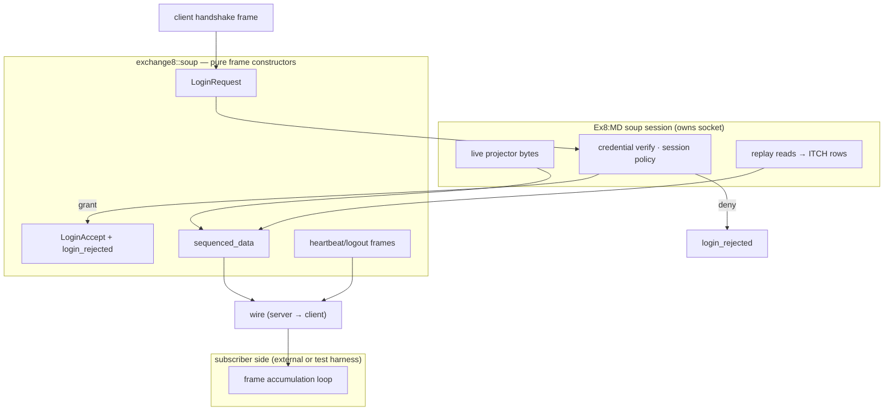
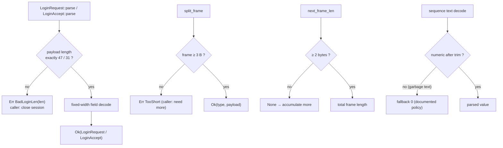
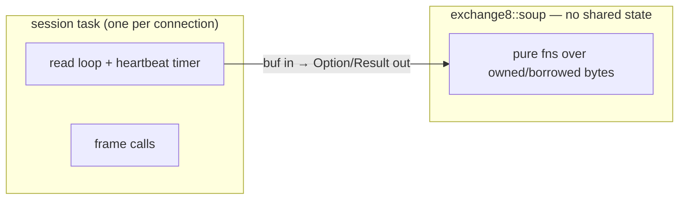
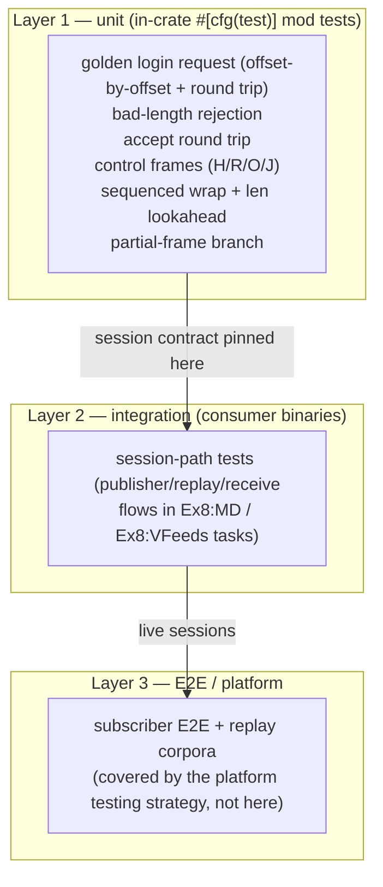

# DESIGN.md: exchange8::soup — Detailed Design Document

## 1. Scope & Context

`exchange8::soup` owns the SoupBinTCP session wire contract for the
exchange8 vertical: the universal `[len u16 BE][type char][payload]`
frame grammar, the fixed-width handshake payloads (Login Request 47 /
Accept 31 / Reject 2 bytes), the control frames (server heartbeat, client
heartbeat, logout), sequenced-data wrapping, and the stream read support
(`next_frame_len`/`split_frame`). It explicitly does **not** own:

- sockets, connection state, heartbeat intervals, reconnection — the
  consuming services' session tasks (Ex8:MD soup servers, Ex8:VFeeds
  session paths) per the market-data design §4.3;
- credential verification and authorization — the shell/platform
  (Sentin8:Auth, Sentin8:Proxy) decides; the crate only carries the
  fields (lossy-trimmed strings, tolerant numeric);
- payload content — `S` frames carry ITCH bytes owned by
  `exchange8::itch`;
- MoldUDP64 downstream packet framing — `exchange8::mold`.

There is no HTTP surface, no database presence, no event emission, no
runtime of its own: the crate is a pure framing library compiled into
the facade `exchange8::soup` (package `exchange8-soup`, workspace member
`crates/soup`) and statically linked into consumer binaries.

### System context

## 2. Runtime Architecture

The runtime-architecture section of the service template does not apply:
the library has no tasks, routers, workers, caches, or background jobs.
Its "architecture" is the module map of one file and the two call shapes
(login handshake; session stream loop) the consumers drive.

### Module map (`src/lib.rs`)

| Unit | Visibility | Responsibility |
|---|---|---|
| `LINE_FEED` (0x0A) | `pub const` | Classic Soup line-termination byte (surface reserved) |
| `msg_type` (8 letters) | `pub mod` | `L` login request, `A` accepted, `J` rejected, `S` sequenced data, `H` server heartbeat, `R` client heartbeat, `U` unsequenced data, `O` logout |
| `reject_reason` (2 codes) | `pub mod` | `A` not authorized, `S` session not available |
| `LOGIN_REQUEST_LEN` (47) / `LOGIN_ACCEPT_LEN` (31) / `LOGIN_REJECT_LEN` (2) / `SERVER_HEARTBEAT_FRAME` (3) | `pub const` | Exact payload/frame sizes (type char inclusive) |
| `SoupError { TooShort, BadLoginLen, UnknownType }` | `pub enum` | Whole failure surface |
| `LoginRequest` | `pub struct` | Handshake payload: username, password, session, `seqnumber u32`; `parse`/`encode` |
| `LoginAccept` | `pub struct` | Session + starting sequence; `parse`/`encode` |
| `login_rejected(reason)`, `server_heartbeat()`, `client_heartbeat()`, `logout()` | `pub fn` | Exact control-frame constructors |
| `sequenced_data(payload)` | `pub fn` | `S` frame wrapper for ITCH bytes |
| `next_frame_len(buf)`, `split_frame(frame)` | `pub fn` | Stream read support |
| `field_str` / `push_field` | private fn | Fixed-width ASCII field trim/pad helpers |

### Handshake path (login)

### Session stream path (data + control, with partial-frame branch)

## 3. Data Model

The library owns no tables. Its "data model" is the frame grammar plus
the two handshake payloads.

| Structure | Fields | Wire representation |
|---|---|---|
| `LoginRequest` | `username`, `password`, `session` (`String`), `seqnumber: u32` | Frame `[47 u16 BE][L]` + payload: user[6]@payload 1..7 (frame 3), pwd[10]@7..17, session[10]@17..27, seq 20 digits@27..47 |
| `LoginAccept` | `session` (`String`), `seqnumber: u32` | Frame `[31 u16 BE][A]` + payload: session[10]@1..11, seq 20@11..31 |
| control frames | — | `[1 u16 BE][type]` for H/R/O; `[2 u16 BE][J][reason]` for rejection |
| sequenced data | `&[u8]` ITCH payload | `[1+len u16 BE][S][payload]` |

- Types derive `Debug + Clone + PartialEq + Eq`; fixed-width ASCII
  fields trim trailing bytes on parse, blank-pad on encode.
- The sequence travels as a 20-character right-aligned decimal string;
  decode trims, parses, and falls back to 0 on non-digit text.

## 4. API Surface

Public API inventory (library audience: exchange8 services; no
authorization gate applies — there are no endpoints, scopes, or tenant
contexts to gate):

| Item | Kind | Contract |
|---|---|---|
| `LINE_FEED` | const | `0x0A` |
| `msg_type::{LOGIN_REQUEST…LOGOUT}` | consts | `L A J S H R U O` type letters |
| `reject_reason::{NOT_AUTHORIZED, NO_SESSION}` | consts | `A` / `S` |
| `LOGIN_REQUEST_LEN` / `LOGIN_ACCEPT_LEN` / `LOGIN_REJECT_LEN` / `SERVER_HEARTBEAT_FRAME` | consts | 47 / 31 / 2 / 3 |
| `LoginRequest::parse(payload) -> Result<Self, SoupError>` | static | Requires exactly 47 payload bytes; tolerant seq decode |
| `LoginRequest::encode() -> Vec<u8>` | method | Full 49-byte frame, blank-padded fixed widths |
| `LoginAccept::parse / encode` | static/method | 31-byte payload ↔ 33-byte frame inverse pair |
| `login_rejected(reason)` | fn | 4-byte frame |
| `server_heartbeat()` / `client_heartbeat()` / `logout()` | fns | 3-byte frames |
| `sequenced_data(itch_payload)` | fn | `[2+1+n u16 BE][S][payload]` |
| `next_frame_len(buf) -> Option<usize>` | fn | `None` until 2 prefix bytes; else total frame size |
| `split_frame(frame) -> Result<(u8, &[u8]), SoupError>` | fn | `(type, payload)` of a complete frame |
| `SoupError { TooShort, BadLoginLen, UnknownType }` | enum | Whole failure surface; `Display` part of contract |

Emissions: none. The library emits no domain events and participates in
no outbox/trigger chain — the event-flow diagram of the service template
does not apply.

## 5. Cross-Cutting Concerns

Each service-template concern below is either answered for a pure library
or explicitly does not apply.

- **Deterministic outcomes.** Same struct → same frame bytes; same
  payload → same parse, always (only the tolerant-sequence fallback is
  input-shaped).
- **Wire fidelity.** The frame grammar, handshake offsets, fixed widths,
  and blank-padded 20-digit sequence are pinned by golden tests anchored
  to `wire-formats.json` (`soupbin_login` block).
- **Precision / endianness.** The one numeric wire field (frame length)
  is `u16` **big-endian**; sequence digits are ASCII decimal.
- **Idempotency / exactly-once.** Not applicable at the library level —
  replay-from-sequence and dedupe are the session model's semantics; a
  re-encoded identical handshake is byte-identical.
- **Authentication.** The *frames* carry credentials; verification,
  policy, and any secret handling are upstream (service shell /
  Sentin8:Auth). The crate never stores or logs credentials — fields
  cross as `String` payloads of callers.
- **RLS / tenant context / audit / rate limiting / drain / TLS.** Not
  applicable — no endpoints, no database, no sockets, no caller
  identity; session TLS is the service shell's (`sentin8-tls`).

## 6. Failure Modes & Recovery

The library performs no I/O; failure is value-level, deterministic, and
total — frame constructors are total, and the fallible parse/split
surfaces reject whole-frame.

- **`BadLoginLen`** is the handshake's integrity gate — a non-catalog
  payload means a non-Soup peer or corruption; the caller's policy is
  connection termination.
- **Partial frames.** `next_frame_len` returning `None` is the normal
  "arrive later" signal, not an error; the stream loop accumulates.
- **`TooShort` on `split_frame`** guards against callers splitting an
  incomplete frame; `UnknownType` is carried for consumers that
  dispatch on type letters with an unknown-letter policy.

## 7. Concurrency & Performance Model

- **No shared state.** All functions are pure over their inputs; frames
  are small owned or borrowed byte spans — any number of connections
  may run concurrently in any host with zero synchronization.
- **Allocation profile.** Encode allocates one exact-capacity `Vec`
  per frame; `split_frame` and `next_frame_len` allocate nothing
  (slices/lookahead only); parses build one small struct.
- **Hot path.** The data-frame wrap is a length add + byte copies in
  frame order; reader-side lookahead is two byte reads plus arithmetic.
  Handshakes are once-per-session.
- **Throughput posture.** Session volume (~4k msg/s per published
  session, transport-driven) sits inside the consumer's existing task
  budget; codec cost is negligible against socket reads.

## 8. Invariants, Insecure-Defaults Rejected, Unsafe Rationale

**Invariants** (pinned by the golden tests):

1. Frame grammar: every frame is `[len u16 BE][type][payload]`, and no
   frame is shorter than 3 bytes.
2. `len` counts the type char; the 2-byte prefix is excluded.
3. Login request payload == 47 bytes, accept == 31; parse enforces it
   with a typed error otherwise.
4. `parse(encode(x))` reproduces the exact struct for both handshake
   payloads.
5. Fixed-width fields truncate inputs to width on encode and trim
   blanks on parse; the sequence field is a 20-char right-aligned
   decimal string.
6. Control frames are payload-free; their `split_frame` payload is
   empty.
7. `next_frame_len` is prefix-consistent: it returns the exact total
   size of the frame whose 2-byte prefix it reads.

**Insecure defaults rejected:**

- *Guessing frame lengths* (parsing incomplete buffers) — corrupts the
  stream cursor irrecoverably; `None`-until-ready instead.
- *Silent length truncation of handshake payloads* — hides peer
  misbehaviour; typed `BadLoginLen` immediately.
- *Strict rejection of non-digit sequence text* — cosmetic deviations
  would kill sessions; tolerant 0-fallback mirrors reference behavior
  (policy question flagged in §10).
- *Interpreting `S` payloads inside the framing crate* — layers must
  not peer into each other's content; ITCH decoding stays in its crate.
- *Secret persistence* — no credential storage anywhere; fields cross
  as caller-owned strings.

**Unsafe rationale:** none — the crate contains no `unsafe` blocks and
no FFI; all byte access is safe slicing.

## 9. Testing Strategy

- **Owned here (unit):** the handshake and framing contract —
  `login_request_golden` (byte-level field offsets + round trip),
  `login_bad_length_rejected`, `login_accept_layout` (+ round trip),
  `control_frames` (H/R/O/J shapes and type letters),
  `sequenced_data_wraps_itch` (wrap + lookahead + split),
  `partial_frame_needs_more` (accumulate-more branch). All tests are
  pure byte assertions, no fixtures outside the crate.
- **Deliberately NOT tested here:** socket/stream behavior, heartbeat
  timing policy, replay reads (`exchange8::mold`, Ex8:MD session
  design), and ITCH payload semantics (`exchange8::itch`).
- **Run:** part of the vertical workspace test pipeline — the
  `crates/soup` unit tests are compiled and executed with the
  exchange8 workspace gate (never outside the workspace Makefile).

## 10. Open Questions

- **Unsequenced-data (`U`) pair.** Type letter pinned, no constructor
  or decode helper yet; lands with a client-side submit need.
- **Sequence-strictness variant.** A `Result`-returning parse for
  callers who must distinguish "sequence 0" from "non-numeric field".
- **Additional classic event types.** End-of-session and debug letters
  are known but unsupported with helpers; consumer demand decides.
- **Supervision helpers.** Heartbeat timing policy is session-task
  business today; if a second consumer repeats the supervision logic, a
  shared, codec-adjacent helper may be extracted.
- **TLS/auth posture.** Whether platform identity (token-grade
  credentials) ever replaces fixed-width user/password on this wire — a
  session-service design decision, not a framing one.

## Design source map

| Aspect | Source |
|---|---|
| Frame grammar + handshake offsets | `design/behavior-catalog/wire-formats.json` (`soupbin_login`) |
| Session model context | `design/sentin8-exchange8-market-data-technical-design.md` §4.3 |
| Frame constants | `crates/soup/src/lib.rs` (unit sources) |

---

**Design attribution:** exchange8:soup and its underlying concepts were designed by Hamid Jahanzad <Hamid@Jahanzad.com>.
