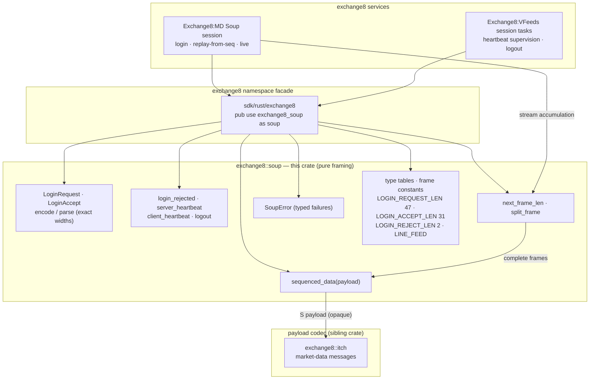

# README.md: exchange8::soup

## 1. Summary

`exchange8::soup` is the SoupBinTCP session-framing codec of the
exchange8 vertical: it encodes and decodes the login conversation
(Login Request / Accept / Reject — including the fixed-width credential
fields' exact layout), builds the control frames (server/client
heartbeats, logout), wraps ITCH payloads into sequenced-data frames,
and supplies the incremental length-prefix logic a stream reader needs
(`next_frame_len` / `split_frame`). It is a pure library — no sockets,
no database, no endpoints, no process of its own. Connection lifecycle,
heartbeat timing, and byte-stream plumbing belong to the consuming
services (Exchange8:MD publisher, Exchange8:VFeeds sessions).

## 2. Motivation

Every SoupBinTCP conversation begins with two fixed-shape handshake
packets whose field offsets are pinned by the wire catalog, and then
proceeds entirely in the same universal frame: a 2-byte big-endian
payload length followed by a type byte and the payload. The codec exists
so that both ends of that conversation have one exact definition:

- **Fixed-width handshake fidelity.** The 49-byte login-request frame
  (user 6, password 10, session 10, sequence 20 as blank-padded digits)
  and 33-byte login-accept are produced and consumed field-exactly,
  anchored to `design/behavior-catalog/wire-formats.json`.
- **One universal frame grammar.** Every other message — heartbeat,
  logout, sequenced ITCH data — is the same `[len u16 BE][type][payload]`
  shape, so the reader is two functions.
- **The sequence handshake is a number.** The 20-character right-aligned
  sequence fields encode the subscriber's replay-from position; the codec
  turns that ASCII field into a `u32` (tolerantly) and back, so
  "resubscribe from sequence 100" is parseable, not stringly-typed.
- **Determinism.** Bytes-in/bytes-out with no I/O lets replay corpora
  and conformance tests run standalone.

## 3. Architecture & High-Level Design

The crate is a single module (`src/lib.rs`) of pure functions and payload
values. Consumers own the TCP connection and the heartbeat timer; they
call `encode`/builders to write frames and `next_frame_len`/`split_frame`/
payload parsers to consume. The `exchange8` namespace facade exposes the
crate as `exchange8::soup`.

- **The codec frames, it does not drive.** Heartbeat intervals,
  reconnection, and replay cursor management sit in the session tasks;
  this crate only makes their wires exact.
- **Three handshake payloads are structs; everything else is a byte.**
  Login/Accept conversations are typed; heartbeats/logout are single
  frame constructors.
- **Sequence recovery rides the handshake.** The login request's
  sequence field is the replay-from position — the codec's role is to
  move the number across the wire losslessly.

## 4. Key Traits and Data Structures

There are no traits, no dyn dispatch — payload structs and frame
constructors.

- **`LoginRequest`** — the subscriber's credentials: `username`,
  `password`, `session`, `seqnumber: u32`. `parse(payload)` insists on
  exactly the 47-byte payload (payload-relative offsets user@1..7,
  pwd@7..17, session@17..27, seq@27..47 — catalog frame anchors
  user@3, pwd@9, session@19, seq@29), decoding digits tolerantly (`0`
  fallback); `encode()` produces the full `[len u16 BE][L][fields][seq-20-digits]`
  frame with blank-padded right-aligned sequence digits.
- **`LoginAccept`** — the publisher's grant: `session` + `seqnumber`.
  31-byte payload ↔ 33-byte frame discipline; `parse`/`encode` inverse
  pair.
- **Control frame constructors** — `login_rejected(reason)`
  (reason `A` not authorized / `S` session not available from
  `reject_reason`), `server_heartbeat()`, `client_heartbeat()`,
  `logout()` — each producing the exact 3–4-byte frame.
- **`sequenced_data(itch_payload)`** — wraps an ITCH payload as the `S`
  server→client message; `next_frame_len(buf)` reads the 2-byte
  prefix to compute the total expected frame length (`None` until two
  bytes are available); `split_frame(frame)` yields
  `(type byte, payload slice)`.
- **Type tables** — `msg_type` (`L A J S H R U O` letters),
  `reject_reason`, and frame constants (`LOGIN_REQUEST_LEN` 47,
  `LOGIN_ACCEPT_LEN` 31, `LOGIN_REJECT_LEN` 2, `SERVER_HEARTBEAT_FRAME`
  3, `LINE_FEED` 0x0A).
- **`SoupError`** — the codec's whole failure surface:
  `TooShort { need, have }`, `BadLoginLen(len)`, `UnknownType(byte)`.

## 5. Rationale, Trade-offs, and Alternatives

- **Full-frame constructors over a socket state machine.** The wire is
  byte-exact but tiny; owning a `LoginState` inside the codec would drag
  reconnection/heartbeat policy in with it. Pure frame functions let the
  session task (which already owns the socket timer) compose them.
- **Numeric fields as blank-padded ASCII.** The 20-digit sequence field is
  blank-padded right-aligned exactly as established Soup implementations
  emit it; decoding parses it tolerantly (whitespace-trimmed, `0`
  fallback on garbage). Strict rejection on non-digit sequence text was
  rejected: session fields are echoed metadata, and a tolerant decode
  matches the reference implementation's behavior without rejecting
  cosmetic deviations.
- **`BadLoginLen` over silent truncation.** The login payload has an
  exact catalog length (47/31); anything else means the peer is not a
  Soup endpoint or the frame is corrupt — typed rejection immediately.
- **`next_frame_len` / `split_frame` as separate calls** — the reader
  accumulates bytes, asks "is a whole frame here?", then splits it. A
  streaming incremental parser could hide this, but the two-function
  contract is stateless and maps directly to any async read loop the
  consumer already runs.
- **Sequenced data payloads stay opaque.** The crate does not peer into
  `S` payloads — ITCH bytes are `exchange8::itch`'s; framing layers must
  not interpret each other's content.
- **No serde, no async, no I/O.** `thiserror` alone; the codec compiles
  into any consumer including test harnesses.

## 6. Internal Implementation & Invariants (Private Design)

- **Field helpers** — `field_str(bytes)` trims trailing bytes from the
  lossy-UTF-8 view; `push_field(out, value, width)` copies up-to-width
  bytes then pads with spaces — the two together round-trip fixed-width
  ASCII fields exactly.
- **Frame-relative offsets.** The catalog speaks frame offsets (user@3
  = after the 2-byte prefix + 1 type byte); payload-relative parsing
  shifts by 2 (`user@1..7`, pwd@7..17, session@17..27, seq@27..47) —
  both coordinate systems are documented at the parse sites.
- **Sequence encoding** — `format!("{:>20}", seq)` right-aligns into the
  20-field; parse trims and parses (fallback 0). Encode is total for
  any `u32`.
- **Invariants held across encode/parse:**
  1. Every frame begins `[len u16 BE][type]`; the count includes the
     type byte, not the 2 byte prefix.
  2. `parse(encode(x))` reproduces the exact struct for both login
     payloads.
  3. `encode` output lengths are exact: 2+47, 2+31, 4, 3, 3, 3, and
     `2 + 1 + payload` respectively.
  4. Fixed-width fields are trimmed on parse, blank-padded on encode —
     identity holds for inputs up to the exact width (longer inputs
     truncate to width by protocol contract).
  5. Control frames have no payload; `split_frame` on them yields an
     empty slice, never an error.

## 7. Unresolved Questions / Future Designs

- **Unsequenced data (`U`) support.** The type letter is pinned but no
  constructor/helper exists yet; arriving with a client-side consumer
  that submits unsequenced traffic.
- **End-of-session / debug event types.** The classic protocol carries
  additional letters (`Z` end of session, `+` debug) the current
  consumer surface never meets; a pass-through helper pair may follow
  the same need.
- **Tolerant `u32` fallback policy.** Sequence decode falling back to 0
  on non-digit text is documented; an explicit `Result`-based parse
  variant could make the fallback a caller policy instead.
- **Heartbeat timeout supervision.** Timing (interval, missed-beat
  policy) is session-task business; the codec supplies only the frames —
  supervision helpers stay out unless a second consumer demands a
  shared implementation.

---

**Design attribution:** exchange8:soup and its underlying concepts were designed by Hamid Jahanzad <Hamid@Jahanzad.com>.
