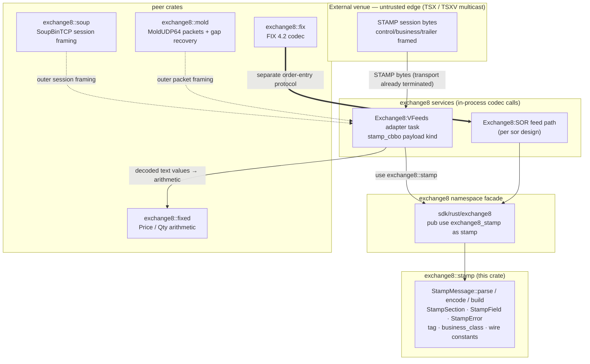
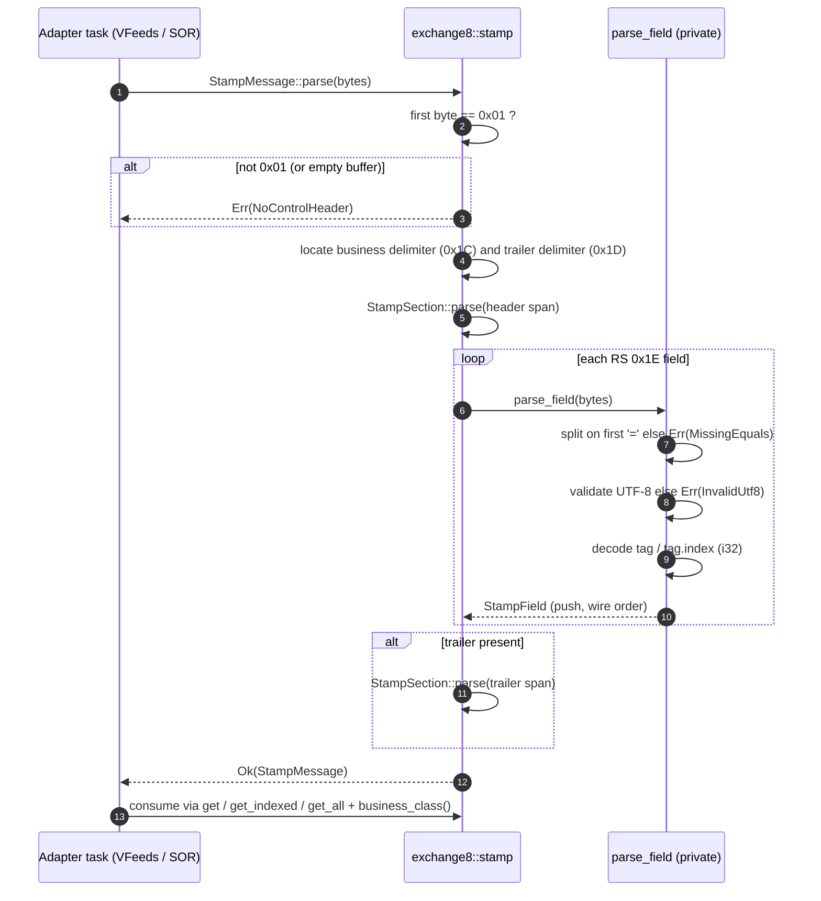
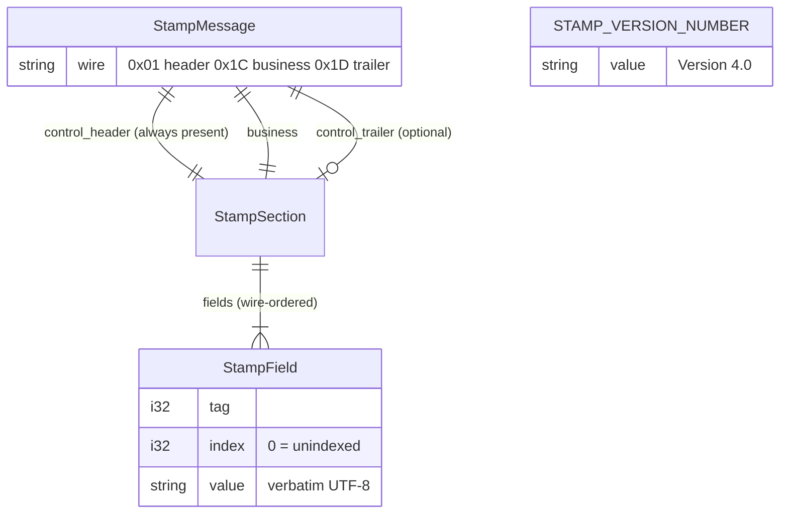
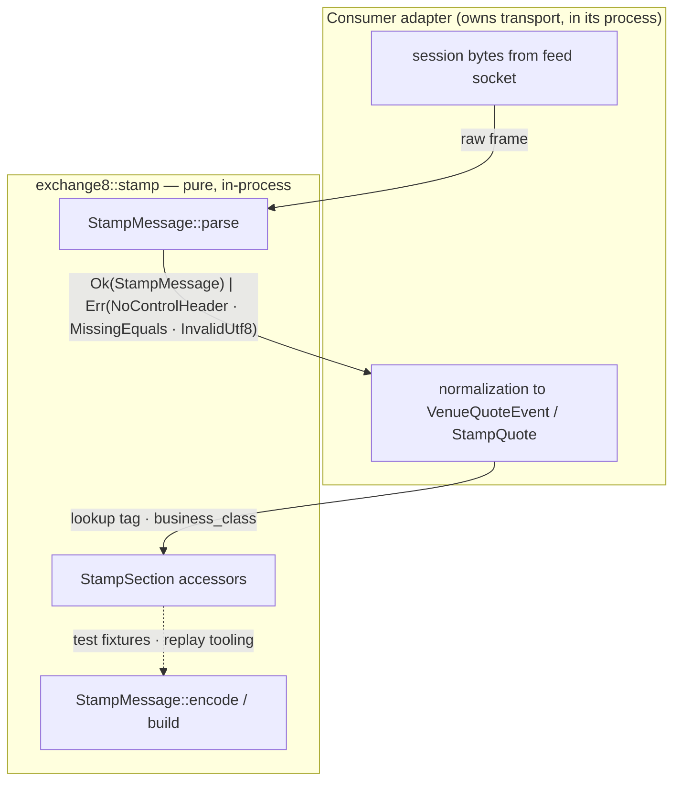
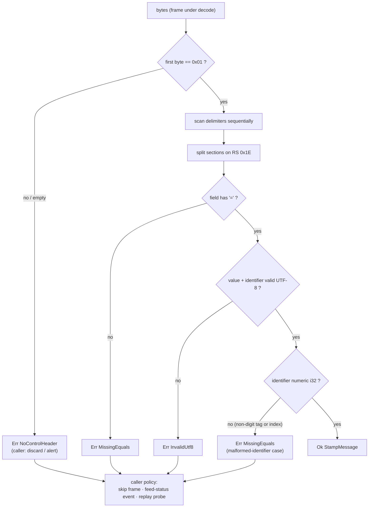
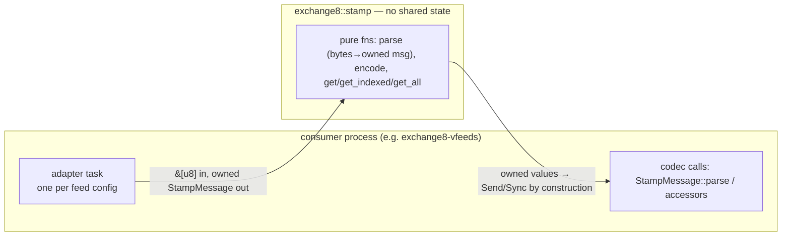
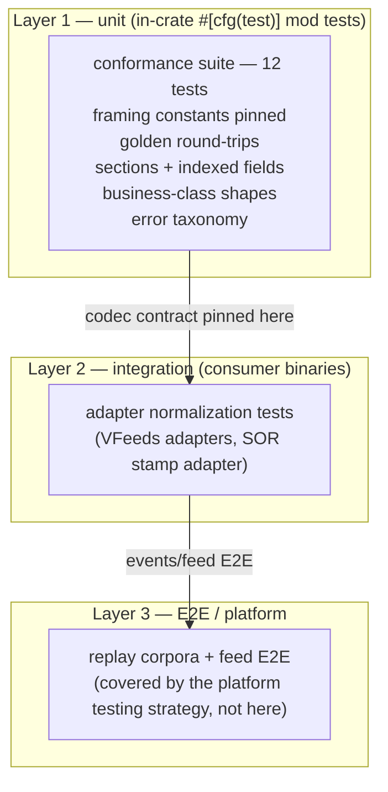

# DESIGN.md: exchange8::stamp — Detailed Design Document

## 1. Scope & Context

`exchange8::stamp` owns the STAMP 4.0 wire grammar for the exchange8
vertical: the framing constants, the tag and business-class vocabularies,
and the lossless `bytes ⇄ struct` transform for frames shaped
`<SOH 0x01> control-header <FS 0x1C> business <GS 0x1D> control-trailer`
with `RS 0x1E`-separated fields. It explicitly does **not** own:

- transport and session supervision — SoupBinTCP framing lives in
  `exchange8::soup`, MoldUDP64 in `exchange8::mold`, and the socket,
  heartbeat, and A/B recovery tasks in the consuming services (Exchange8:VFeeds
  per the venue-feed design; the Exchange8:SOR feed path per the SOR design);
- value semantics — prices, volumes, and quantities stay verbatim UTF-8;
  scale and arithmetic are `exchange8::fixed` and adapter concerns;
- normalization — bytes-to-`VenueQuoteEvent` translation is the adapter
  layer's job, not the codec's;
- FIX 4.2 — the order-entry protocol is `exchange8::fix` + Exchange8:Gateway.

There is no HTTP surface, no database presence, no event emission, no
runtime of its own: the crate is a pure function library compiled into the
facade `exchange8::stamp` (package `exchange8-stamp`, workspace member
`crates/stamp`) and statically linked into consumer binaries.

### System context

## 2. Runtime Architecture

The runtime architecture section of the service template does not apply:
the library has no tasks, routers, workers, caches, or background jobs.
Its "architecture" is the module map of one file and the call shape the
consumers drive.

### Module map (`src/lib.rs`)

| Unit | Visibility | Responsibility |
|---|---|---|
| Wire constants (`CONTROL_HEADER_CHAR`, `BUSINESS_CONTENT_CHAR`, `CONTROL_TRAILER_CHAR`, `FIELD_CHAR`, `DOT_CHAR`, `EQUAL_CHAR`) | `pub` | The five delimiter bytes and two identifier separators of the grammar, plus `STAMP_VERSION_NUMBER` (`"Version 4.0"`) |
| `tag` (61 constants) | `pub mod` | Numbered wire tags from `ACCOUNT_ID` (1) to `STOCK_RESUME_TIME` (132) |
| `business_class` (9 constants) | `pub mod` | Order/trade class codes `"001"` … `"010"` |
| `StampError` | `pub enum` | `NoControlHeader`, `MissingEquals`, `InvalidUtf8` (`thiserror` display strings) |
| `StampField` | `pub struct` | `(tag: i32, index: i32, value: String)` |
| `StampSection` | `pub struct` | Ordered `Vec<StampField>` + `get` / `get_indexed` / `get_all`; private `parse(buf)` and `encode(out)` |
| `parse_field` | private fn | Identifier/value split: first `=`, UTF-8 validation, `tag` vs `tag.index` decoding |
| `StampMessage` | `pub struct` | `control_header` + `business` + optional `control_trailer`; `parse` / `encode` / `build` / `business_class()` |

### Core decode path

## 3. Data Model

The library owns no tables. Its "data model" is the decoded in-memory
model and the wire encoding it maps to.

### Structures ↷ wire encoding

| Structure | Fields | Wire representation |
|---|---|---|
| `StampField` | `tag: i32`, `index: i32`, `value: String` | `<tag>[.<index>]=<value>`; the `.index` suffix is written only when `index != 0` |
| `StampSection` | `fields: Vec<StampField>` | Fields joined by `RS 0x1E`; sections may be empty |
| `StampMessage` | `control_header: StampSection`, `business: StampSection`, `control_trailer: Option<StampSection>` | `0x01 header 0x1C business 0x1D trailer`; business delimiter emitted only when business is non-empty or a trailer exists |

- All types are `Debug + Clone + PartialEq + Eq` (and `Default` for
  `StampSection`/`StampMessage`) — comparable, storable, and
  `Send`/`Sync` by construction (owned `String` values, no interior
  mutability, no lifetimes).
- Encoding text is ASCII delimiters plus decimal identifiers and verbatim
  UTF-8 values; there is no endianness, no alignment, and no binary
  numeric encoding anywhere in the grammar.

## 4. API Surface

Public API inventory (library audience: exchange8 services; no
authorization gate applies — there are no endpoints, scopes, or tenant
contexts to gate):

| Item | Kind | Contract |
|---|---|---|
| `StampMessage::parse(&[u8]) -> Result<StampMessage, StampError>` | static | Full-frame decode; requires leading `0x01`; header-only / business-only / trailer-only / all-section frames all legal |
| `StampMessage::encode(&self) -> Vec<u8>` | method | Byte-exact re-serialization in stored field order |
| `StampMessage::build(business_class, fields) -> StampMessage` | static | Authoring: class (tag 6) first, then unindexed fields (index 0) |
| `StampMessage::business_class(&self) -> Option<&str>` | method | Tag-6 lookup in the business section |
| `StampSection::get(tag)` / `get_indexed(tag, index)` / `get_all(tag)` | methods | First index-0 value / exact-index value / all values in stored order |
| `StampField { tag, index, value }` | struct | Decoded unit; identity `tag` or `tag.index` |
| `StampError { NoControlHeader, MissingEquals, InvalidUtf8 }` | enum | Whole failure surface; `Display` messages are part of the contract |
| `tag` module (61 constants, `ACCOUNT_ID` 1 … `STOCK_RESUME_TIME` 132) | mod | Pinned tag numbers |
| `business_class` module (9 constants, `"001"` … `"010"`) | mod | Pinned class codes |
| Framing constants + `STAMP_VERSION_NUMBER` | consts | `0x01` / `0x1C` / `0x1D` / `0x1E` / `.` / `=` / `"Version 4.0"` |

Emissions: none. The library emits no domain events and participates in no
outbox/trigger chain — the event flow diagram of the service template does
not apply.

## 5. Cross-Cutting Concerns

Each service-template concern below is either answered for a pure library
or explicitly does not apply.

- **Deterministic outcomes.** Same input bytes → same `StampMessage` and
  same output bytes, always: no environment reads, no clock, no RNG, no
  locale-dependent formatting (identifiers are decimal, values verbatim).
- **Precision.** The codec re-defines nothing: numeric scale (×10⁴-style
  conventions), rounding, and quantity semantics are decided downstream
  by `exchange8::fixed` and the adapters; values cross the crate verbatim.
- **Wire stability.** The framing constants, tag numbers, and class codes
  are pinned by conformance tests (framing-char checks, tag-value checks,
  golden round-trips), making accidental wire drift a failing build rather
  than a deployed incompatibility.
- **Endianness.** Not applicable — the grammar is delimiter text, not
  binary layout; there are no multi-byte numeric fields.
- **Idempotency / exactly-once.** Not applicable at the library level:
  the caller's sequencing (A/B recovery, retransmission) guarantees
  dedupe; decoding the same frame twice yields the same result by
  determinism.
- **Authentication / authorization.** Not applicable — no caller identity,
  no HTTP, no tenant resolution. The library is statically linked; it
  cannot be reached except in-process by authorized consumers.
- **RLS / tenant context.** No database, no tables, no rows — nothing to
  scope. Frames are per-instance inputs of the consuming service.
- **Audit journaling.** Not applicable — the codec performs no auditable
  domain change; consumers journal their own feed outcomes.
- **Rate limiting / bot protection.** Not applicable — no endpoints.
- **Graceful drain.** Not applicable — no runtime; linked code drains with
  its consumer binary.
- **TLS posture.** Not applicable — the codec touches neither sockets nor
  key material; venue TLS/mTLS is the session layer's concern
  (`sentin8-tls` at the service shell).

## 6. Failure Modes & Recovery

The library performs no I/O, so it has no crash-recovery paths. Failures
are value-level, deterministic, and total: `parse` either returns a
complete message or a typed error — never a partially-populated one.

- **Truncated captures.** The control trailer is optional; a stream cut
  after the business section still yields a usable header + business
  message (explicitly required by the capture-tolerance contract).
- **Empty / session-only frames.** Header-only frames, business delimiter
  with empty sections, and all-empty sections decode successfully --
  session heartbeats are not errors.
- **Caller-side recovery.** On typed error, the consumer's documented
  policy applies: skip the frame, record a feed anomaly via the service's
  status/audit surfaces, and rely on session-layer recovery (A/B re-fill,
  retransmission) for lost content. The codec never repairs silently.
- **Known hardening gap.** A frame whose control-trailer delimiter appears
  before the business delimiter can panic in the business-section slice
  (the sequential scan assumes business before trailer). The failure is
  unreachable for venue-conformant input and for self-produced
  (`encode`) frames; typed-error hardening of the split is planned (§10).

## 7. Concurrency & Performance Model

- **No shared state.** Every function takes input by reference or value
  and returns owned data; there is no static, no mutex, no pool, and no
  interior mutability. Any number of feed tasks may call concurrently on
  any host — correctness is trivially true, and the task/channel topology
  is entirely the consumer's (one adapter task per feed, per the
  venue-feed design).
- **Allocation profile.** One `Vec` per section (three per frame), one
  `String` per field. Frames are small (hundreds of bytes); the cost is
  bounded and predictable. A borrowed-view parse would remove the
  per-value allocation (§10) at the price of lifetimes.
- **Hot path.** `parse` is a constant number of linear scans over the
  buffer (three delimiter searches + field splitting) — O(frame length),
  no regex, no backtracking. Lookups are linear scans over the section's
  fields; sections in practice carry tens of fields, so this is the
  cheap branch.
- **Throughput posture.** The venue-feed sizing (~4k msg/s per feed) is
  transport-driven; the codec's per-frame cost is negligible against
  socket work and sits entirely inside the consumer's existing task
  budget — no scheduling, no blocking, no syscalls.

## 8. Invariants, Insecure-Defaults Rejected, Unsafe Rationale

**Invariants** (enforced structurally and by the conformance tests):

1. `parse` accepts only frames beginning with `0x01`; the empty buffer and
   any other leading byte are `NoControlHeader`.
2. Round-trip identity: `parse(encode(m)) == m` structurally, and
   `encode(parse(b)) == b` byte-for-byte for grammar-conformant input.
3. Field order is preserved; indexed fields keep their index; the `.index`
   suffix is written only for non-zero indices, so wire text and parsed
   identity map one-to-one.
4. Accessor semantics: `get` = index 0 only, `get_indexed` = exact index,
   `get_all` = stored order, in all cases scanning only that section.
5. Values are verbatim (validated UTF-8 only); the codec never trims,
   normalizes, or numeric-decodes.
6. `parse` returns complete messages or errors — no partial-success
   shapes, no per-field defaults.
7. Owned data only: no lifetimes escape, no unsafe code (the crate
   contains none, and any future version must justify it here).

**Insecure defaults rejected:**

- *Lossy decoding* (replacing invalid UTF-8 with a replacement char) —
  silently corrupts order/trade numbers; rejected for typed rejection.
- *Silent repair* (defaulting missing `=` or missing delimiter) — hides
  protocol drift; decoded-then-defaulted frames poison quote state
  downstream.
- *Canonicalizing reorders* (sorting/deduplicating repeated tags at
  encode) — alters venue semantics the codec has no authority over.
- *Interpreting values in the codec* — pins scale and field semantics
  inside a framing library; rejected in favor of opaque text.
- *Panic-based rejection* (expect/unwrap on grammar) — a feed is untrusted
  input; malformation is an expected input, not a bug report.

**Unsafe rationale:** none — the crate contains no `unsafe` blocks and no
FFI; delimiters are compared as raw bytes, and all parsing is safe slice
arithmetic.

## 9. Testing Strategy

- **Owned here (unit):** the full grammar contract, in the crate's test
  module — control/builder framing constants (`control_chars_match_spec`),
  pinned tag numbers (`spec_tag_values`), golden full-frame round-trip
  (`round_trip_full_message`), section separator placement
  (`section_field_separator_is_rs`), indexed-field identity and ordering
  (`indexed_fields_preserved`), header-only and empty-section frames
  (`header_only_message`, `empty_business_section_ok`), business/trailer
  delimiter ordering (`business_and_trailer_offsets`), realistic
  business-class shapes (`trade_confirm_message_shape`,
  `order_request_message_shape`), and the error taxonomy
  (`missing_control_header_rejected`, `field_without_equals_rejected`).
  All tests are pure byte assertions — no fixtures outside the crate, no
  mocks.
- **Deliberately NOT tested here:** socket/session behavior (SoupBinTCP,
  A/B recovery — `exchange8::soup`, `exchange8::mold`, service session
  tasks), quote normalization and value semantics (adapter layers),
  end-to-end feed flows (platform-level replay corpora), and FIX 4.2
  (`exchange8::fix`).
- **Run:** part of the vertical workspace gate — `make test` (debug) /
  `make test-fast` (release) / coverage inside `cargo test -p
  exchange8-stamp`.

## 10. Open Questions

- **Out-of-order delimiter hardening.** Pin the business/trailer scan as a
  typed error (`StampError`) when the trailer delimiter precedes the
  business delimiter, closing the §6 hardening gap without changing any
  valid-frame behavior.
- **Zero-copy parse view.** Offer a borrowed `parse` (values as `&str`
  tied to the input buffer) for the hottest feed paths while keeping the
  owned API as the general contract.
- **Typed per-class models.** Whether each `business_class` gains a
  checked struct + serde layout in this crate (the manifest already
  declares `serde`, currently unused by sources) or consumers keep
  map-style access.
- **Trailer semantics.** Trailer-level integrity/authenticity checks are
  unimplemented (the trailer is opaque); the exact venue definition and
  the reject-or-accept policy awaits pinning.
- **Streaming/incremental parse.** Whether chunked TCP reads want a
  stateful parser API to avoid whole-frame buffering at the session
  layer.
- **Full tag coverage.** The `tag` module pins the 61 tags the exchange
  consumes; whether the remaining venue vocabulary must be encoded for
  unfiltered passthrough (decode-unknown-tag is already lossless) is a
  consumer-compatibility question, not a codec-format one.

---

**Design attribution:** exchange8:stamp and its underlying concepts were designed by Hamid Jahanzad <Hamid@Jahanzad.com>.
