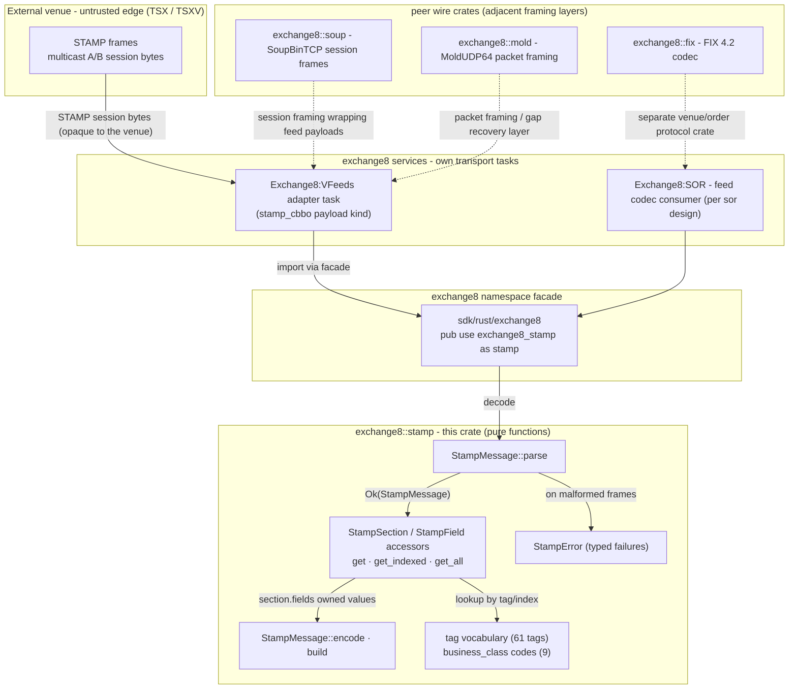

# exchange8::stamp

## 1. Summary

`exchange8::stamp` is the STAMP 4.0 wire-format codec of the exchange8
vertical: it decodes raw STAMP frames - the TSX venue-feed/order protocol -
into an ordered, lossless section/field model, and encodes messages back to
byte-identical wire output. It is a pure library: no HTTP surface, no
database presence, no sockets, and no process of its own. Byte-frame
parsing/encoding is everything it owns; transport, session state, and quote
normalization belong to the consuming services and peer crates.

## 2. Motivation

The STAMP feed is the authoritative consolidated-quote (CBBO) source in the
TSX venue matrix. The codec exists so that exchange adapters have one
exact, testable definition of the protocol rather than half-understood
vendor dialects:

- **Losslessness as a contract.** Field order and multi-value (indexed)
  fields (`50.1=...`, `50.2=...`) are preserved exactly as received, so a
  decode→encode round trip reproduces the input byte-for-byte - the
  property replay corpora and conformance tests need.
- **Malformed input is a typed error, never a panic and never a repair.**
  A hostile or corrupt venue frame surfaces as one of three typed errors
  instead of a partially-defaulted message.
- **One place defines the vocabulary.** The numbered tag set and the
  business-class code table are shared constants; adapters, tests, and
  replay tooling all import the same identifiers instead of pinning magic
  integers locally.
- **Pure testability.** The codec is bytes-in / bytes-or-struct-out with no
  I/O or scheduling, so the full framing grammar is covered by in-crate
  conformance tests without service scaffolding.

## 3. Architecture & High-Level Design

The crate is a single module (`src/lib.rs`) of pure functions and owned
value types. Consumers (venue-feed adapter tasks inside Exchange8:VFeeds, the
Exchange8:SOR feed path per its design) hold the sockets, heartbeat supervision,
and retransmission loops, and call the codec in-process for every frame.
The exchange8 namespace facade exposes the crate as `exchange8::stamp`.

- **Decode is a single pass**: the parser locates the three section
  delimiters sequentially (control header → business → control trailer),
  splits each section on the field separator, and decodes each field into
  `(tag, index, value)`.
- **Encode is the exact inverse**: sections write their fields in stored
  order; the business delimiter and trailer are emitted only when present.
- **The vocabulary is the API**: consumers address fields through
  `exchange8::stamp::tag` constants and classify messages through the
  `business_class` code table; the codec treats values as opaque UTF-8
  text and never interprets them.

## 4. Key Traits and Data Structures

There are no traits, no dyn dispatch, and no callbacks - the crate is
data-oriented. Consumers drive it; nothing drives consumers.

- **`StampField`** - one field: `tag` (i32), `index` (i32, `0` when
  unindexed), `value` (verbatim UTF-8 `String`). The identity of a field on
  the wire is `tag` for unindexed fields and `tag.index` for indexed ones.
- **`StampSection`** - an ordered `Vec<StampField>` plus lookup accessors:
  `get` (first value with index 0), `get_indexed` (exact `tag.index`), and
  `get_all` (all values for a tag in stored order).
- **`StampMessage`** - the decoded frame: `control_header`, `business`, and
  the optional `control_trailer`; `business_class()` reads the
  message-type discriminator (tag 6). Static methods: `parse` (bytes →
  message), `encode` (message → bytes), `build` (business class + unindexed
  fields → message).
- **`StampError`** - the codec's entire failure surface:
  `NoControlHeader`, `MissingEquals`, `InvalidUtf8`.
- **Wire constants** - the delimiter bytes (`0x01` control header, `0x1C`
  business, `0x1D` trailer, `0x1E` field separator) plus the `.`/`=` field
  identifier separators and the `Version 4.0` version string.
- **`tag` module** - the 61 numbered wire tags the exchange consumes,
  from `ACCOUNT_ID` (1) to `STOCK_RESUME_TIME` (132).
- **`business_class` module** - the nine order/trade message classes:
  order request, quote request, stock status request, order cancel
  request/confirm/reject, trade confirm, business reject, and order ack.

## 5. Rationale, Trade-offs, and Alternatives

- **Opaque text fields instead of a typed message schema.** The codec
  decodes the framing grammar (sections, field separators, indices) and
  stops there. Prices, volumes, and quantities stay verbatim strings;
  scale decisions (price ×10⁴ and similar conventions) belong to
  consumers, where `exchange8::fixed` owns arithmetic. Rejected
  alternative: per-business-class typed structs - attractive ergonomics,
  but it would pin vendor tag semantics inside the codec, freeze scale
  decisions that belong to consumers, and turn every vocabulary addition
  into a schema migration of this crate.
- **Owned `String` values instead of borrowed slices.** Parsing returns an
  owned `StampMessage` rather than a view borrowing the input. Frames are
  small (hundreds of bytes), allocation is one `String` per field, and
  owned values survive the read buffer - no lifetime entanglement between
  feed buffers and consumer state machines. A zero-copy `parse` view
  remains a possible future API (see §7) but was not the default: a
  lifetime-free value type is trivially `Send`/`Sync` and store-anywhere.
- **Typed errors instead of panics or lossy defaults.** Every
  grammar violation the codec can detect is a typed, `PartialEq`
  comparable `StampError`. A "best effort" parser that defaults missing
  separators or lossily converts bytes would silently corrupt order and
  trade content - the worst failure mode for a market-data path - so the
  contract is reject-early.
- **Field-order preservation over re-sorting.** Encoding writes fields in
  received order and lookups scan in stored order, making the codec a
  faithful wire mirror rather than a canonicalizer. Any semantic ordering
  (e.g. deduplicating repeated tags) belongs to the consumer, which knows
  the business class of the frame; the codec stays schema-agnostic.
- **Sequential delimiter scanning.** Parsing scans once for the three
  section delimiters and once per section for fields - O(frame length)
  with no regular expressions and no backtracking. This keeps hot feed
  paths linear and allocation-light (one output `Vec`, one `String` per
  field value).

## 6. Internal Implementation & Invariants (Private Design)

- **Frame splitting** - `StampMessage::parse` requires the first byte to
  be the control-header constant; anything else is `NoControlHeader`
  (including the empty buffer). It then scans sequentially: the business
  section is the span between the first business delimiter and the first
  trailer delimiter; the trailer (when its delimiter is present) is the
  span after that. A frame may carry only the control header (session /
  heartbeat messages are header-only), only a trailer, or no delimiters at
  all - each combination parses without error as long as the outermost
  byte is correct.
- **Section parsing** - `StampSection::parse` treats the section span as
  `FIELD_CHAR`-separated fields, tolerates empty sections, and skips empty
  spans between consecutive separators. Each field is decoded by the
  private `parse_field`: split on the **first** `=` (values may contain
  further `=` bytes), require valid UTF-8, and decode the identifier as
  either `tag` or `tag.index` decimal i32.
- **Index discipline** - an identifier without a dot parses with `index
  = 0`; a dotted identifier parses both parts as i32. Encode writes the
  dot suffix only for non-zero indices, so wire text and parsed identity
  round-trip exactly.
- **Encode shape** - encode emits the control-header byte, the header
  fields, then the business delimiter + fields only when the business
  section is non-empty or a trailer exists, then the trailer delimiter +
  fields when a trailer is present. `StampMessage::build` writes the
  business class as the first business field (tag 6), followed by the
  supplied fields in order, all with index 0.
- **Invariants held across parse/encode:**
  1. `parse` succeeds only when the first byte is `0x01`.
  2. `parse(encode(m))` is structurally identical to `m`, and
     `encode(parse(bytes))` equals `bytes` byte-for-byte for
     grammar-conformant input.
  3. Field order is never re-ordered; indexed fields keep their index.
  4. Lookups: `get` matches index 0 only; `get_indexed` matches the exact
     index; `get_all` preserves stored order.
  5. The codec never interprets, trims, or numeric-decodes values; values
     keep the exact bytes carried on the wire (validated as UTF-8).
  6. Non-digit identifiers or non-integer indices surface as
     `MissingEquals` - the crate's catch-all for malformed identifiers -
     rather than being accepted or defaulted.

## 7. Unresolved Questions / Future Designs

- **Typed message models.** Per-business-class structs (order request,
  trade confirm) with serde serialization over the decoded fields would
  give consumers compile-checked field lists; the manifest already declares
  `serde`, and the codec sources carry no derives today.
- **Trailer semantics.** The control trailer is parsed as an opaque
  section; STAMP trailer-level checks (checksum / authentication-style
  fields) are not validated in this crate.
- **Malformed delimiter ordering.** A frame carrying the control-trailer
  delimiter before the business delimiter can panic on the business
  section slice (an out-of-order-delimiter edge the current split logic
  does not guard); hardening the split to a typed error is a planned
  correction - see `DESIGN.md` §6/§10.
- **Zero-copy parsing.** A borrowed-view `parse` for the hottest feed
  paths would remove the per-field `String` allocation; the owned API
  remains the general-purpose contract.
- **Incremental/streaming parse.** The API parses complete frames; a
  streaming parser for chunked TCP reads could avoid buffering whole
  frames in the session layer.

---

**Architecture & Design:** exchange8:stamp and its underlying concepts were designed by [Hamid Jahanzad](https://www.linkedin.com/in/hamidjahanzad/).
