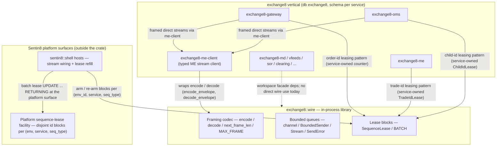
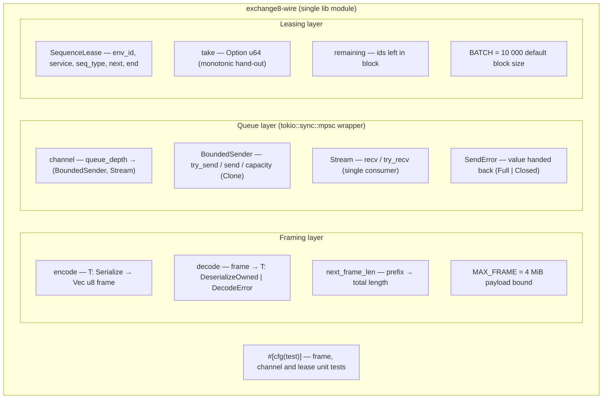
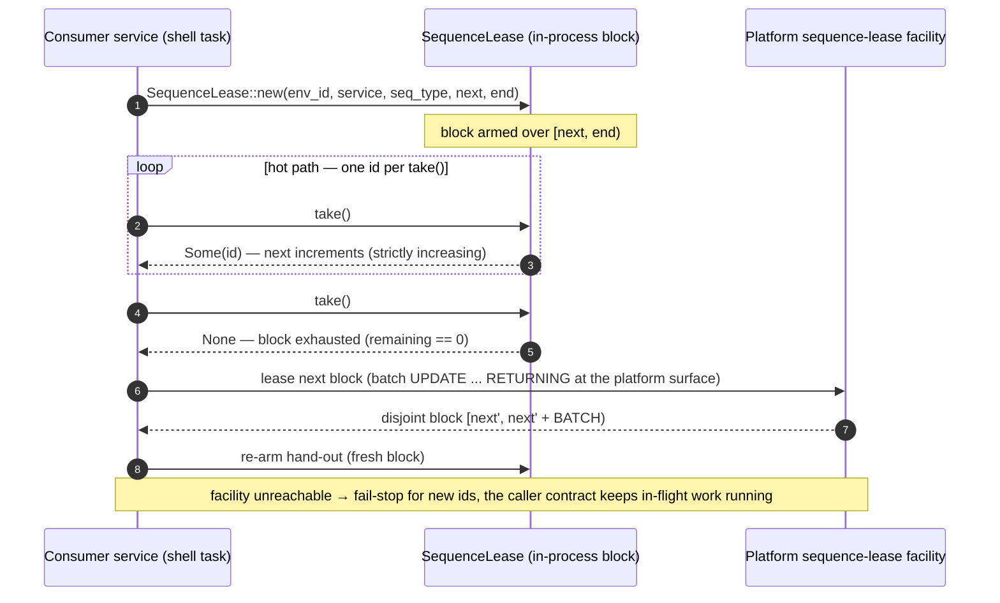
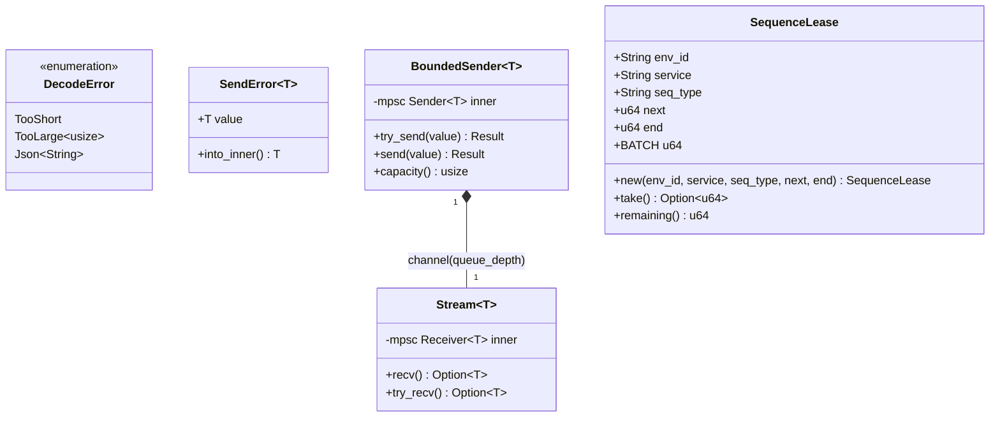
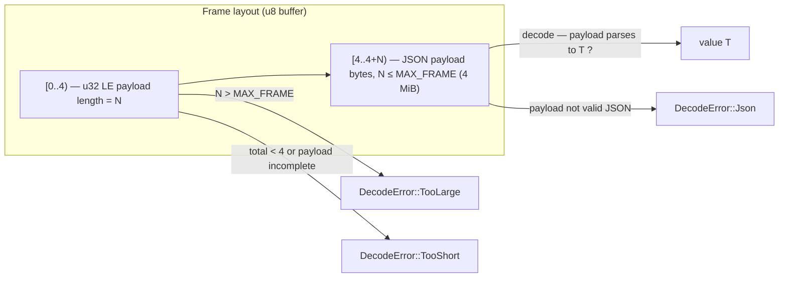
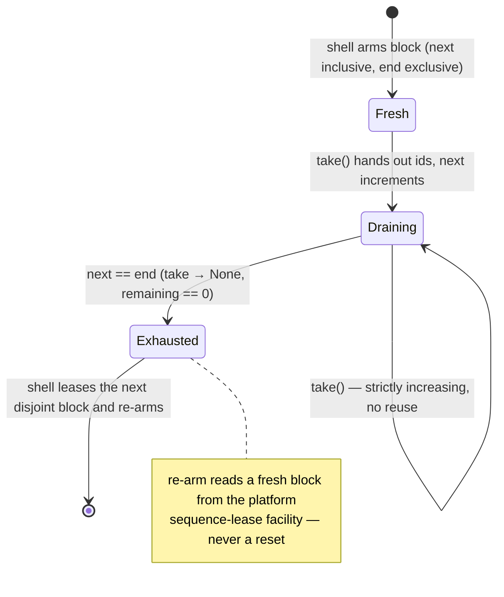
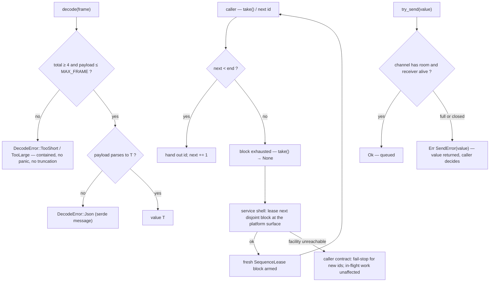
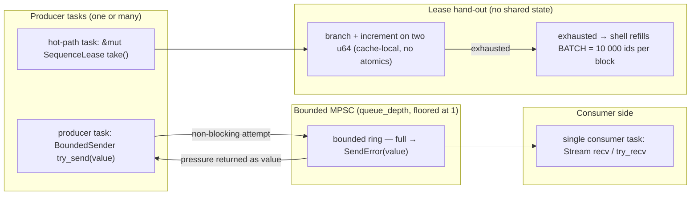
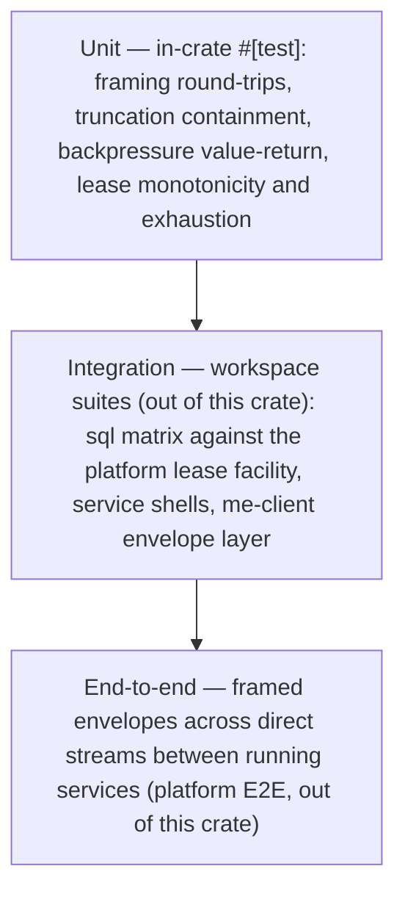

# exchange8::wire — Detailed Design Document

> Deep, implementation-complete design for the `exchange8-wire` library crate
> (facade `exchange8::wire`, sources `crates/wire/src/lib.rs`). Companion
> documents: `README.md` (overview) and `BUSINESS.md` (business requirements).
> Vertical context: `design/sentin8-exchange8-technical-design.md` §4.1
> (namespace layout), §5.2/§7.2 (transport tiers);
> `design/sentin8-exchange8-data-model-technical-design.md` §2a (sequence leases).

## 1. Scope & Context

`exchange8::wire` is an **in-process library** consumed by the exchange8 service
binaries and sibling crates. It owns:

- the framed codec — `encode` / `decode` / `next_frame_len`, the `MAX_FRAME`
  bound and the `DecodeError` taxonomy;
- the bounded in-process queue pair — `channel` / `BoundedSender` / `Stream` /
  `SendError`;
- the in-process id-lease block — `SequenceLease` (identity triple +
  half-open window, `BATCH = 10 000` default).

It explicitly does **not** own:

- the id-counter substrate — the Sentin8 platform sequence-lease facility does;
  the vertical database declares no sequence table (data-model design §2a);
- transport sockets, TLS or external wire formats (FIX / ITCH / MoldUDP64 /
  SoupBinTCP / STAMP have their own crates);
- domain DTOs (`exchange8::contracts`) and typed envelope logic
  (`exchange8::me::client`);
- service lease *policy* — the shell-owned counters me `TradeIdLease`,
  gateway `OrderIdAssigner`, oms `ChildIdLease` follow the same hand-out/refill
  pattern but live in their services.

**Trust boundaries.** The crate is a library: it never speaks on the network,
never holds a token, never touches a database. Every consumer runs inside a
service shell that performed the standard authorization pipeline (bearer verify →
tenant resolve → Shield authorize → RLS context → execute → audit) before any
frame or id crosses the wire. The `SequenceLease` identity triple
(`env_id`, `service`, `seq_type`) is carried in-process so the refill call can be
scoped per environment; the crate itself performs no tenant resolution.

## 2. Runtime Architecture

There is **no runtime of its own** and no HTTP surface of any kind: the crate is a
library whose entry points are plain functions and methods called from service
tasks. Internally it is one module (`crates/wire/src/lib.rs`) with three conceptual
layers plus an in-crate test module.

**Request lifecycle — not applicable.** A library has no inbound request surface;
there are no HTTP endpoints, no router, no handlers. The lifecycle that *is*
worth diagramming is the **lease refill lifecycle** — how an in-process block is
born, drained and replaced. This is the mechanism that turns platform-owned id
allocation into a hot-path operation:

The framing layers have no lifecycle at all — `encode`/`decode` are pure
functions; `channel` is created once per wiring site.

## 3. Data Model

**No database tables are owned.** The crate declares none, reads none and writes
none; there is no DSN, no pool, no RLS involvement, no outbox and no audit
journal. The vertical id-counter substrate lives in the Sentin8 platform
(data-model design §2a); this crate holds only in-process value types. An
Entity-Relationship diagram therefore does not fit — the model is value layout,
not entity relationship — so the structures are shown as a class diagram
(runtime value layout) plus the wire layout.

Lease block state machine — the block is the only stateful construct:

Internal representations: `SequenceLease` is three `String`s + two `u64`s
(`next`/`end` as an inclusive/exclusive pair — a `remaining()` of zero or an
explicit `None` from `take()` is the only exhaustion signal). `BoundedSender` /
`Stream` are thin newtypes over `tokio::sync::mpsc::Sender` / `Receiver`
(deliberate: the tokio types stay hidden so the crate keeps only the two
semantics the vertical needs — bounded `try_send` and single-consumer streams).
`DecodeError` is clonable and comparable for golden-test assertions.

## 4. API Surface

This is a library: there are **no HTTP endpoints** (no public, no internal, no
admin surface — the API surface section of the service template does not apply in
its HTTP form). The public API inventory is grouped by role; every item is
**for exchange8 services and sibling crates only** — it is never part of any
client-facing surface (BFF, apps and FIX clients never see these types).

| Item | Form | Role | Consumer gate |
|---|---|---|---|
| `encode<T: Serialize>(value: &T) -> Vec<u8>` | function | serialize `value` into `4-byte LE length + JSON` | services tier |
| `decode<T: DeserializeOwned>(frame: &[u8]) -> Result<T, DecodeError>` | function | decode a complete frame (prefix included) | services tier |
| `next_frame_len(prefix: &[u8]) -> Option<usize>` | function | total expected frame length from a partial prefix (streamed reads) | services tier |
| `MAX_FRAME: usize` (4 MiB) | constant | payload bound — corrupt-prefix containment | services tier |
| `DecodeError` (`TooShort` / `TooLarge` / `Json`) | enum | contained, panic-free framing errors | services tier |
| `channel<T>(queue_depth) -> (BoundedSender<T>, Stream<T>)` | function | bounded MPSC pair (depth floored at 1) | services tier |
| `BoundedSender<T>` (+ `Clone`) | struct | producer side — `try_send` (non-blocking), async `send`, `capacity` | services tier |
| `Stream<T>` | struct | consumer side — `recv` (await), `try_recv` (drain) | services tier |
| `SendError<T>` + `into_inner` | struct | value handed back on full/closed channel | services tier |
| `SequenceLease::new(env_id, service, seq_type, next, end)` | constructor | arm an in-process lease block | services tier |
| `SequenceLease::take() -> Option<u64>` | method | next id; `None` when exhausted | services tier |
| `SequenceLease::remaining() -> u64` | method | ids left in the current block | services tier |
| `SequenceLease::BATCH: u64` (10 000) | const | default ids per lease block | services tier |

There are no builders and no traits — the crate's contract is small by design.
The only in-tree crate-level consumer is `exchange8::me::client`
(`encode_envelope` / `decode_envelope` wrap `encode` / `decode` over
`exchange8::contracts::Envelope<T>`); the 13 service binaries reach the crate
through the facade `exchange8::wire`, and the shell-owned lease counters follow
the `SequenceLease` hand-out/refill pattern.

**Event flow — not applicable in the service-template sense.** The library emits
no events and consumes none; it is not wired to Sentin8:Bus. Its observable
output is the framed byte stream and the handed-out ids that flow through
consumers' `outbox → Bus → trigger` chains. The refill sequence diagram in §2 is
the closest lifecycle diagram.

## 5. Cross-Cutting Concerns

- **Authentication / authorization.** Not applicable inside the crate — no
  token, no scope, no policy decision. Frames and ids are produced *after* the
  consumer's shell has run the standard 8-step pipeline; the crate is
  post-authorization plumbing.
- **Tenant resolution / RLS.** No database access, no tenant-context setter. The
  `SequenceLease` identity triple exists precisely so the platform refill surface
  can scope blocks per environment; id uniqueness across the platform is
  guaranteed by the facility's disjoint blocks, not by this crate.
- **Idempotency / exactly-once.** Hand-out of a given id from a given block is
  once-only by construction (the counter only moves forward). Delivery-level
  idempotency of the *messages* carried in frames is the envelope's job
  (`exchange8::contracts::Envelope.idempotency_key`), enforced by consumers.
- **Ordering / monotonicity.** Ids are strictly increasing within a block; across
  blocks the platform guarantees disjoint contiguous blocks (`UPDATE ...
  RETURNING` batch leases proved disjoint and rollback-safe in the vertical's
  SQL matrix); across restarts ids continue from the platform's value — ids
  never reset within an environment. Frames are point-to-point and carry the
  emitter's own ordering concerns (per-stream `seq` on envelopes).
- **Rate limiting / bot protection.** Not applicable (in-process library).
- **Audit journaling.** Not applicable — no durable state; consumers journal and
  audit their domain effects themselves. Note in passing: consuming services may
  audit id-block exhaustion (a fail-stop condition) — that is their choice, not
  the crate's.
- **Graceful drain / TLS posture.** Handled by the consuming shells (`sentin8::shell`);
  the crate is transport-agnostic (frames ride whatever transport the shell runs,
  e.g. a TLS stream or an in-process pipe).

## 6. Failure Modes & Recovery

- **Lease exhaustion — fail-stop semantics (caller contract).** The crate makes
  exhaustion observable (`None`, `remaining() == 0`) and fabrication beyond the
  block impossible by construction. The policy is the consumer's: the matching
  engine fail-stops *new* trade ids (no fill can be assigned) while resting
  orders and cancels continue; gateway and OMS refill before routing proceeds.
  The library's guarantee is narrower and absolute: no id is ever issued
  twice by the same block, and no block issues an id outside its window.
- **Refill failure.** The platform facility owns allocation (batch
  `UPDATE ... RETURNING`, disjoint by transaction isolation, proven in the
  vertical's SQL-matrix tests). A failed refill leaves the caller holding an
  empty block — the repeated-`None` case — and the consumer's fail-stop rule
  applies. The crate contributes no retry loop by design: retry policy lives at
  the service shell.
- **Framing failure.** Corrupt or truncated input is returned as `TooShort` /
  `TooLarge` / `Json`. Nothing panics; nothing is truncated silently; the
  `MAX_FRAME` check fires before any payload copy, so a hostile prefix cannot
  drive allocation.
- **Backpressure / closure.** `try_send` on a full channel returns
  `SendError(value)` — the value is physically handed back (never dropped) — and
  closure is indistinguishable from fullness in the type. Callers treat
  persistent `SendError` plus `Stream::recv() == None` as the closure signal.
- **Recovery is the caller's.** The library is stateless across restarts; lease
  blocks are re-armed from platform state at shell boot (matching-engine
  recovery refills its trade-id lease at the replay frontier), which keeps the
  crate free of any recovery machinery.

## 7. Concurrency & Performance Model

Single-writer, lock-free-in-the-common-case, bounded where it matters:

- **Task layout.** No tasks of its own. The queue tier is used across producer
  and consumer tasks (`BoundedSender: Clone` wraps the tokio sender;
  `Stream` is single-consumer by design). The lease block is used by exactly one
  task per counter — the single-writer ownership model the matching engine and
  the gateway assigner already follow.
- **Locking strategy.** No mutexes, no atomics in the lease tier; the queue tier
  inherits `tokio::sync::mpsc` internals. Cross-task contention exists only at
  the bounded queue — the intended backpressure point.
- **Batch sizing.** `BATCH = 10 000` amortizes one platform refill across
  10 000 hand-outs; block identity (`env_id`, `service`, `seq_type`) is carried
  so the refill call is precise. A block's memory cost is two `u64`s plus the
  identity strings — constant per service, not per id.
- **Hot paths.** `encode` performs one allocation (pre-sized); `take` is a branch
  and increment; `try_send` is the tokio mpsc non-blocking attempt. `decode`
  validates before copying and parses once.
- **Backpressure.** Explicit and value-safe: a full bounded queue returns the
  value; there is no unbounded growth path and no lossy queue in the crate.

## 8. Invariants, Insecure-Defaults Rejected, Unsafe Rationale

There is **no `unsafe` anywhere in the crate** — verified by source inspection;
all behavior is safe Rust over `serde` and `tokio` internals.

Always-true invariants:

1. Ids from one lease block are strictly increasing and unique within the block.
2. No lease block ever hands out an id outside `[next, end)`.
3. A frame whose payload length exceeds `MAX_FRAME` is never decoded (`TooLarge`).
4. A truncated frame never yields a payload — `TooShort`, never partial data.
5. A full or closed bounded channel always returns the value in `SendError`.
6. `channel(queue_depth)` always yields a queue with room ≥ 1 (depth floored at 1).
7. No public function panics on caller-supplied input; `encode`'s single `expect`
   documents the in-memory-serialization-cannot-fail invariant, not an input
   condition.

Insecure or surprising defaults deliberately rejected:

- silent truncation of oversize frames (rejected: `TooLarge` before copy);
- unbounded queues (rejected: explicit bounded depth);
- zero-capacity channels (rejected: floored at 1);
- panic-on-backpressure or silent drop (rejected: value-returning error type);
- a built-in DSN / SQL refill path (rejected: platform owns the id-counter
  substrate; refill lives in the service shell).

## 9. Testing Strategy

Unit tests live in-crate (`#[cfg(test)] mod tests` in `crates/wire/src/lib.rs`)
and run inside the workspace's hermetic suite:

- `frame_round_trip` — `encode` → `next_frame_len` → `decode` returns the value
  (framing contract end to end).
- `frame_too_short` — a 3-byte input is `DecodeError::TooShort` (no panic).
- `bounded_channel_backpressure` — two sends fill the queue, the third returns
  the value in `SendError`, FIFO order is preserved and the slot is reused.
- `sequence_lease` — hand-out is monotonic (`100`; `101`), `remaining` tracks the
  window, exhaustion returns `None` and never an id beyond the block.

Deliberately **not** tested here (owned elsewhere):

- platform lease disjointness and rollback safety — proven by the vertical's
  live SQL-matrix suite against the platform facility (batch `UPDATE ...
  RETURNING` blocks); a library-unit concern would duplicate a database
  integration guarantee.
- transport behavior of frames over sockets/TLS — owned by the consuming
  services and the protocol crates (SoupBinTCP and friends).
- envelope idempotency semantics — owned by `exchange8::contracts` and the
  consumers.
- shell wiring of refills (when a `NeedLease` fires) — owned by the service
  binaries' `sentin8::shell` hosts.

## 10. Open Questions

- **Lease-counter convergence.** The service shell counters (me `TradeIdLease`,
  gateway `OrderIdAssigner`, oms `ChildIdLease`) re-implement the hand-out/refill
  pattern rather than composing over `SequenceLease`, and each carries its own
  rollover nuance (me daily rollover continues from the platform value; gateway
  per-process monotonic; OMS child ids with idempotent re-arm). Whether to unify
  them onto one library type — trading three service-core touchpoints for one
  semantics — is deferred.
- **`next_frame_len` bound enforcement.** The helper does not apply `MAX_FRAME`;
  streamed readers must bound-check themselves. A bound-checking variant would
  close that footgun but no second streamed consumer exists yet.
- **Streamed frame reader.** No async frame-reader primitive (`read prefix →
  bound-check → read payload → decode`) exists; `exchange8::me::client` composes
  `encode`/`decode` by hand. Adding one is cheap once a second consumer needs it.
- **Decode error fidelity.** `DecodeError::Json` carries a flattened message;
  structured serde error data (path, line) would help programmatic triage if a
  consumer ever needs to branch on failure cause.
- **Framing payload format.** JSON is debuggable and serde-aligned at the
  internal tier's volume; if a direct-stream tier ever outgrows it, a binary
  payload framing would be added *beside* the length prefix (and the external
  formats stay in their own codec crates regardless).

---

**Design attribution:** exchange8:wire and its underlying concepts were designed by Hamid Jahanzad <Hamid@Jahanzad.com>.
