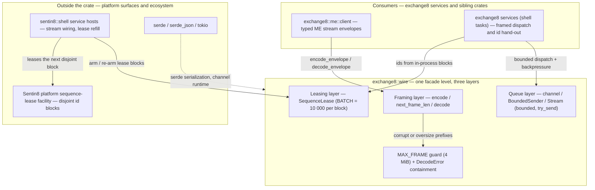

# README.md: exchange8::wire

## 1. Summary

`exchange8::wire` (package `exchange8-wire`, sources in `crates/wire/src/lib.rs`) is
the service-agnostic transport-primitives library of the exchange8 vertical — the
capital-markets platform of Sentin8. It ships three small, orthogonal library layers
consumed by the exchange8 service binaries and sibling crates:

- a **framed codec** — 4-byte little-endian length prefix + serde-JSON payload
  (`encode` / `decode` / `next_frame_len`, bounded by `MAX_FRAME`),
- **bounded in-process MPSC channels** (`channel` → `BoundedSender` / `Stream`)
  whose hot-path contract is non-blocking `try_send` with the value handed back on
  backpressure (`SendError`),
- **id lease blocks** (`SequenceLease`) — an in-process window of ids handed out
  strictly increasing until exhausted, refilled in `BATCH = 10 000` batches from the
  platform sequence-lease facility.

The crate holds no service identity, no protocol format of its own, no database and
no I/O: it is the in-process half of the vertical's wire contract, sitting at one
facade level (`exchange8::wire`) per architecture principles §2.1.

## 2. Motivation

- **One framing for the internal direct-stream tier.** Order flow between
  Exchange8:Gateway, Exchange8:ME, Exchange8:OMS and Exchange8:SOR rides point-to-point framed streams
  (master design §5.2, §7.2), not HTTP and not bus-relayed payloads. Without a
  shared codec, every service re-implements — and subtly diverges on — length
  prefixes, truncation handling and error semantics.
- **Hot-path contracts that cannot surprise.** Matching-tier code cannot afford
  blocking sends, silent drops or panics on the send/decode route. The bounded
  queue hands full-channel pressure back as a value; decode failures are returned
  errors; nothing in the crate panics on input.
- **Business ids without per-id round trips.** Every order, trade and child-order
  id comes from an in-process lease block. Batch leasing amortizes the platform's
  sequence allocation into 10 000-id blocks: hot-path id hand-out is one branch
  plus an increment.
- **The vertical does not own the id-counter substrate.** The vertical database
  declares no sequence table (data-model design §2a); the Sentin8 platform
  sequence-lease facility owns allocation. This crate holds only the in-process
  block hand-out that services fill from that facility.
- **Namespace discipline.** Transport primitives used by several services must not
  nest under one service's facade path (architecture principles §2.1); the crate
  exposes service-neutral primitives at `exchange8::wire` and nothing else.

## 3. Architecture & High-Level Design

The crate is a single library module organized as three independent layers; no
layer knows which service is calling. Consumers import through the workspace
facade (`sdk/rust/exchange8`: `pub use exchange8_wire as wire;`) — services use
`exchange8::wire`, and the typed ME client (`exchange8::me::client`) wraps the
framing tier for its envelope encode/decode.

The three layers are independent: the framing tier needs only `serde`
(+ `serde_json`), the queue tier needs only `tokio`, the lease tier needs neither
runtime nor serialization. Nothing here is tied to one service identity; SoupBinTCP
and the external wire formats have their own crates (`crates/soup`, `crates/itch`,
`crates/mold`, `crates/stamp`, `crates/fix`) — distinct formats, kept separate.

## 4. Key Traits and Data Structures

Concepts the crate exposes (plain synchronous types and functions — no traits):

- **Frame** — the wire unit: a 4-byte little-endian `u32` payload length followed
  by that many JSON bytes. `encode` serializes a domain value into one frame;
  `decode` reads prefix + payload back as `T: DeserializeOwned` (or a contained
  `DecodeError`); `next_frame_len` computes the expected total length from a
  partial prefix for streamed readers. `MAX_FRAME` (4 MiB) bounds every payload.
- **Bounded queue pair** — `channel(queue_depth)` yields `BoundedSender<T>`
  (clonable across tasks; `try_send` never blocks and returns the value on a full
  or closed channel; async `send` for non-hot paths; `capacity` reports queue
  depth) and `Stream<T>` (single consumer; `recv` awaits, `try_recv` drains).
  Depth is floored at one so `try_send` always has a well-defined success case.
- **SendError** — the backpressure contract: both a full channel and a closed
  receiver hand the value back; `into_inner` recovers it. No panic path exists in
  the send tier — the caller decides to retry, drain or treat closure as shutdown.
- **Lease block** — `SequenceLease` couples an identity triple
  (`env_id`, `service`, `seq_type` — e.g. `('env-1', 'me', 'trade')`) with a
  half-open window `[next, end)`: `take()` hands out the next id until exhaustion
  (`None`), `remaining()` reports ids left, and `BATCH = 10 000` is the default
  block size the service shell refills with.
- **Batch refill (concept, not code)** — the crate never touches a database. When
  a block is exhausted, the *service shell* leases the next disjoint block from
  the platform sequence-lease facility and re-arms hand-out.
- **Monotonicity guarantees** — within a block, ids are strictly increasing and
  never reused; across blocks, the platform facility guarantees disjoint
  contiguous blocks, so the sequence keeps rising; across restarts, ids never
  reset within an environment — gaps between ids are tolerated, duplicates are
  impossible by construction.

## 5. Rationale, Trade-offs, and Alternatives

- **Pattern choices.**
  *Framing = length prefix + JSON*, not a bespoke binary protocol: the domain DTOs
  are serde types owned by the contracts crate, frames stay human-inspectable, and
  schema evolution follows serde. The high-volume external wire formats (FIX,
  ITCH, MoldUDP64, SoupBinTCP, STAMP) live in dedicated codec crates — `wire`
  deliberately does not compete with them.
  *Id leasing = amenable batch blocks*, mirroring how FIX engines and matching
  engines amortize sequence allocation: one platform interaction per 10 000 hand
  outs, zero-allocation hand-out in between.
  *Backpressure = value-returning `try_send`*, not blocking sends and not
  silently dropping: the trading hot path keeps its latency budget, and pressure
  becomes a decision the shell owns.
- **Dispatching.** All public functions are generic over `Serialize` /
  `DeserializeOwned` (static, monomorphized dispatch). There is no pluggable-codec
  abstraction, precisely because none is needed — dynamic dispatch (`Box<dyn>`)
  would add a vtable call per frame on the hot path for no requirement today.
- **Concurrency.** The queue tier wraps `tokio::sync::mpsc`: sender clone-across-
  tasks, single receiver, bounded. The lease tier has zero interior
  synchronization — ownership-based single-writer use (`&mut`), no atomics, no
  locks; two `u64` counters are cache-local. Cross-task queueing is intentionally
  the only synchronization point, because it is the intended backpressure point.
- **Rejected alternatives.**
  *Per-id platform round trips* — simpler, but puts a database round trip inside
  the matching hot path; rejected.
  *Unbounded queues* — unbounded memory under a slow consumer; rejected in favor
  of explicit bounded depth.
  *Bincode/protobuf payloads* — a schema-codegen dependency chain and non-self-
  describing bytes for little volume benefit in the internal tier; rejected.
  *An in-crate lease-refill SQL client* — the id-counter substrate is platform
  owned and refill belongs to the service shell; embedding DSN/SQL in this
  service-agnostic crate would put platform coupling in the wrong layer;
  rejected (data-model design §2a).

## 6. Internal Implementation & Invariants (Private Design)

- `encode` serializes first, then prefixes; the output buffer is allocated once
  (`4 + body.len()`), so the hot path performs exactly one allocation per frame.
  Serialization of in-memory serde domain types cannot fail — the code documents
  that invariant where it occurs.
- `decode` validates in order: total length ≥ 4 (`TooShort`), payload length ≤
  `MAX_FRAME` (`TooLarge`, checked *before* any payload copy), payload complete
  (`TooShort`), payload parses (`Json` with the serde message). A corrupt length
  prefix can therefore never drive an oversize allocation or a truncation.
- `next_frame_len` returns `Some(payload_len + 4)` and deliberately does *
  not* apply `MAX_FRAME` — streamed readers enforce the bound themselves (see
  Open Questions).
- `channel` floors `queue_depth` at 1: a zero-capacity channel would make every
  `try_send` fail by construction — that failure mode is designed away.
- The lease window is half-open: `next` inclusive, `end` exclusive; `take` is a
  single `next < end` branch plus increment. At exhaustion the block is inert
  (`remaining() == 0`); re-arming means a fresh block from the platform facility.
- Invariants (always true):
  1. Ids handed out by a block are strictly increasing and unique within the
     block.
  2. A block never hands out an id outside `[next, end)`.
  3. A frame whose payload length exceeds `MAX_FRAME` is never decoded.
  4. A full or closed bounded channel always returns the value to the caller.
  5. No crate function panics on input (`encode`'s `expect` covers only the
     in-memory-serialization-cannot-fail invariant).

## 7. Unresolved Questions / Future Designs

- **Service-side lease counters.** The shell-owned counters — me `TradeIdLease`,
  gateway `OrderIdAssigner`, oms `ChildIdLease` — re-implement the same
  hand-out/refill pattern in their services instead of composing over
  `SequenceLease`. Unifying them would centralize rollover semantics (daily
  rollover vs continue-from-DB) and re-arm behavior; deferred because it touches
  three service cores.
- **Streamed decode helper.** No frame-reader primitive over an async bytes
  stream exists yet (`read prefix → bound-check → read payload`). `exchange8::me::client`
  composes `encode`/`decode` by hand; a `FrameReader` is a candidate once a
  second consumer needs it.
- **`next_frame_len` bound checking.** A variant that applies `MAX_FRAME` would
  remove the bound-enforcement burden from future streamed readers.
- **Decode error fidelity.** `DecodeError::Json` carries a flattened serde
  message; structured error data could aid programmatic triage if a consumer ever
  needs to branch on JSON failure causes.

---

**Design attribution:** exchange8:wire and its underlying concepts were designed by Hamid Jahanzad <Hamid@Jahanzad.com>.
